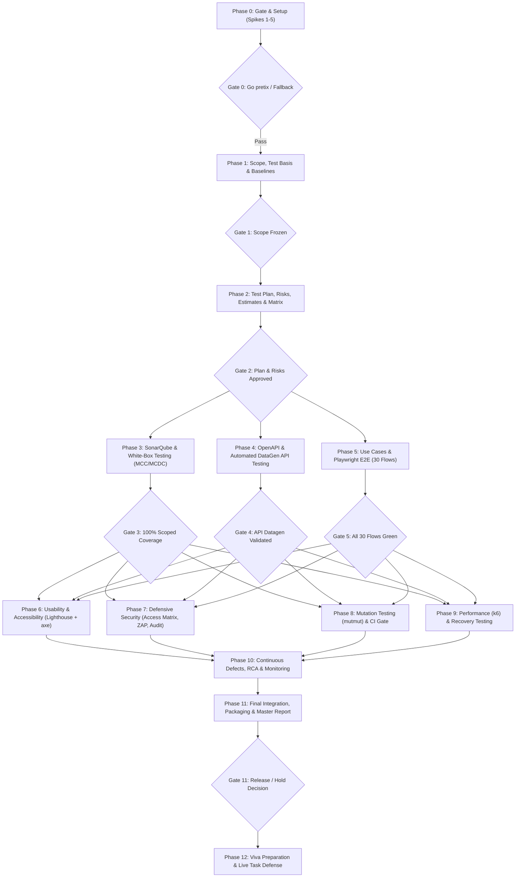

# Software Quality Engineering (SE3002) — Master Project Context & Specification
**Course:** SE3002 Software Quality Engineering  
**Project:** Automated Testing of an Open-Source Management Information System (pretix)  
**Standard:** Gold Medalist Quality Benchmark (Target: 120/120 Marks — Zero Compromise)  
**Baseline Target System:** `pretix` (Open-Source Django-based Ticketing and Order Management System)  
**Fallback System (if Gate 0 fails):** `Snipe-IT` (Asset Management System)

---

## 1. Executive Summary & Quality Engineering Philosophy

This document serves as the single source of truth for the SE3002 Software Quality Engineering Final Project. The overarching mandate is to deliver an end-to-end, rigorous, automated verification and quality engineering framework for an open-source Management Information System (MIS) meeting and exceeding all requirements specified in the course project brief and phased project plan.

### Core Tenets of Gold-Medalist Execution
1. **Zero Evidence Fabrication:** Every number, metric, execution report, and log is generated directly from reproducible scripts running on real system baselines. Raw execution artifacts (k6 raw JSON/CSV, SonarQube analysis, ZAP passive scans, Playwright traces, coverage XMLs) are permanently preserved with timestamps.
2. **Defensible Test Basis:** Every test case, assertion, boundary value, and equivalence class is strictly derived from verified source code behavior, upstream documentation, or explicitly justified engineering assumptions.
3. **100% Traceability:** A bi-directional traceability matrix connects every Functional Requirement (FR) and Business Rule (BR) to Risk IDs, Test IDs, Test Levels (Unit, API, E2E, Security, Performance), and Defect IDs.
4. **No Escape Hatches:** Continuous Integration (CI) quality gates are inviolable (`continue-on-error: false`, no `|| true`). Failing builds block merges. Documented defect fixes and pipeline blocking demonstrations are preserved in Git history.
5. **Absolute Viva Readiness:** Every team member maintains deep technical ownership of their assigned areas and is prepared to independently defend assertions, recalculate metrics on paper (e.g., Cyclomatic Complexity from CFG), predict failure modes for live code/spec changes, and demonstrate compliance without notes.

---

## 2. Complete 120-Mark Evaluation Rubric & Deliverables Mapping

| Component | Marks | CLO | Exact Evidence Required | Target Deliverables / Artifacts |
| :--- | :---: | :---: | :--- | :--- |
| **System and Scope** | 5 | CLO3 | Registered repository, reproducible baseline, two related workflows with requirements, business rules, and a defensible test basis analysed from documentation. | `docs/baseline.md`, `docs/test-basis.md`, `scripts/setup.sh`, `scripts/seed.sh`, `scripts/reset.sh`, `upstream/` pinned commit tag `v0.1-baseline`. |
| **Static Analysis and Metrics** | 5 | CLO3 | SonarQube metrics reported and analysed for quality and risk; hand-calculated cyclomatic complexity from CFG compared with SonarQube & radon. | `reports/sonar/`, Sonar analysis writeup, `docs/cfg/` (CFG node-edge diagram, manual CC calculation vs tool comparison). |
| **Test Plan, Estimation, and Traceability** | 7 | CLO3 | Complete IEEE 829-aligned test plan (scope, approach by risk, schedule, entry/exit criteria); three-point estimates (PERT) compared with actual effort; requirements traceability matrix. | `docs/test-plan.md`, `docs/estimation.md`, `docs/traceability-matrix.md`. |
| **Risk Register and Exit Criteria** | 5 | CLO3 | At least 8 product risks + 2 project risks scored ($Likelihood \times Impact$, 1–5 on $5 \times 5$ matrix) mapped to test techniques & depth; at least 3 measurable exit criteria (at least 2 tied to top risks). | `docs/risk-register.md` (Risk matrix, mitigation strategies, techniques mapping, measurable exit criteria). |
| **White-Box Unit Testing** | 16 | CLO2 | 100% statement and branch coverage of server-side business logic (justified exceptions in writing); complete MCC table; derived MC/DC pairs on critical module; 4 explicit BR test suites. | `tests/team/unit/`, pytest coverage report (HTML/XML), `docs/coverage-exceptions.md`, `docs/mcc-mcdc-tables.md`. |
| **API and Integration Testing** | 10 | CLO2 | EP and 3-point BVA on all inputs using data generator; all API coverage criteria met (endpoints, inputs, status codes); cross-workflow state validation; idempotency & rejection checks. | `tests/team/api/`, pytest execution reports, API coverage matrix, endpoint weakness logs. |
| **Automated Test Data Generation** | 7 | CLO2 | Valid OpenAPI 3.0/3.1 specification; working custom generator script producing EP classes and 3-point BVA values; proven regeneration demo when 2 constraints change. | `openapi/team-spec.yaml`, `tools/datagen/`, generator unit tests, `docs/regeneration-demo.md`. |
| **Use Case Specification** | 3 | CLO3 | 6 formal use cases (2 per member / 3 per pair) derived from FRs: ID, actor, preconditions, main flow, $\ge 2$ alternative flows, $\ge 2$ exception flows, postconditions. | `docs/use-cases.md` (Fully articulated flow specifications traced to FR and BR IDs). |
| **Use Case Test Automation** | 6 | CLO2 | Automated Playwright tests for every single flow ($\approx 30$ flows total); on-screen confirmation assertions and database/API postcondition state verifications. | `tests/team/e2e/`, Playwright test suites, Playwright HTML report (`reports/e2e/`). |
| **Mutation Analysis and CI Quality Gate** | 8 | CLO3 | Mutation score from mutmut; $\ge 2$ custom mutation operators based on business rules; $\ge 15$ surviving mutants analysed and categorized (equivalent, missing test, weak assertion); CI quality gate blocking bad PR and passing good PR; documented fix PR. | `docs/mutation-operators.md`, `docs/surviving-mutants-analysis.md`, `.github/workflows/pr-gate.yml`, `docs/gates.md`, `docs/pr-log.md`. |
| **Usability & Accessibility Evaluation** | 5 | CLO3 | Automated Lighthouse (accessibility, best practices, SEO) + axe-core scans on key logged-in screens; unified issue register; Playwright rejection/recovery & keyboard tab navigation tests; before-and-after fix on 1 screen. | `tests/team/a11y/`, `reports/a11y/` (raw before/after JSON/HTML), `docs/a11y-before-after.md`, screen patch/fix. |
| **Defensive Security Assessment** | 6 | CLO2 | Workflow attack surface documentation; Role Access Matrix across 2+ roles; Playwright automated verification of $\ge 4$ access decisions (allowed + denied); OWASP ZAP passive scan with $\ge 2$ controls reviewed; pip-audit dependency scan. | `docs/attack-surface.md`, `docs/access-matrix.md`, `tests/team/security/`, `reports/zap/`, `reports/security/pip-audit.json`. |
| **Performance and Recovery** | 5 | CLO2 | Pre-established p95 and failure targets with engineering justification; PostgreSQL k6 load runs (1 VU vs $\ge 5$ VUs, $\ge 60\text{s}$ steady state, repeated twice); automated failure-and-recovery test via test double verifying data integrity & idempotency. | `tests/team/perf/`, `reports/perf/` (raw k6 summary/JSON), `docs/perf-results.md`, recovery test script in API suite. |
| **Defect Management & RCA** | 7 | CLO3 | Structured GitHub Issues with severity, priority, lifecycle status, triage decision, risk link; $\ge 2$ deep Root Cause Analyses (5 Whys + Fishbone diagrams) with corrective/preventive actions; Pareto chart analysis. | GitHub Issues export / `docs/defects/`, `docs/rca/rca-1.md`, `docs/rca/rca-2.md`, `docs/defects/pareto-analysis.md`. |
| **Monitoring & Test Completion Report** | 5 | CLO3 | Weekly progress reports with planned vs actual, control actions, GQM metrics (defect density, requirements coverage, reopen rate); Comprehensive Test Completion Report with residual risk assessment and release/hold recommendation against 3 criteria. | `docs/weekly-reports/week-N.md`, `docs/completion-report.md`. |
| **Viva, Live Task & AI-Use Record** | 20 | CLO1 | Individual demonstration and assertion explanation; live task execution (business rule change or API spec change) with written predictions; complete, transparent AI-use log. | `docs/ai-use-record.md`, `prompts/` archive, live viva performance. |
| **TOTAL** | **120** | — | **Full Marks Benchmark Across All Areas** | Complete repository zip (with `.git`) + Final Master PDF Report. |

---

## 3. System Scope: Target Architecture (`pretix`)

### 3.1. System Overview
- **Application:** `pretix` (Enterprise-grade, open-source ticketing and event management system built on Python/Django).
- **Upstream Repository:** `https://github.com/pretix/pretix`
- **Licence:** GNU Affero General Public License v3.0 (AGPL-3.0) with additional commercial exception clauses.
- **Architecture:** Django MVC/MVT, Django REST Framework (REST API), PostgreSQL database backend, Celery task queue, Redis caching/locking.

### 3.2. Workflows & Shared State Definition
The core test scope isolates the **Order & Quota Management Lifecycle** in a single event module:
1. **Workflow A (Order Placement & Quota Allocation):**
   - *Starting Condition:* An active event exists with defined items, item variations, and quotas with known available capacity.
   - *User Action:* Customer selects ticket items/quantities, provides attendee/billing details, and submits the order creation request (via API or Web Storefront).
   - *Expected Outcome:* If quota is available, the order is created with status `n` (Pending), reservation holds are placed on the quota, payment instructions/redirection are issued, and remaining available quota decreases by the ordered count. If sold out, the order is rejected with an explicit quota exhaustion error.
2. **Workflow B (Order Lifecycle State Transitions & Quota Release/Consolidation):**
   - *Starting Condition:* An existing order is in `n` (Pending) status with quota held.
   - *User Action:* Order transitions occur — either customer/organizer cancels the order (`c`), the order payment deadline expires (`e`), or payment is marked received/confirmed (`p`).
   - *Expected Outcome:* 
     - Upon cancellation or expiration: The order state updates accordingly, and previously reserved quota is immediately returned to the pool (quota availability increases).
     - Upon payment confirmation: Order transitions to `p` (Paid), locking in quota permanently. If an expired order receives late payment, payment is accepted *only if* quota is still available; otherwise, an over-quota state rejection or refund workflow is triggered.
3. **The Shared Record / State:**
   - **`Quota Availability`**: Dynamically computed and tracked via `pretix.base.models.Quota` and calculated from `OrderPosition` states (`n`, `p`, `c`, `e`) and cart positions. Workflow A *reads* and *decrements* available quota; Workflow B *modifies order status*, thereby *incrementing or finalizing* available quota.

### 3.3. Defined User Roles & Actors
1. **Organizer Team Member (Privileged Operator):**
   - Possesses permissions: `can_change_orders`, `can_view_orders`, `can_change_event_settings`.
   - Capable of manually changing order status (canceling, marking paid, extending expiry), modifying quotas, and viewing confidential order logs.
2. **Read-Only Auditor / Team Member:**
   - Possesses permissions: `can_view_orders`.
   - Can inspect order lists, attendee details, and quota reports, but any `POST`, `PUT`, `PATCH`, or `DELETE` action targeting orders or quotas must receive HTTP 403 Forbidden.
3. **Anonymous Shop Customer (Public Actor):**
   - Can browse public event items, place orders, view order payment status via secret order code, but has zero access to administrative views, other customers' orders, or organizer APIs.

### 3.4. Target Functional Requirements (FRs)
- **FR1 (Order Submission within Quota):** System shall accept order creation for valid items when requested quantity $\le$ current available quota.
- **FR2 (Quota Depletion Rejection):** System shall reject order creation with an informative error when requested quantity $>$ available quota.
- **FR3 (Order Cancellation Quota Release):** System shall transition an order from `Pending` to `Canceled` upon authorized user action and release all associated quota back to the pool.
- **FR4 (Payment Expiration Handling):** System shall mark an unpaid order as `Expired` once `expires < now()` and release its reserved quota.
- **FR5 (Late Payment with Available Quota):** System shall accept late payment for an `Expired` order and transition it to `Paid` if all associated item quotas have sufficient capacity.
- **FR6 (Late Payment Over-Quota Rejection):** System shall reject late payment confirmation for an `Expired` order if any associated item quota has been exhausted.
- **FR7 (Idempotent Order Submission):** System shall ensure duplicate API order creation requests carrying the same `Idempotency-Key` do not create duplicate orders or deduct quota multiple times.
- **FR8 (Restricted Access Control):** System shall prevent read-only users and unauthenticated users from performing mutating order operations (`cancel`, `mark_paid`).

### 3.5. Target Business Rules (BRs)
- **BR1 — Boundary Limit Rule:**
  - *Definition:* Quantity sold + pending reserved positions cannot exceed total quota capacity:
    $$\text{Total Reserved} + \text{Total Sold} \le \text{Quota Limit}$$
  - *Testing Focus:* 3-point BVA at $\text{Limit} - 1$, exactly at $\text{Limit}$, and $\text{Limit} + 1$.
- **BR2 — Decision with Multiple Booleans (Purchasability Check):**
  - *Definition:* An item is purchasable if and only if:
    $$(\text{Item Active} == \text{True}) \land (\text{Now} \ge \text{Available From}) \land (\text{Now} \le \text{Available Until}) \land (\forall q \in \text{Quotas}, \text{Available}(q) \ge \text{Requested Quantity})$$
  - *Testing Focus:* Full Decision Table testing covering all Boolean combinations, MCC, and MC/DC pair derivation.
- **BR3 — State Transition Rule (Order Lifecycle):**
  - *Definition:* Governs valid transitions between states $\{\text{Pending (n)}, \text{Paid (p)}, \text{Canceled (c)}, \text{Expired (e)}\}$.
    - Allowed: $\text{Pending} \to \text{Paid}$, $\text{Pending} \to \text{Canceled}$, $\text{Pending} \to \text{Expired}$, $\text{Expired} \to \text{Paid}$ (conditional on BR4), $\text{Paid} \to \text{Canceled}$ (refund).
    - Disallowed: $\text{Canceled} \to \text{Paid}$, $\text{Canceled} \to \text{Pending}$, $\text{Expired} \to \text{Pending}$, $\text{Paid} \to \text{Pending}$.
  - *Testing Focus:* State transition matrix testing all valid paths and at least one invalid transition from every state.
- **BR4 — Decision with Multiple Booleans (Expired Order Payment Acceptance):**
  - *Definition:* An expired order can only be transitioned to `Paid` if:
    $$(\text{Current State} == \text{'e'}) \land (\text{Payment Status} == \text{'VALID'}) \land (\text{Quota Availability} \ge \text{Order Size})$$
  - *Testing Focus:* Decision table combinations and explicit assertion of rejection if quota was consumed by another buyer during expiration.

---

## 4. Phase-by-Phase Roadmap, Gates & Artifacts



### Detailed Phase Specifications

#### Phase 0: Gate and Setup (Spikes & Verification)
- **Objective:** De-risk the tech stack, verify pretix locally, and validate tools before committing to the repository baseline.
- **Spike 1 (Environment & Seed):** Install pretix (local virtualenv or containerized), run migrations, seed organizer, event, items, quotas, and admin/operator users via CLI and REST API. Record exact commands in `docs/spikes.md`.
- **Spike 2 (API & Idempotency):** Execute REST API calls to place order with `Idempotency-Key`, repeat request, assert duplicate rejection/handling, cancel order, verify quota readback before and after.
- **Spike 3 (White-Box Scoping & Complexity):** Scan pretix codebase using `radon` and `lizard`. Identify quota availability calculation (`pretix/base/services/quotas.py`) and order state machine (`pretix/base/services/orders.py`). Select 2 target functions with 6 to 10 decision paths.
- **Spike 4 (Mutation & Static Analysis):** Run `mutmut` on target quota module with timeout to ensure compatibility. Run SonarQube scan.
- **Spike 5 (E2E, ZAP, k6):** Run 1 headless Playwright login test, proxy traffic through OWASP ZAP passive scanner, execute 1-minute k6 benchmark with 1 user.
- **Gate 0 Exit Check:** Spikes 1, 2, and 4 pass cleanly; output logged in `reports/spikes/`. If failing, pivot immediately to Snipe-IT.

#### Phase 1: Scope and Test Basis
- **Objective:** Freeze functional requirements, business rules, user roles, shared state, and create reproducible environment scripts.
- **Deliverables:**
  - `upstream/`: Vendored or pinned pretix commit, tagged `v0.1-baseline`.
  - `scripts/setup.sh`: Automated environment creation and dependency installation.
  - `scripts/seed.sh`: Deterministic database seeding (organizer, event, items, quotas, user accounts).
  - `scripts/reset.sh`: Database purge and re-seed returning system to identical starting state. Verified by running twice and comparing cryptographic database hash/state.
  - `docs/test-basis.md`: Formal specification of 8+ FRs, 4 BRs, 2+ roles, expected behavior sourced from docs/code.
- **Gate 1 Exit Check:** 8+ FRs mapped to 4 BRs and 2 roles; `reset.sh` verified twice. Tag `gate-1`.

#### Phase 2: Test Management Foundation
- **Objective:** Author comprehensive IEEE 829 test plan, risk register, PERT 3-point estimates, and traceability matrix skeleton.
- **Deliverables:**
  - `docs/test-plan.md`: Scope, approach by risk level, roles, environment, schedule, entry/exit/suspension/resumption criteria.
  - `docs/estimation.md`: Three-point estimates ($O, M, P$) per area and PERT expected effort calculation:
    $$E = \frac{O + 4M + P}{6}, \quad \sigma = \frac{P - O}{6}$$
  - `docs/risk-register.md`: $\ge 8$ product risks (oversell, expired payment concurrency, cart lock leakage, voucher bypass, API permission escalation, duplicate orders, rate-limiting false failures, illegal state transition) and $\ge 2$ project risks (tool incompatibility, member availability). Mapped to $5 \times 5$ matrix ($R = L \times I$).
  - `docs/traceability-matrix.md`: Bidirectional traceability table mapping Requirements $\to$ Business Rules $\to$ Risks $\to$ Test Case IDs $\to$ Test Levels.
  - Goal-Question-Metric (GQM) Framework: Defect density, requirements coverage, reopen rate.
- **Gate 2 Exit Check:** Test plan approved; 10+ risks scored and mapped to techniques; $\ge 3$ measurable exit criteria established. Tag `gate-2`.

#### Phase 3: Static Analysis & White-Box Unit Testing
- **Objective:** Perform SonarQube inspection, manual CFG/CC verification, and achieve 100% statement and branch coverage on scoped server-side logic with MCC/MCDC.
- **Deliverables:**
  - SonarQube full scan report in `reports/sonar/` covering complexity, duplication, code smells, bugs, vulnerabilities, coverage, technical debt, and ratings.
  - `docs/cfg/`: Control Flow Graph (CFG) drawn for key business-rule function. Hand calculation of McCabe's Cyclomatic Complexity:
    $$V(G) = E - N + 2P \quad \text{or} \quad V(G) = D + 1$$
    Compare with SonarQube and radon values; document any discrepancy.
  - `tests/team/unit/`: Pytest suite achieving 100% statement and 100% branch coverage on scoped quota/order logic.
  - `docs/coverage-exceptions.md`: Justifications for any line excluded from coverage.
  - `docs/mcc-mcdc-tables.md`: Complete Multiple Condition Coverage (MCC) truth table ($2^n$ combinations) for multi-condition decision, with derived Minimal Condition/Decision Coverage (MC/DC) independent toggle pairs.
- **Gate 3 Exit Check:** 100% statement/branch coverage achieved on scoped files; CFG and MCC/MCDC tables committed; Sonar report saved. Tag `gate-3`.

#### Phase 4: API Testing & Automated Test Data Generation
- **Objective:** Spec-driven API testing utilizing an automated test data generator implementing EP and 3-point BVA.
- **Deliverables:**
  - `openapi/team-spec.yaml`: Accurate OpenAPI 3.0 specification of order and quota endpoints.
  - `tools/datagen/`: Standalone Python CLI tool reading `team-spec.yaml` schema constraints (min, max, pattern, enum, minItems) and generating:
    - Equivalence Partitioning (EP) valid and invalid input sets (1 invalid value per negative test).
    - 3-point Boundary Value Analysis (BVA) values: $(\text{Limit}-1, \text{Limit}, \text{Limit}+1)$.
  - `tests/team/api/`: Pytest + Requests suite consuming generator output exclusively. Tests rule rejections, invalid transitions, idempotency (`Idempotency-Key`), and quota readback.
  - `docs/regeneration-demo.md`: Demonstration changing 2 schema constraints (e.g., maximum item quantity, quota ceiling), regenerating test cases, and documenting the resulting test execution differences.
- **Gate 4 Exit Check:** All API tests pass on baseline; zero hardcoded test data; dynamic regeneration proven. Tag `gate-4`.

#### Phase 5: Use Cases & Browser End-to-End Automation
- **Objective:** Specify and fully automate all user flows in Playwright with Chromium.
- **Deliverables:**
  - `docs/use-cases.md`: 6 complete use cases (Main, 2 Alternative, 2 Exception flows each = 30 discrete flows).
  - `tests/team/e2e/`: Robust Playwright (Python or TS) test suite implementing all 30 flows.
  - Dual assertions per flow: Front-end UI confirmation/error assertion + backend postcondition verification (direct API query or database inspection).
  - Flakiness mitigations: Deterministic pre-test seed via `reset.sh`, local dummy email backend, offline test payment gateway.
  - `reports/e2e/`: Playwright HTML execution report.
- **Gate 5 Exit Check:** All 30 flows pass in 3 consecutive clean test runs. Tag `gate-5`.

#### Phase 6: Usability and Accessibility Evaluation
- **Objective:** Automated a11y and UX evaluation, keyboard navigation testing, and verified before-and-after screen repair.
- **Deliverables:**
  - Automated Playwright browser tests verifying:
    1. Rejection error message clarity and subsequent successful recovery.
    2. Full keyboard tab navigation (DOM focus order through required inputs to submit button and Enter key form submission).
  - Full Google Lighthouse audit (Accessibility, Best Practices, SEO) on authenticated use case screens.
  - `@axe-core/playwright` automated WCAG 2.1 AA scan on all screens.
  - Deduplicated issue register: Element selector, WCAG rule violated, user impact, proposed remediation.
  - Target UI Fix: Remediate 1 identified accessibility defect (in pretix template or standalone mock view), rerun tools, and document quantitative improvements in `docs/a11y-before-after.md`.
- **Gate 6 Exit Check:** Two automated a11y tools run; issue register finalized; verified before-and-after improvement logged. Tag `gate-6`.

#### Phase 7: Defensive Security Assessment
- **Objective:** Surface attack modeling, role-based access control (RBAC) testing, passive vulnerability scanning, and software supply chain audit.
- **Deliverables:**
  - `docs/attack-surface.md`: Enumeration of routes, parameters, HTTP methods, and exposed data.
  - `docs/access-matrix.md`: Matrix mapping actions to roles (Organizer, Read-Only, Anonymous).
  - `tests/team/security/`: Playwright security test suite verifying $\ge 4$ access decisions (asserting HTTP 200/redirect for allowed roles, HTTP 403 Forbidden / redirect for unauthorized roles).
  - `reports/zap/`: OWASP ZAP passive scan report captured during E2E test runs. Analysis of security controls (cookies `HttpOnly`, `Secure`, `SameSite`, anti-CSRF tokens, CSP headers).
  - `reports/security/pip-audit.json`: `pip-audit` scan report on pinned dependencies with vulnerability analysis and remediation strategy.
- **Gate 7 Exit Check:** Access matrix verified with 4+ automated tests; ZAP and dependency audit reports saved. Tag `gate-7`.

#### Phase 8: Mutation Testing & CI Quality Gate
- **Objective:** Evaluate test suite fault-detection capability, construct custom mutation operators, kill surviving mutants, and enforce strict CI PR gates.
- **Deliverables:**
  - `mutmut` baseline run on business-rule module. Mutation score recorded.
  - `docs/mutation-operators.md`: Implementation and documentation of $\ge 2$ domain-specific custom mutation operators (e.g., swapping `<=` to `<` on quota bounds, mutating `AND` to `OR` in purchasability conditions).
  - `docs/surviving-mutants-analysis.md`: Detailed inspection of $\ge 15$ surviving mutants classified into:
    1. Equivalent mutants (cannot be killed; formal justification provided).
    2. Missing test cases (killed by introducing new tests).
    3. Weak assertions (killed by tightening postcondition assertions).
  - `.github/workflows/pr-gate.yml`: GitHub Actions pipeline running SonarQube, unit tests, API tests, Playwright E2E, and mutation testing. Enforces strict quality thresholds without escape hatches (`continue-on-error: false`).
  - `docs/pr-log.md`: Evidence of (1) Documented fix PR (branch fails test initially, passes after commit), and (2) Blocked PR (intentionally drops coverage or mutation score below threshold, blocked from merging by CI).
- **Gate 8 Exit Check:** Mutation analysis complete; $\ge 15$ mutants killed/analyzed; CI PR gate verified with real PR logs. Tag `gate-8`.

#### Phase 9: Performance and Recovery
- **Objective:** Rigorous load benchmarking under realistic concurrency and fault injection recovery verification.
- **Deliverables:**
  - Justified target SLA: p95 response time threshold (e.g., $\le 500\text{ ms}$) and unexpected failure rate target (e.g., $< 1.0\%$) defined *prior* to testing.
  - PostgreSQL backing store configured to prevent SQLite database lock contention during multi-user runs.
  - `tests/team/perf/load-test.js`: Grafana k6 script executing target operation (order creation).
    - Run A: 1 Virtual User (VU), $\ge 60\text{s}$ steady state (executed twice).
    - Run B: $\ge 5$ concurrent VUs, $\ge 60\text{s}$ steady state (executed twice).
    - Metrics captured: p95 (ms), requests/sec (RPS), unexpected failure rate (separating expected HTTP 429 rate-limiting from 5xx server errors).
  - `docs/perf-results.md`: Environment specifications, raw k6 output analysis, target vs actual comparison.
  - Automated Recovery Test: Fault injection test utilizing a mock/test double to induce network/database failure mid-transaction (prior to commit), verifying that partial writes are rolled back, service is restored, retry succeeds, and no duplicate records or orphaned quota holds persist.
- **Gate 9 Exit Check:** All k6 runs executed and logged; recovery test passes; performance interpretation documented. Tag `gate-9`.

#### Phase 10: Defect Management, RCA & Monitoring
- **Objective:** Rigorous defect lifecycle management, Pareto analysis, Ishikawa root cause analyses, and GQM weekly tracking.
- **Deliverables:**
  - GitHub Issues defect log: Every defect recorded with ID, Title, Reproduction Steps, Expected vs Actual, Severity, Priority, Status, Triage Decision, and Linked Risk ID.
  - `docs/rca/`: Root Cause Analysis for at least 2 major defects combining **5 Whys Analysis** and **Fishbone (Ishikawa) Diagrams**, along with corrective actions and preventive organizational controls.
  - `docs/defects/pareto-analysis.md`: Defect categorization by subsystem (Functional, API, UI/A11y, Security, Performance, Environment) with Pareto 80/20 distribution chart.
  - `docs/weekly-reports/`: Structured weekly monitoring reports detailing planned vs actual progress, variance analysis, corrective control actions, and Goal-Question-Metric (GQM) measurements.
- **Continuous Exit Check:** All defects triaged and risk-linked; 2 RCAs complete; weekly GQM reports maintained.

#### Phase 11: Final Integration, Packaging & Master Report
- **Objective:** Clean-machine validation, master PDF report authoring, and rubric-compliant packaging.
- **Deliverables:**
  - Clean-Machine Verification: Full execution of `setup.sh`, `seed.sh`, test suites, mutation, k6, ZAP, and Playwright on a fresh environment.
  - Final Master PDF Report: Comprehensive academic report incorporating all sections, executive summaries, risk matrices, traceability tables, evidence links, AI-use records, and release recommendations.
  - Actual vs Target evaluation of the 3 pre-defined release exit criteria.
  - Final Effort Variance: Comparison of actual hours logged vs Phase 2 PERT three-point estimates.
  - Release / Hold Decision: Evidence-based release verdict.
  - Package Assembly: Strict archive creation adhering to course naming guidelines:
    - `Project_RollNumber1_RollNumber2_RollNumber3_Section.zip` (containing entire repository including `.git` history).
    - `Project_RollNumber1_RollNumber2_RollNumber3_Section.pdf`.
- **Gate 11 Exit Check:** Package verified; clean rerun successful; tag `v1.0-submission`.

#### Phase 12: Viva Preparation & Live Defense Strategy
- **Objective:** Complete readiness of all members to independently defend any component and execute live tasks.
- **Deliverables:**
  - Live Test Rerun: Every member rehearsed to run any test in their domain and explain every single assertion line.
  - Live Task Rehearsal:
    1. Business-rule mutation task (e.g., swapping comparison operator in quota calculation): Predict failing unit tests, mutant kill status, and CI gate failures *beforehand in writing*, make edit, verify prediction.
    2. OpenAPI spec update task (e.g., changing max order size): Predict failing API tests, execute datagen regeneration, demonstrate automated test adaptation.
  - Comprehensive Viva Q&A Drill covering all 16 rubric components.

---

## 5. Team Roles and Ownership Matrix

The project team consists of **3 members**, each owning a dedicated technical domain while sharing test management governance:

| Area / Component | Primary Owner | Assigned Student | Specific Responsibilities |
| :--- | :---: | :---: | :--- |
| **Area A: White-Box, Static Analysis, Mutation & CI** | **Member 1** | **Sohaib (24i-3108)** | SonarQube/SonarCloud analysis, CFG generation & manual CC calculation, pytest unit test suite (100% statement & branch coverage on scoped order/quota logic), MCC & MC/DC derivation, mutmut execution, custom mutation operators, surviving mutant analysis, GitHub Actions CI PR gate workflow, documented fix PR & blocked PR. (Marks: 5 + 16 + 8 = **29 marks**) |
| **Area B: API Testing & Automated Test Data Generation** | **Member 2** | **M. Hasaam (24i-3107)** | OpenAPI specification (`team-spec.yaml`), custom test data generator tool (`tools/datagen/`), pytest API integration test suite, EP and 3-point BVA implementation, API coverage matrix, constraint change regeneration demonstration, performance load testing (k6 OSS). (Marks: 10 + 7 = **17 marks**) |
| **Area C: Use Cases, Usability, Accessibility & Security** | **Member 3** | **Shaiman (24i-3074)** | Use case specifications (6 use cases, 30 flows), Playwright E2E automation with UI + DB/API assertions, Lighthouse audits, axe-core scans, screen accessibility remediation (before/after), access control matrix, Playwright security role checks, OWASP ZAP passive scanning, dependency vulnerability audit. (Marks: 3 + 6 + 5 + 6 + 5 = **25 marks**) |
| **Shared: Test Management & Governance** | **All Members** | **Sohaib, Hasaam, Shaiman** | Test plan authoring, 3-point estimation (individual estimates per area), risk scoring & mapping, traceability matrix maintenance, defect logging & triage, RCA (5 Whys + Fishbone), weekly GQM progress logs, AI-use disclosure, final report authoring. (Marks: 7 + 5 + 7 + 5 + 3 = **27 marks**) |
| **Individual Viva & AI-Use Defense** | **Individual** | **Each Member** | Individual explanation of owned area, live test execution & assertion defense, live task execution (business rule or API spec mutation), prompt transparency. (**20 marks each**) |

**Submission Archive Name Pattern:** `Project_24i-3108_24i-3107_24i-3074_<SECTION>.zip` and `.pdf`

---

## 6. Target Directory Layout

```
sqe_project/
├── .github/
│   └── workflows/
│       └── pr-gate.yml               # Inviolable CI pipeline configuration
├── docs/
│   ├── baseline.md                   # Upstream hash, licence, toolchain versions
│   ├── test-basis.md                 # FRs, BRs, roles, documented behavior
│   ├── test-plan.md                  # IEEE 829 test plan
│   ├── estimation.md                 # Three-point estimates (PERT) vs actuals
│   ├── risk-register.md              # 5x5 Product & Project risk matrix
│   ├── traceability-matrix.md        # Bi-directional requirements matrix
│   ├── coverage-exceptions.md        # Justifications for any uncovered lines
│   ├── mcc-mcdc-tables.md            # MCC truth tables and MC/DC pairs
│   ├── mutation-operators.md         # Custom mutation operator specs
│   ├── surviving-mutants-analysis.md # Detailed analysis of 15+ mutants
│   ├── regeneration-demo.md          # Data generator constraint change demo
│   ├── use-cases.md                  # 6 detailed use cases (30 flows)
│   ├── a11y-before-after.md          # Accessibility fix comparison report
│   ├── attack-surface.md             # Security attack surface model
│   ├── access-matrix.md              # Role-permission verification matrix
│   ├── perf-results.md               # k6 performance benchmarks & targets
│   ├── pr-log.md                     # Documented fix PR & blocked PR evidence
│   ├── gates.md                      # CI threshold justifications
│   ├── ai-use-record.md              # Full AI transparency and prompt log
│   ├── completion-report.md          # Test completion & release recommendation
│   ├── cfg/                          # CFG diagrams & manual CC derivations
│   ├── defects/                      # Defect logs and Pareto analysis
│   ├── rca/                          # 5-Whys and Fishbone root cause analyses
│   └── weekly-reports/               # Weekly monitoring and GQM metric logs
├── openapi/
│   └── team-spec.yaml                # Verified OpenAPI spec for target endpoints
├── reports/
│   ├── spikes/                       # Phase 0 spike outputs
│   ├── sonar/                        # Raw SonarQube reports & metrics export
│   ├── coverage/                     # Pytest HTML/XML coverage reports
│   ├── mutation/                     # Raw mutmut output logs
│   ├── e2e/                          # Playwright HTML test report
│   ├── a11y/                         # Raw Lighthouse & axe-core JSON/HTML
│   ├── zap/                          # Raw OWASP ZAP passive scan reports
│   ├── security/                     # pip-audit vulnerability scan results
│   └── perf/                         # Raw k6 test run output (JSON/CSV)
├── scripts/
│   ├── setup.sh                      # Environment setup script
│   ├── seed.sh                       # Deterministic data seeding script
│   └── reset.sh                      # Database reset & validation script
├── tests/
│   └── team/
│       ├── unit/                     # Pytest white-box unit tests
│       ├── api/                      # Pytest API integration tests
│       ├── e2e/                      # Playwright browser end-to-end tests
│       ├── a11y/                     # Playwright + axe-core accessibility tests
│       ├── security/                 # Playwright role-based access tests
│       └── perf/                     # Grafana k6 load test scripts
├── tools/
│   └── datagen/                      # Custom spec-driven test data generator
├── upstream/                         # Pinned pretix repository source
├── prompt.md                         # Initial project directive
├── context.md                        # Master Project Context (This File)
├── sonar-project.properties          # SonarQube scanner configuration
├── setup.cfg                         # mutmut configuration
└── pytest.ini                        # Pytest & coverage configuration
```

---

## 7. Confirmed Project Parameters & Instructor Query Strategy

### 7.1. Confirmed Project Settings
1. **Team Composition (3 Members):**
   - **Sohaib (24i-3108):** Member 1 (Area A: Static Analysis, White-box, Mutation, CI)
     - GitHub: `sohaibAkhlaq` (`sohaibikhlaq5@gmail.com`)
   - **M. Hasaam (24i-3107):** Member 2 (Area B: API Testing, Data Generation, Performance)
     - GitHub: `M-Hasaam` (`m.hasaam.official@gmail.com`)
   - **Shaiman (24i-3074):** Member 3 (Area C: Use Cases, E2E Playwright, Usability, A11y, Security)
     - GitHub: `ShaimanQasir` (`shamshaiman312@gmail.com`)
2. **Execution Environment:** Docker Desktop on Windows (Engine 29.9.3).
3. **Static Analysis & Gate Platform:** SonarCloud (official cloud platform for SonarQube with GitHub Actions PR gate integration).

### 7.2. Course Instructor Inquiries (Phase 0, Step 2 Analysis & Email Template)
The course specification mandates written confirmation from the instructor for 4 specific technical points before passing Gate 0. Below is the precise academic rationale and formal email draft:

#### Pedagogical Rationale (What "Ma'am" Demands & Why):
- **Query 1 (White-Box Scope):** pretix contains >200,000 lines of code across dozens of modules. The rubric demands 100% statement and branch coverage of *server-side business logic*. We clarify that this applies to our chosen workflows' business logic (`pretix.base.services.quotas` and `pretix.base.services.orders`), ensuring that during the viva, grading focuses on complete MCC/MC/DC coverage of the chosen core rather than the entire ERP codebase.
- **Query 2 (Documented PR Fix Location):** Upstream pretix is a live commercial repository with strict contributor policies. The brief explicitly states *"Upstream tests earn no marks. Keep your own tests in a separate folder."* We clarify that the required documented bug fix and blocked PR take place in our team's repository fork to demonstrate our CI quality gates.
- **Query 3 (Public Repository & Licence):** pretix is licensed under GNU AGPL-3.0. The course brief requires a "public GitHub link in the report". We confirm that hosting our team repo publicly on GitHub satisfies the course requirements while complying with AGPL-3.0.
- **Query 4 (SonarCloud vs SonarQube):** SonarCloud is SonarSource's official managed platform executing the identical SonarQube engine. Using SonarCloud allows native GitHub Actions integration without local server bottlenecks.

#### Ready-to-Send Instructor Email Template:
```text
Subject: SE3002 SQE Final Project — Technical Clarifications for pretix (Section [Your Section] - Group 24i-3108, 24i-3107, 24i-3074)

Respected Ma'am,

We hope this email finds you well.

Our group has selected 'pretix' (open-source Django ticketing system) for our SE3002 Software Quality Engineering Final Project, focusing on the Order and Quota Management workflows (Workflow A: Order Placement; Workflow B: Order Cancellation & State Transitions).

As part of our Phase 0 Setup and Governance checklist, we would appreciate your written confirmation on the following four technical considerations:

1. White-Box Coverage Scope:
   pretix contains over 200,000 lines of code across multiple subsystems. To achieve the required 100% statement and branch coverage, complete MCC truth tables, and MC/DC condition pairs, may we scope the unit testing to the server-side business logic functions directly governing our chosen workflows (specifically pretix.base.services.quotas and pretix.base.services.orders)? Any uncovered edge cases within these scoped functions will be formally justified in our coverage exceptions log.

2. Documented PR Fix Location:
   To demonstrate the CI quality gate, the brief requires one documented fix via PR (failing initially, passing after) and one pipeline-blocked PR. May we confirm that this PR cycle is to be demonstrated within our team's GitHub repository fork (either patching a discovered defect in the application module or our custom tooling/datagen), in accordance with the rule that upstream tests earn no marks?

3. Repository Visibility & AGPL v3:
   The project guidelines request a public GitHub link in the final report. Because pretix is licensed under GNU AGPL v3, we intend to keep our team repository publicly hosted on GitHub under AGPL v3. Could you kindly confirm this meets your expectations?

4. SonarCloud vs. Self-Hosted SonarQube:
   We plan to use SonarCloud (the official cloud-hosted platform powered by SonarQube) for automated static analysis, technical debt tracking, and GitHub Actions PR quality gates. Could you please confirm that SonarCloud reports are fully acceptable for the SonarQube component of the rubric?

Thank you for your guidance and support.

Warm regards,
Sohaib (24i-3108)
M. Hasaam (24i-3107)
Shaiman (24i-3074)
Section: [Your Section]
BS Software Engineering
```


