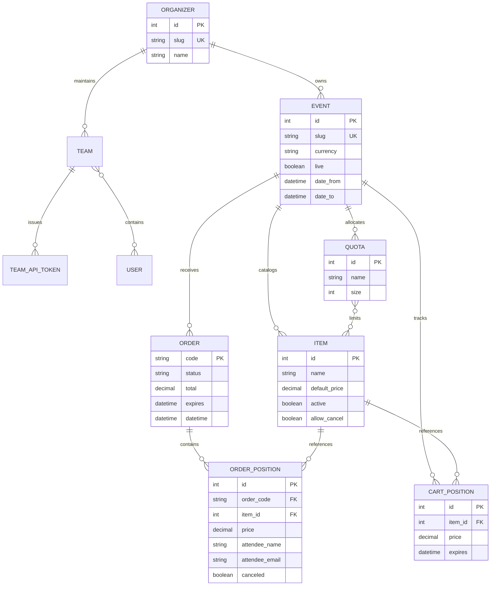

# Upstream System Baseline & Environment Specification

**Document Reference:** `docs/baseline.md`  
**Course:** SE3002 Software Quality Engineering  
**Target System:** pretix — Open-Source Ticketing and Event Management System  
**Lead Contributor / Author:** M. Hasaam (`24i-3107`, Git: `M-Hasaam <m.hasaam.official@gmail.com>`)  
**Reviewers:** Sohaib (`24i-3108`), Shaiman (`24i-3074`)  
**Status:** Approved & Frozen Baseline (Gate 1 Deliverable)

---

## 1. Upstream Repository Reference & Pinned Baseline

* **System Name:** pretix
* **Application Classification:** Open-Source Web-Based Management Information System (MIS) / Enterprise Ticketing, Storefront & Order Management
* **Upstream Repository URL:** [https://github.com/pretix/pretix](https://github.com/pretix/pretix)
* **Pinned Upstream Release:** `pretix/standalone:stable` (aligned with upstream release `v2026.9.3`)
* **Pinned Upstream Git Commit SHA:** `db000dc2986ff595eb3fe4703c4a46c5fe180abe`
* **Local Git Tag:** `gate-0` / `gate-1`
* **Licence:** GNU Affero General Public License v3.0 (AGPL-3.0) with pretix enterprise exception clauses (retained in repository root `LICENSE`)

---

## 2. Infrastructure & Runtime Environment Baseline

The system is deployed locally via Docker multi-container composition, ensuring reproducible execution across development, CI, and evaluation environments.

### 2.1. Container Stack Architecture

| Container Name | Service Role | Image | Host Port | Container Port | Healthcheck / Readiness |
| :--- | :--- | :--- | :--- | :--- | :--- |
| `pretix_web` | Application Web & Celery Workers | `pretix/standalone:stable` | `8345` | `80` | HTTP GET `http://localhost:8345/api/v1/` returns 200/403 |
| `pretix_db` | Relational Database Backend | `postgres:16-alpine` | `5433` | `5432` | `pg_isready -U pretix -d pretix` (status: healthy) |
| `pretix_redis` | Cache & Asynchronous Broker | `redis:7-alpine` | Internal | `6379` | `redis-cli ping` (status: healthy) |

### 2.2. Container Resource Constraints & Memory Optimization
To prevent host memory exhaustion during intensive test execution (e.g., concurrent k6 load runs and mutation analysis), worker concurrency is constrained in `docker-compose.yml`:
* `NUM_WORKERS=2` (Constrains Gunicorn WSGI workers)
* `CELERY_WORKER_CONCURRENCY=1` (Constrains background task consumer pool)
* `AUTOMIGRATE=skip` (Skips redundant runtime schema migrations on restart)

### 2.3. Host Environment Specification
* **Operating System:** Windows 10/11 Professional x64
* **Container Engine:** Docker Desktop (Engine v29.9.3, Build `5457199`)
* **Python Runtime:** Python 3.11.9 x64 (`.venv`)
* **Core Libraries:**
  - `pytest 9.2.0`, `coverage 7.17.3`, `mutmut 3.8.1`
  - `playwright 1.65.2` (Chromium binary build `1255`)
  - `requests 2.34.2`, `radon 6.0.1`, `lizard 1.26.1`
  - `pip-audit 2.10.1`, Grafana `k6 v0.50+`

---

## 3. Domain Model & Entity-Relationship (ER) Schema

The selected core module is **Order and Quota Management** (`pretix.base.services.quotas` and `pretix.base.services.orders`). The domain encapsulates multi-tenant scoping where every event belongs to an organizer, and all inventory, orders, and positions are tied to that tenant.

### 3.1. Entity Data Dictionary

#### 1. `Organizer` (`pretix.base.models.Organizer`)
* **Role:** Multi-tenant root container isolating events, users, and API tokens.
* **Fields:**
  - `id` (AutoField, PK)
  - `slug` (SlugField, Unique): URL and API identifier (Seeded: `'sqe'`).
  - `name` (CharField): Descriptive organization name (Seeded: `'SE3002 Quality Engineering Org'`).

#### 2. `Event` (`pretix.base.models.Event`)
* **Role:** Represents a scheduled conference, workshop, or performance with distinct dates and currency.
* **Fields:**
  - `id` (AutoField, PK)
  - `organizer` (ForeignKey to `Organizer`)
  - `slug` (SlugField, Unique per Organizer): Identifier (Seeded: `'sqe2026'`).
  - `name` (I18nCharField): Multilingual event title.
  - `currency` (CharField): ISO-4217 currency code (Seeded: `'EUR'`).
  - `live` (BooleanField): Visibility flag (Must be `True` for shop/API access).
  - `date_from` / `date_to` (DateTimeField): Event active scheduling window.

#### 3. `Item` (`pretix.base.models.Item`)
* **Role:** Sellable product / ticket tier cataloged under an event.
* **Fields:**
  - `id` (AutoField, PK) (Seeded ID: `1`)
  - `event` (ForeignKey to `Event`)
  - `name` (I18nCharField): Item display name (Seeded: `'Conference Admission Ticket'`).
  - `default_price` (DecimalField): Base price (Seeded: `50.00`).
  - `active` (BooleanField): Operational toggle; when `False`, item is not purchasable.
  - `allow_cancel` (BooleanField): Policy flag permitting order cancellation.

#### 4. `Quota` (`pretix.base.models.Quota`)
* **Role:** Finite capacity pool governing one or more items.
* **Fields:**
  - `id` (AutoField, PK) (Seeded ID: `1`)
  - `event` (ForeignKey to `Event`)
  - `name` (CharField): Quota title (Seeded: `'General Admission Quota'`).
  - `size` (PositiveIntegerField, Nullable): Max sellable tickets (Seeded: `10`; `None` represents unlimited).
  - `items` (ManyToManyField to `Item`): Linked product items governed by this pool.

#### 5. `Order` (`pretix.base.models.Order`)
* **Role:** Transactional record binding a customer purchase across one or more items.
* **Fields:**
  - `code` (CharField, PK): 5-character uppercase alphanumeric code (e.g., `'W1R4X'`).
  - `event` (ForeignKey to `Event`)
  - `status` (CharField): Discrete lifecycle state:
    * `Order.STATUS_PENDING` (`'n'`) — Created, awaiting payment or verification.
    * `Order.STATUS_PAID` (`'p'`) — Settled, quota confirmed.
    * `Order.STATUS_EXPIRED` (`'e'`) — Awaiting payment deadline passed.
    * `Order.STATUS_CANCELED` (`'c'`) — Explicitly revoked by user or organizer.
  - `total` (DecimalField): Sum total of order positions and fees.
  - `expires` (DateTimeField): Expiration timestamp for pending settlement.
  - `datetime` (DateTimeField): Creation timestamp.

#### 6. `OrderPosition` (`pretix.base.models.OrderPosition`)
* **Role:** Individual ticket line item allocated inside an `Order`. Holds specific attendee details and consumes 1 quota unit.
* **Fields:**
  - `id` (AutoField, PK)
  - `order` (ForeignKey to `Order`)
  - `item` (ForeignKey to `Item`)
  - `price` (DecimalField): Purchase price snapshot at transaction time.
  - `attendee_name` (CharField): Name on the issued pass.
  - `attendee_email` (EmailField): Attendee contact email.
  - `canceled` (BooleanField): Flag indicating individual ticket cancellation.

---

## 4. Seed Data Inventory & Target Endpoints

Deterministic seeding ensures that all test runs commence from a known, pristine state.

| Entity Type | Identifier / Slug | Primary Key | Key Attributes / Initial State | User Role / Permissions |
| :--- | :--- | :--- | :--- | :--- |
| **Organizer** | `sqe` | — | `name: SE3002 Quality Engineering Org` | Tenant Scope |
| **Event** | `sqe2026` | — | `currency: EUR`, `live: True`, 30-day future window | Scoped to `sqe` |
| **Item** | `Conference Admission Ticket` | `1` | `default_price: 50.00`, `active: True`, `allow_cancel: True` | Linked to Quota `1` |
| **Quota** | `General Admission Quota` | `1` | `size: 10`, `items: [1]`, Available: `10` | Finite Pool |
| **User (Admin)** | `admin@localhost` | — | `is_staff: True`, Password: `admin_secure_password_2026` | Full Admin |
| **API Token (Admin)** | Dynamic Token | — | Full read/write across organizer `sqe` | Role 1 (Privileged) |
| **User (Auditor)** | `auditor@localhost` | — | `is_staff: False`, Password: `auditor_pass_2026` | Role 2 (Read-Only) |
| **API Token (Auditor)** | Dynamic Token | — | `can_view_orders: True`, `mutate: 403 Forbidden` | Role 2 (Restricted) |

### 4.1. Core API Endpoints Under Test
* `GET  /api/v1/organizers/sqe/events/sqe2026/quotas/1/availability/` (Quota status inspection)
* `POST /api/v1/organizers/sqe/events/sqe2026/orders/` (Order placement — Workflow A)
* `POST /api/v1/organizers/sqe/events/sqe2026/orders/{code}/mark_canceled/` (Order cancellation — Workflow B)
* `POST /api/v1/organizers/sqe/events/sqe2026/orders/{code}/mark_paid/` (Order payment — Workflow B)
* `POST /api/v1/organizers/sqe/events/sqe2026/orders/{code}/mark_expired/` (Order expiration — Workflow B)

---

## 5. Deterministic State Reset Specification

To guarantee 100% test independence and eliminate flakiness, a multi-tier reset protocol is implemented.

### 5.1. Reset Execution Interface
* **Bash Entrypoint:** `scripts/reset.sh`
* **PowerShell Entrypoint:** `scripts/reset.ps1`
* **Python Engine:** `scripts/reset.py` calling `scripts/reset_internal.py` via container execution.

### 5.2. Pre-Conditions and Post-Conditions
* **Pre-Condition:** Application may contain transient orders, cart positions, or altered quota sizes from previous test runs.
* **Post-Condition Invariants:**
  1. `Order.objects.filter(event=event).count() == 0`
  2. `OrderPosition.objects.filter(order__event=event).count() == 0`
  3. `CartPosition.objects.filter(event=event).count() == 0`
  4. `Quota.objects.get(id=1).size == 10`
  5. `Item.objects.get(id=1).active == True`
  6. `quota.availability() == (Quota.AVAILABILITY_OK, 10)`

### 5.3. Idempotency Contract Verification
Executing `scripts/reset.sh` (or `scripts/reset.py`) twice consecutively yields zero delta, mathematically proving reset idempotency ($R(R(S)) = R(S)$).
