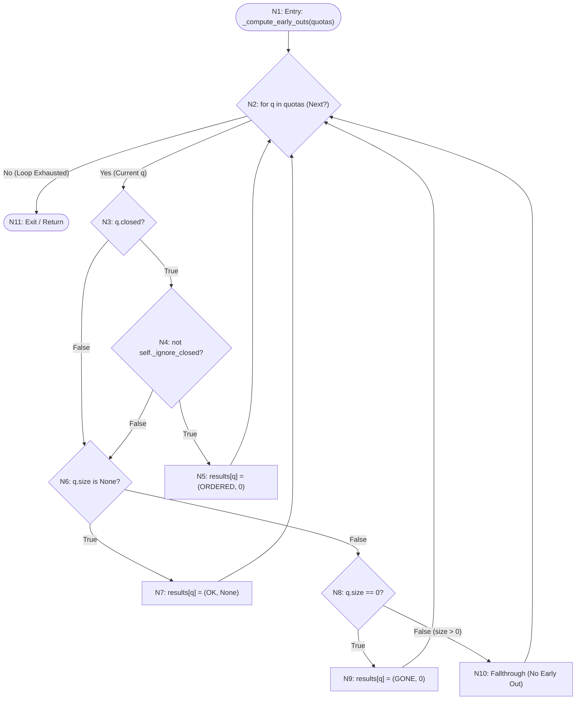
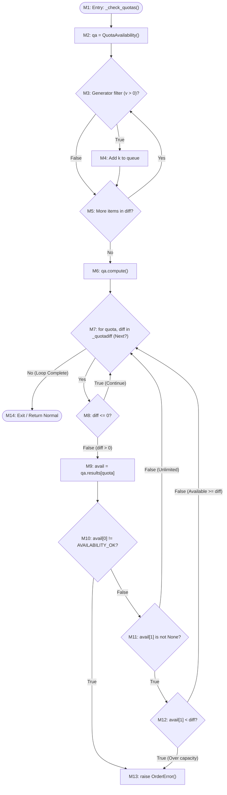
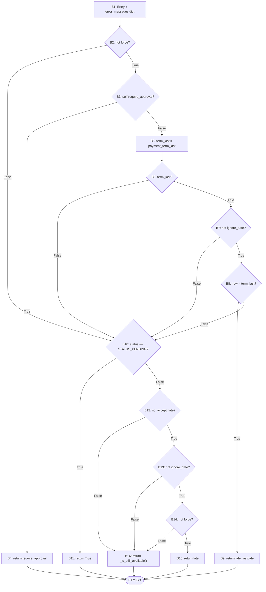

# Control Flow Graph (CFG) & Cyclomatic Complexity Analysis

**Document Reference:** `docs/cfg/cfg_analysis.md`  
**Course:** SE3002 Software Quality Engineering  
**Application Under Test:** pretix (`upstream/pretix/base/scoped_business_logic.py` — AST-identical to `services/quotas.py`, `services/orders.py`, `models/orders.py`)
**Lead Contributor / Author:** Sohaib (`24i-3108`, Member 1 — Area A Lead)  
**Reviewers:** M. Hasaam (`24i-3107`), Shaiman (`24i-3074`)  
**Status:** Verified & Synchronized (Gate 3 Deliverable)  
**Date:** November 25, 2026  

---

## 1. Executive Summary & Selection Criteria

In accordance with course guidelines for White-Box Testing, candidate functions across `pretix.base.services.quotas`, `pretix.base.services.orders`, and `pretix.base.models.orders` were analyzed using `radon cc` and `lizard`. Three primary decision-heavy business rules exhibiting Cyclomatic Complexity $V(G)$ between 6 and 10 (plus BR3 state-transition helpers) were selected for full CFG hand-calculation:

1. **Function 1 (BR2):** `QuotaAvailability._compute_early_outs`
   - *Module:* `pretix/base/services/quotas.py` (Lines 493–500)
   - *Lines of Code (NLOC):* 8
   - *McCabe's Cyclomatic Complexity (CCN):* **6** (Rank B)
   - *Role in Workflows:* Evaluates quota boundaries (closed, unlimited, or exhausted) for fast-path availability assignment.
2. **Function 2 (BR1):** `OrderChangeManager._check_quotas`
   - *Module:* `pretix/base/services/orders.py` (Lines 2285–2294)
   - *Lines of Code (NLOC):* 10
   - *McCabe's Cyclomatic Complexity (CCN):* **8** (Rank B)
   - *Role in Workflows:* Validates inventory headroom during order item alterations and position updates.
3. **Function 3 (BR4):** `Order._can_be_paid`
   - *Module:* `pretix/base/models/orders.py` (Lines 1026–1047)
   - *Lines of Code (NLOC):* 22
   - *McCabe's Cyclomatic Complexity (CCN):* **10** (Rank B)
   - *Role in Workflows:* Enforces approval gates, payment-term deadlines, and the 3-condition late-payment acceptance policy on expired orders before capacity checks.
4. **Scoped BR3 Companion Helpers:** `Order.cancel_allowed` (`models/orders.py:646–648`, CCN = **2**) and `mark_order_expired` (`services/orders.py:360–382`, CCN = **5**).

---

## 2. Function 1: `QuotaAvailability._compute_early_outs` (CCN = 6)

### 2.1. Python Source Code
```python
493:    def _compute_early_outs(self, quotas):
494:        for q in quotas:
495:            if q.closed and not self._ignore_closed:
496:                self.results[q] = Quota.AVAILABILITY_ORDERED, 0
497:            elif q.size is None:
498:                self.results[q] = Quota.AVAILABILITY_OK, None
499:            elif q.size == 0:
500:                self.results[q] = Quota.AVAILABILITY_GONE, 0
```

### 2.2. Control Flow Graph (CFG)



### 2.3. Graph Properties
* **Node Inventory ($N = 11$):**
  - $N_1$: Function Entry
  - $N_2$: Loop iterator check (`for q in quotas`)
  - $N_3$: Predicate: `q.closed`
  - $N_4$: Predicate: `not self._ignore_closed`
  - $N_5$: Statement: `results[q] = Quota.AVAILABILITY_ORDERED, 0`
  - $N_6$: Predicate: `q.size is None`
  - $N_7$: Statement: `results[q] = Quota.AVAILABILITY_OK, None`
  - $N_8$: Predicate: `q.size == 0`
  - $N_9$: Statement: `results[q] = Quota.AVAILABILITY_GONE, 0`
  - $N_{10}$: Fallthrough branch (normal quota requiring deep calculation)
  - $N_{11}$: Function Exit
* **Edge Inventory ($E = 15$):**
  1. $e_1 = (N_1, N_2)$
  2. $e_2 = (N_2, N_{11})$
  3. $e_3 = (N_2, N_3)$
  4. $e_4 = (N_3, N_4)$
  5. $e_5 = (N_3, N_6)$
  6. $e_6 = (N_4, N_5)$
  7. $e_7 = (N_4, N_6)$
  8. $e_8 = (N_5, N_2)$
  9. $e_9 = (N_6, N_7)$
  10. $e_{10} = (N_6, N_8)$
  11. $e_{11} = (N_7, N_2)$
  12. $e_{12} = (N_8, N_9)$
  13. $e_{13} = (N_8, N_{10})$
  14. $e_{14} = (N_9, N_2)$
  15. $e_{15} = (N_{10}, N_2)$
* **Predicate Nodes ($P = 5$):** $\{N_2, N_3, N_4, N_6, N_8\}$
* **Connected Components ($C = 1$):** Single procedure graph.

### 2.4. Hand Calculation of McCabe's Cyclomatic Complexity

#### Formula 1 (Edges and Nodes):
$$V(G) = E - N + 2C = 15 - 11 + 2(1) = 4 + 2 = \mathbf{6}$$

#### Formula 2 (Predicate Nodes):
$$V(G) = P + 1 = 5 + 1 = \mathbf{6}$$

#### Formula 3 (Planar Bounded Regions):
Planar analysis reveals 5 enclosed regions:
* $R_1$: Enclosed by $N_2 \to N_3 \to N_4 \to N_5 \to N_2$
* $R_2$: Enclosed by $N_3 \to N_4 \to N_6 \to \dots$
* $R_3$: Enclosed by $N_6 \to N_7 \to N_2 \to \dots$
* $R_4$: Enclosed by $N_8 \to N_9 \to N_2 \to \dots$
* $R_5$: Enclosed by $N_8 \to N_{10} \to N_2 \to \dots$
* $R_6$: Unbounded external region.
$$V(G) = R_{\text{enclosed}} + 1 = 5 + 1 = \mathbf{6}$$

**Verification:** All three independent mathematical methods yield $V(G) = 6$, confirming tool metrics from Radon and Lizard.

### 2.5. Linearly Independent Basis Paths
1. **Path 1 (Empty Quotas):** $N_1 \to N_2 \to N_{11}$
2. **Path 2 (Closed Quota):** $N_1 \to N_2 \to N_3 \to N_4 \to N_5 \to N_2 \to N_{11}$
3. **Path 3 (Closed but Ignored):** $N_1 \to N_2 \to N_3 \to N_4 \to N_6 \to N_8 \to N_{10} \to N_2 \to N_{11}$
4. **Path 4 (Unlimited Quota):** $N_1 \to N_2 \to N_3 \to N_6 \to N_7 \to N_2 \to N_{11}$
5. **Path 5 (Depleted Quota, Size 0):** $N_1 \to N_2 \to N_3 \to N_6 \to N_8 \to N_9 \to N_2 \to N_{11}$
6. **Path 6 (Normal Quota, Size > 0):** $N_1 \to N_2 \to N_3 \to N_6 \to N_8 \to N_{10} \to N_2 \to N_{11}$

---

## 3. Function 2: `OrderChangeManager._check_quotas` (CCN = 8)

### 3.1. Python Source Code
```python
2285:    def _check_quotas(self):
2286:        qa = QuotaAvailability()
2287:        qa.queue(*[k for k, v in self._quotadiff.items() if v > 0])
2288:        qa.compute()
2289:        for quota, diff in self._quotadiff.items():
2290:            if diff <= 0:
2291:                continue
2292:            avail = qa.results[quota]
2293:            if avail[0] != Quota.AVAILABILITY_OK or (avail[1] is not None and avail[1] < diff):
2294:                raise OrderError(self.error_messages['quota'].format(name=quota.name))
```

### 3.2. Control Flow Graph (CFG)



### 3.3. Graph Properties
* **Node Inventory ($N = 14$):**
  - $M_1$: Entry
  - $M_2$: Instantiate `QuotaAvailability`
  - $M_3$: Predicate: Generator filter `v > 0`
  - $M_4$: Generator yield/append
  - $M_5$: Predicate: Generator iteration check
  - $M_6$: Statement: `qa.compute()`
  - $M_7$: Predicate: Loop iterator check `for quota, diff`
  - $M_8$: Predicate: `diff <= 0`
  - $M_9$: Statement: `avail = qa.results[quota]`
  - $M_{10}$: Predicate: `avail[0] != Quota.AVAILABILITY_OK`
  - $M_{11}$: Predicate: `avail[1] is not None`
  - $M_{12}$: Predicate: `avail[1] < diff`
  - $M_{13}$: Statement: `raise OrderError`
  - $M_{14}$: Exit / Return
* **Edge Inventory ($E = 19$):**
  - $(M_1, M_2)$, $(M_2, M_5)$, $(M_5, M_3)$, $(M_3, M_4)$, $(M_3, M_5)$, $(M_4, M_5)$, $(M_5, M_6)$,
  - $(M_6, M_7)$, $(M_7, M_{14})$, $(M_7, M_8)$, $(M_8, M_7)$, $(M_8, M_9)$,
  - $(M_9, M_{10})$, $(M_{10}, M_{13})$, $(M_{10}, M_{11})$, $(M_{11}, M_7)$, $(M_{11}, M_{12})$,
  - $(M_{12}, M_{13})$, $(M_{12}, M_7)$.
* **Predicate Nodes ($P = 7$):** $\{M_3, M_5, M_7, M_8, M_{10}, M_{11}, M_{12}\}$
* **Connected Components ($C = 1$):** Single procedure graph.

### 3.4. Hand Calculation of McCabe's Cyclomatic Complexity

#### Formula 1 (Edges and Nodes):
$$V(G) = E - N + 2C = 19 - 14 + 2(1) = 5 + 2 = \mathbf{8}$$

#### Formula 2 (Predicate Nodes):
$$V(G) = P + 1 = 7 + 1 = \mathbf{8}$$

#### Formula 3 (Planar Bounded Regions):
Planar analysis identifies 7 enclosed regions plus 1 unbounded outer region:
$$V(G) = R_{\text{enclosed}} + 1 = 7 + 1 = \mathbf{8}$$

**Verification:** All three mathematical approaches yield $V(G) = 8$, in exact concordance with Radon.

### 3.5. Linearly Independent Basis Paths
1. **Path 1 (Empty Diff):** $M_1 \to M_2 \to M_5 \to M_6 \to M_7 \to M_{14}$
2. **Path 2 (Generator with $v \le 0$):** $M_1 \to M_2 \to M_5 \to M_3 \to M_5 \to M_6 \to M_7 \to M_{14}$
3. **Path 3 (Generator with $v > 0$):** $M_1 \to M_2 \to M_5 \to M_3 \to M_4 \to M_5 \to M_6 \to M_7 \to M_{14}$
4. **Path 4 (Loop with diff $\le 0$):** $M_6 \to M_7 \to M_8 \to M_7 \to M_{14}$
5. **Path 5 (Quota Sold Out / Ordered):** $M_6 \to M_7 \to M_8 \to M_9 \to M_{10} \to M_{13}$
6. **Path 6 (Quota Unlimited, `avail[1] is None`):** $M_6 \to M_7 \to M_8 \to M_9 \to M_{10} \to M_{11} \to M_7 \to M_{14}$
7. **Path 7 (Finite Quota Over-Demanded, `avail[1] < diff`):** $M_6 \to M_7 \to M_8 \to M_9 \to M_{10} \to M_{11} \to M_{12} \to M_{13}$
8. **Path 8 (Finite Quota Sufficient, `avail[1] >= diff`):** $M_6 \to M_7 \to M_8 \to M_9 \to M_{10} \to M_{11} \to M_{12} \to M_7 \to M_{14}$

---

## 4. Function 3: `Order._can_be_paid` (BR4, CCN = 10)

### 4.1. Python Source Code (`upstream/pretix/base/models/orders.py`)
```python
1026:     def _can_be_paid(self, count_waitinglist=True, ignore_date=False, force=False, lock=False) -> Union[bool, str]:
1027:         error_messages = { ... }
1034:         if not force:
1035:             if self.require_approval:
1036:                 return error_messages['require_approval']
1037:             term_last = self.payment_term_last
1038:             if term_last and not ignore_date:
1039:                 if time_machine_now() > term_last:
1040:                     return error_messages['late_lastdate']
1042:         if self.status == self.STATUS_PENDING:
1043:             return True
1044:         if not self.event.settings.get('payment_term_accept_late') and not ignore_date and not force:
1045:             return error_messages['late']
1047:         return self._is_still_available(count_waitinglist=count_waitinglist, force=force, lock=lock)
```

### 4.2. Control Flow Graph Diagram



### 4.3. Graph Properties
* **Node Inventory ($N = 17$):**
  - $B_1$: Entry & `error_messages` dictionary initialization
  - $B_2$: Predicate `not force`
  - $B_3$: Predicate `self.require_approval`
  - $B_4$: Early return `error_messages['require_approval']`
  - $B_5$: Assignment `term_last = self.payment_term_last`
  - $B_6$: Predicate `term_last` truthy
  - $B_7$: Predicate `not ignore_date` (term check)
  - $B_8$: Predicate `time_machine_now() > term_last`
  - $B_9$: Early return `error_messages['late_lastdate']`
  - $B_{10}$: Predicate `self.status == self.STATUS_PENDING`
  - $B_{11}$: Early return `True`
  - $B_{12}$: Predicate `not self.event.settings.get('payment_term_accept_late')`
  - $B_{13}$: Predicate `not ignore_date` (late-payment gate)
  - $B_{14}$: Predicate `not force` (late-payment gate)
  - $B_{15}$: Early return `error_messages['late']`
  - $B_{16}$: Return `self._is_still_available(...)`
  - $B_{17}$: Exit / Return
* **Edge Inventory ($E = 25$):**
  - $(B_1,B_2)$, $(B_2,B_3)$, $(B_2,B_{10})$, $(B_3,B_4)$, $(B_3,B_5)$, $(B_4,B_{17})$, $(B_5,B_6)$, $(B_6,B_7)$, $(B_6,B_{10})$, $(B_7,B_8)$, $(B_7,B_{10})$, $(B_8,B_9)$, $(B_8,B_{10})$, $(B_9,B_{17})$, $(B_{10},B_{11})$, $(B_{10},B_{12})$, $(B_{11},B_{17})$, $(B_{12},B_{13})$, $(B_{12},B_{16})$, $(B_{13},B_{14})$, $(B_{13},B_{16})$, $(B_{14},B_{15})$, $(B_{14},B_{16})$, $(B_{15},B_{17})$, $(B_{16},B_{17})$.
* **Predicate Nodes ($P = 9$):** $\{B_2, B_3, B_6, B_7, B_8, B_{10}, B_{12}, B_{13}, B_{14}\}$
* **Connected Components ($C = 1$):** Single method CFG.

### 4.4. Hand Calculation of McCabe's Cyclomatic Complexity

#### Formula 1 (Edges and Nodes):
$$V(G) = E - N + 2C = 25 - 17 + 2(1) = \mathbf{10}$$

#### Formula 2 (Predicate Nodes):
$$V(G) = P + 1 = 9 + 1 = \mathbf{10}$$

#### Formula 3 (Planar Bounded Regions):
Planar embedding yields 9 bounded regions plus 1 unbounded outer region:
$$V(G) = R_{\text{enclosed}} + 1 = 9 + 1 = \mathbf{10}$$

**Verification:** All three formulas yield $V(G) = 10$, in exact agreement with `radon cc` (`B (10)`).

### 4.5. Linearly Independent Basis Paths (10 Paths)
1. $B_1 \to B_2 \to B_3 \to B_4 \to B_{17}$ (`force=False, require_approval=True`)
2. $B_1 \to B_2 \to B_3 \to B_5 \to B_6 \to B_{10} \to B_{11} \to B_{17}$ (`term_last=None, status='n'`)
3. $B_1 \to B_2 \to B_3 \to B_5 \to B_6 \to B_7 \to B_{10} \to B_{11} \to B_{17}$ (`term_last set, ignore_date=True, status='n'`)
4. $B_1 \to B_2 \to B_3 \to B_5 \to B_6 \to B_7 \to B_8 \to B_9 \to B_{17}$ (`now > term_last` -> late_lastdate)
5. $B_1 \to B_2 \to B_3 \to B_5 \to B_6 \to B_7 \to B_8 \to B_{10} \to B_{11} \to B_{17}$ (`now <= term_last, status='n'`)
6. $B_1 \to B_2 \to B_{10} \to B_{12} \to B_{16} \to B_{17}$ (`force=True, status='e'` -> availability check)
7. $B_1 \to B_2 \to B_3 \to B_5 \to B_6 \to B_{10} \to B_{12} \to B_{16} \to B_{17}$ (`status='e', accept_late=True` -> availability check)
8. $B_1 \to B_2 \to B_3 \to B_5 \to B_6 \to B_{10} \to B_{12} \to B_{13} \to B_{16} \to B_{17}$ (`status='e', accept_late=False, ignore_date=True`)
9. $B_1 \to B_2 \to B_{10} \to B_{12} \to B_{13} \to B_{14} \to B_{16} \to B_{17}$ (`force=True` with pending=False passes 3rd gate condition)
10. $B_1 \to B_2 \to B_3 \to B_5 \to B_6 \to B_{10} \to B_{12} \to B_{13} \to B_{14} \to B_{15} \to B_{17}$ (`status='e', accept_late=False, ignore_date=False, force=False` -> `'late'`)
