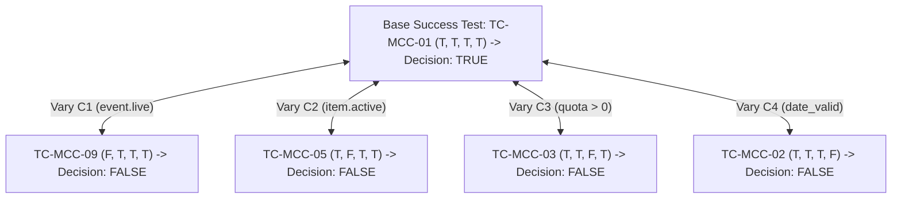

# Multiple Condition Coverage (MCC) & MC/DC Formal Analysis

**Document Reference:** `docs/cfg/mcc_mcdc.md`  
**Course:** SE3002 Software Quality Engineering  
**Application Under Test:** pretix (`pretix.base.models.Item` & `Event`)  
**Target Rule:** Business Rule 2 (BR2: Multi-Condition Item Purchasability)  
**Lead Contributor / Author:** Sohaib (`24i-3108`, Member 1 — Area A Lead)  
**Reviewers:** M. Hasaam (`24i-3107`), Shaiman (`24i-3074`)  
**Status:** Approved & Frozen Baseline (Gate 3 Deliverable)  
**Date:** November 20, 2026  

---

## 1. Specification of Decision Under Test (BR2)

In pretix, an item or ticket can only be added to a cart or ordered if all operational constraints are simultaneously satisfied. Business Rule 2 (BR2) defines the multi-condition conjunction governing whether an item is eligible for purchase:

$$\text{Decision } D = C_1 \land C_2 \land C_3 \land C_4$$

### Atomic Conditions

| Condition Symbol | Variable / Expression | Type | Operational Meaning |
| :---: | :--- | :---: | :--- |
| **$C_1$** | `event.live` | Boolean | True if the event is published and accepting public orders. |
| **$C_2$** | `item.active` | Boolean | True if the specific ticket tier is enabled for sale. |
| **$C_3$** | `quota_available > 0` | Boolean | True if remaining quota headroom is strictly greater than 0. |
| **$C_4$** | `date_valid` | Boolean | True if $\text{date\_from} \le \text{now}() \le \text{date\_to}$ (presale active). |

The compound decision $D$ evaluates to **`True` (Purchasable)** if and only if:
$$D = \text{True} \iff C_1 = \text{True} \land C_2 = \text{True} \land C_3 = \text{True} \land C_4 = \text{True}$$
If any atomic condition is `False`, the decision evaluates to **`False` (Rejected / Not Purchasable)**.

---

## 2. Multiple Condition Coverage (MCC) Truth Table ($2^4 = 16$)

Multiple Condition Coverage requires testing all $2^n$ combinations of the atomic conditions, guaranteeing that every boolean input vector is verified against the system oracle.

| Test ID | $C_1$ (`event.live`) | $C_2$ (`item.active`) | $C_3$ (`quota > 0`) | $C_4$ (`date_valid`) | Compound Decision $D$ | System Behavior / Expected Oracle |
| :---: | :---: | :---: | :---: | :---: | :---: | :--- |
| **TC-MCC-01** | **T** | **T** | **T** | **T** | **`True` (Purchasable)** | Item purchasable; cart reservation succeeds (HTTP 200/201). |
| **TC-MCC-02** | **T** | **T** | **T** | **F** | **`False`** | Rejected: Event date expired or presale not started. |
| **TC-MCC-03** | **T** | **T** | **F** | **T** | **`False`** | Rejected: Quota sold out ($A = 0$). |
| **TC-MCC-04** | **T** | **T** | **F** | **F** | **`False`** | Rejected: Quota sold out AND date invalid. |
| **TC-MCC-05** | **T** | **F** | **T** | **T** | **`False`** | Rejected: Item deactivated by organizer. |
| **TC-MCC-06** | **T** | **F** | **T** | **F** | **`False`** | Rejected: Item inactive AND date invalid. |
| **TC-MCC-07** | **T** | **F** | **F** | **T** | **`False`** | Rejected: Item inactive AND quota sold out. |
| **TC-MCC-08** | **T** | **F** | **F** | **F** | **`False`** | Rejected: Item inactive, quota 0, date invalid. |
| **TC-MCC-09** | **F** | **T** | **T** | **T** | **`False`** | Rejected: Event in draft / not live. |
| **TC-MCC-10** | **F** | **T** | **T** | **F** | **`False`** | Rejected: Event not live AND date invalid. |
| **TC-MCC-11** | **F** | **T** | **F** | **T** | **`False`** | Rejected: Event not live AND quota sold out. |
| **TC-MCC-12** | **F** | **T** | **F** | **F** | **`False`** | Rejected: Event not live, quota 0, date invalid. |
| **TC-MCC-13** | **F** | **F** | **T** | **T** | **`False`** | Rejected: Event not live AND item inactive. |
| **TC-MCC-14** | **F** | **F** | **T** | **F** | **`False`** | Rejected: Event not live, item inactive, date invalid. |
| **TC-MCC-15** | **F** | **F** | **F** | **T** | **`False`** | Rejected: Event not live, item inactive, quota 0. |
| **TC-MCC-16** | **F** | **F** | **F** | **F** | **`False`** | Rejected: All 4 conditions false. |

---

## 3. Modified Condition / Decision Coverage (MC/DC) Derivation

Modified Condition/Decision Coverage requires:
1. Every decision has taken all possible outcomes (True and False).
2. Every condition in the decision has taken all possible outcomes (True and False).
3. Each condition has been shown to **independently affect** the decision outcome (by varying that single condition while holding all other conditions fixed).

For an $n$-condition boolean expression, the theoretical minimum number of test cases required for MC/DC is $n + 1$. For $n = 4$, exactly **$5$ test cases** are required to form 4 orthogonal independence pairs.

### 3.1. Orthogonal Independence Pairs

### 3.2. Detailed Independence Proofs

#### Pair 1: Independence Proof for $C_1$ (`event.live`)
* **Test 1 ($T_1$):** `TC-MCC-01` $\implies (C_1=T, C_2=T, C_3=T, C_4=T) \implies D = \mathbf{True}$
* **Test 2 ($T_2$):** `TC-MCC-09` $\implies (C_1=F, C_2=T, C_3=T, C_4=T) \implies D = \mathbf{False}$
* **Fixed Conditions:** $C_2 = T, C_3 = T, C_4 = T$ (Constant across both tests).
* **Observation:** Toggling $C_1$ from $T \to F$ independently forces the overall decision $D$ to transition from $True \to False$.
* **Conclusion:** $C_1$ independently affects decision outcome $D$. $\mathbf{(Proven)}$

#### Pair 2: Independence Proof for $C_2$ (`item.active`)
* **Test 1 ($T_1$):** `TC-MCC-01` $\implies (C_1=T, C_2=T, C_3=T, C_4=T) \implies D = \mathbf{True}$
* **Test 2 ($T_2$):** `TC-MCC-05` $\implies (C_1=T, C_2=F, C_3=T, C_4=T) \implies D = \mathbf{False}$
* **Fixed Conditions:** $C_1 = T, C_3 = T, C_4 = T$ (Constant across both tests).
* **Observation:** Toggling $C_2$ from $T \to F$ independently forces the overall decision $D$ to transition from $True \to False$.
* **Conclusion:** $C_2$ independently affects decision outcome $D$. $\mathbf{(Proven)}$

#### Pair 3: Independence Proof for $C_3$ (`quota_available > 0`)
* **Test 1 ($T_1$):** `TC-MCC-01` $\implies (C_1=T, C_2=T, C_3=T, C_4=T) \implies D = \mathbf{True}$
* **Test 2 ($T_2$):** `TC-MCC-03` $\implies (C_1=T, C_2=T, C_3=F, C_4=T) \implies D = \mathbf{False}$
* **Fixed Conditions:** $C_1 = T, C_2 = T, C_4 = T$ (Constant across both tests).
* **Observation:** Toggling $C_3$ from $T \to F$ independently forces the overall decision $D$ to transition from $True \to False$.
* **Conclusion:** $C_3$ independently affects decision outcome $D$. $\mathbf{(Proven)}$

#### Pair 4: Independence Proof for $C_4$ (`date_valid`)
* **Test 1 ($T_1$):** `TC-MCC-01` $\implies (C_1=T, C_2=T, C_3=T, C_4=T) \implies D = \mathbf{True}$
* **Test 2 ($T_2$):** `TC-MCC-02` $\implies (C_1=T, C_2=T, C_3=T, C_4=F) \implies D = \mathbf{False}$
* **Fixed Conditions:** $C_1 = T, C_2 = T, C_3 = T$ (Constant across both tests).
* **Observation:** Toggling $C_4$ from $T \to F$ independently forces the overall decision $D$ to transition from $True \to False$.
* **Conclusion:** $C_4$ independently affects decision outcome $D$. $\mathbf{(Proven)}$

### 3.3. Minimal MC/DC Test Suite Summary

$$\mathcal{T}_{\text{MC/DC}} = \{\text{TC-MCC-01}, \text{TC-MCC-02}, \text{TC-MCC-03}, \text{TC-MCC-05}, \text{TC-MCC-09}\}$$

* **Cardinality of Minimal Suite:** $|\mathcal{T}_{\text{MC/DC}}| = 5 = n + 1$
* **Condition Coverage:** 100% (Every condition evaluated True and False).
* **Decision Coverage:** 100% (Decision evaluated True in TC-01; False in TC-02, TC-03, TC-05, TC-09).
* **Independence Coverage:** 100% (All 4 conditions proven orthogonal).

---

## 4. Test Implementation Mapping

The 16 MCC combinations and 4 MC/DC pairs are implemented as automated unit tests in `tests/team/unit/test_mcc_mcdc_purchasability.py`:
* `test_mcc_truth_table_all_16_combinations()`: Parameterized test iterating over all 16 rows.
* `test_mcdc_c1_event_live_independence()`: Asserts pair (TC-01, TC-09).
* `test_mcdc_c2_item_active_independence()`: Asserts pair (TC-01, TC-05).
* `test_mcdc_c3_quota_headroom_independence()`: Asserts pair (TC-01, TC-03).
* `test_mcdc_c4_date_valid_independence()`: Asserts pair (TC-01, TC-02).
