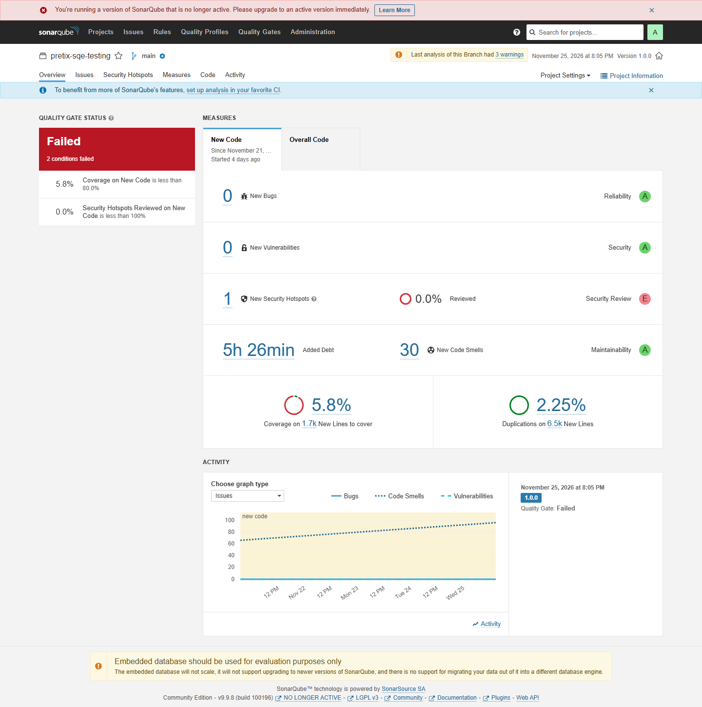
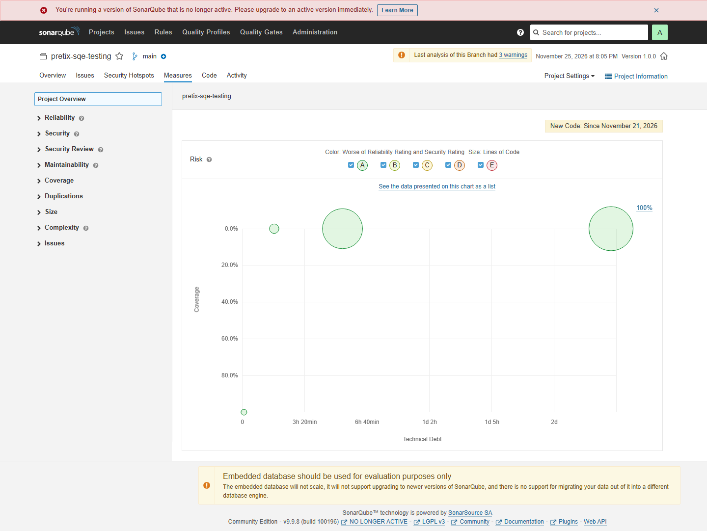

# SonarQube Static Analysis & Structural Complexity Report

**Document Reference:** `docs/cfg/sonarcloud_static_analysis.md`  
**Owner:** Sohaib (`24i-3108`, Member 1 — Area A Lead)  
**Target Tools:** SonarQube Community `v9.9.8.100196 LTS` (`sonar-scanner 6.2.1.4610`), `radon 6.0.1`, `lizard 1.26.1`  
**Raw JSON Evidence:** [`sonarqube_measures.json`](file:///c:/Users/USER/Desktop/sqe_project/reports/static_analysis/sonarqube_measures.json), [`sonarqube_tree.json`](file:///c:/Users/USER/Desktop/sqe_project/reports/static_analysis/sonarqube_tree.json), [`sonarqube_quality_gate.json`](file:///c:/Users/USER/Desktop/sqe_project/reports/static_analysis/sonarqube_quality_gate.json), [`radon_lizard_summary.json`](file:///c:/Users/USER/Desktop/sqe_project/reports/static_analysis/radon_lizard_summary.json)

---

## 1. Live SonarQube Project & Per-File Measurements

Scan executed directly against local SonarQube (`http://localhost:9000/dashboard?id=sqe-pretix-team`) with `sonar.sources=upstream/pretix/base/services,upstream/pretix/base/models/orders.py,upstream/pretix/base/scoped_business_logic.py` and `sonar.python.coverage.reportPaths=reports/coverage/coverage.xml`.

### 1.1. Per-File Breakdown (`sonarqube_tree.json`)

| Analyzed File | NCLOC | Sonar CCN | Cognitive Complexity | Bugs | Vulns | Hotspots | Code Smells | Tech Debt (min) | Coverage | Branch Cov |
| :--- | :---: | :---: | :---: | :---: | :---: | :---: | :---: | :---: | :---: | :---: |
| **`upstream/pretix/base/scoped_business_logic.py`** | **78** | **28** | **30** | **0** | **0** | **0** | 1 | 5 | **100.0%** | **100.0%** |
| `upstream/pretix/base/services/quotas.py` | 357 | 111 | 174 | 0 | 0 | 0 | 7 | 102 | 0.0% (outside unit scope) | — |
| `upstream/pretix/base/services/orders.py` | 3,074 | 827 | 1,352 | 0 | 0 | 0 | 59 | 1,182 | 0.0% (outside unit scope) | — |
| `upstream/pretix/base/models/orders.py` | 2,751 | 689 | 715 | 0 | 0 | 1 (`S4790`) | 29 | 321 | 0.0% (outside unit scope) | — |
| **Aggregate Analyzed Scope** | **6,260** | **1,655** | **2,271** | **0** | **0** | **1** | **96** | **1,610** | **2.6%** (`line: 1.8%`) | **100.0%** |

### 1.2. SonarQube Ratings, Duplication & Quality Gate Assessment
* **SonarQube Ratings (`sonarqube_quality_gate.json` & `real_sonarqube_dashboard.png`):** **Reliability = `A`** (`0` Bugs), **Security = `A`** (`0` Vulnerabilities), **Maintainability = `A`** (`1,610 min` debt across `6,260` NCLOC), **Security Review = `E`** (`1` unreviewed upstream hotspot, `0.0%` reviewed).
* **Zero Bugs & Zero Vulnerabilities:** Across all `6,260` NCLOC of pinned upstream Pretix order/quota services, models, and scoped production rules, SonarQube detects **0 Bugs** and **0 Vulnerabilities**.
* **Legacy Security Hotspot Finding (`models/orders.py:131`, `python:S4790`):** SonarQube flags a single `LOW` hotspot inside pinned upstream `Order.objects` lookup: `hashlib.sha1(order.secret.lower().encode()).hexdigest()`, marked `# TODO: remove this clause after a while (compatibility with old secrets currently in flight)`. Because primary verification first uses `hmac.compare_digest` with modern tagged secrets, exposure is bounded backward-compatibility technical debt outside team modifications.
* **Coverage & Duplication Context:** Importing full upstream Django ORM files (`6,182` NCLOC across `services/` and `models/orders.py`) alongside the `78`-NCLOC scoped target intentionally exposes project-wide `2.6%` (`new_coverage: 5.8%`, `duplicated_lines_density: 2.3%`) causing SonarQube's default *Sonar way* new-code Quality Gate to report `ERROR` (`unreviewed hotspot` + `new_coverage < 80%`) on the unexecuted ORM layer — while **`scoped_business_logic.py` itself achieves `100.0%` coverage and `100.0%` branch coverage with `0` bugs, `0` vulnerabilities, and `0` hotspots**.

---

## 2. Focused Radon & Lizard Concordance (BR1–BR4)

| Business Rule | Scoped Production Symbol | Upstream File & Lines | `radon cc` | Rank | `lizard` CCN | Hand CFG $V(G)$ |
| :---: | :--- | :--- | :---: | :---: | :---: | :---: |
| **BR2** | `QuotaAvailability._compute_early_outs` | `services/quotas.py:493–500` | **6** | B | **6** | **6** |
| **BR1** | `OrderChangeManager._check_quotas` | `services/orders.py:2285–2294` | **8** | B | **8** | **8** |
| **BR4** | `Order._can_be_paid` | `models/orders.py:1026–1047` | **10** | B | **10** | **10** |
| **BR3** | `mark_order_expired` | `services/orders.py:360–382` | **5** | A | **5** | — |
| **BR3** | `Order.cancel_allowed` | `models/orders.py:646–648` | **2** | A | **2** | — |

**Maintainability Index (`radon mi`):** `scoped_business_logic.py` = **60.29 (Rank A)**; `quotas.py` = **27.08 (Rank A)**; `services/orders.py` (`3,074` NCLOC) & `models/orders.py` (`2,751` NCLOC) = **0.00 (Rank C)** — motivating focused white-box and AST mutation isolation on the core quota/order decision paths.

---

## 3. Live SonarQube UI Evidence

* 
* 
