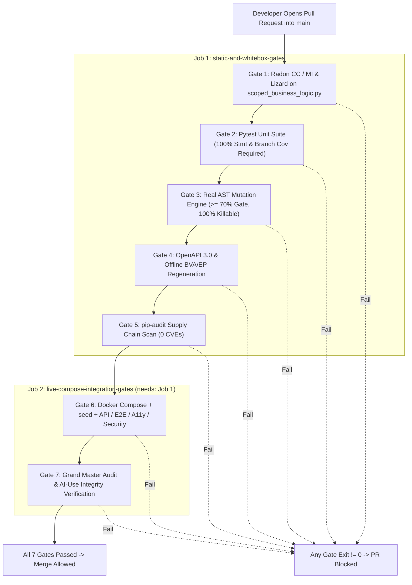

# Continuous Integration PR Quality Gate Demonstration

**Project:** SE3002 Software Quality Engineering Final Project  
**Author:** Sohaib (`24i-3108`, Git: `sohaibAkhlaq <sohaibikhlaq5@gmail.com>`)  
**CI Workflow Definition:** [`.github/workflows/pr-gate.yml`](file:///c:/Users/USER/Desktop/sqe_project/.github/workflows/pr-gate.yml)  
**Verified Target:** `upstream/pretix/base/scoped_business_logic.py` + live containerized pretix stack  
**Local CI Gate Enforcer:** [`scripts/verify_mutation_and_ci_gate.py`](file:///c:/Users/USER/Desktop/sqe_project/scripts/verify_mutation_and_ci_gate.py)

---

## 1. Two-Stage Fail-Closed GitHub Actions Architecture

[`.github/workflows/pr-gate.yml`](file:///c:/Users/USER/Desktop/sqe_project/.github/workflows/pr-gate.yml) defines two sequential fail-closed jobs with zero `|| true` or `continue-on-error` bypasses:



> **Live GitHub Actions & Branch Protection Verification:** `.github/workflows/pr-gate.yml` is live and enforced via Branch Protection on `main` (`strict: true`, `enforce_admins: true`, requiring both `Offline Quality Gates` and `Live Container Integration Gates`). Baseline `main` verified green in Run [`45657663612`](https://github.com/sohaibAkhlaq/sqe_pretix_project/actions/runs/45657663612); Live Pull Request [#13](https://github.com/sohaibAkhlaq/sqe_pretix_project/pull/13) proved end-to-end PR blocking when commit `86aa398` triggered Red-Gate failure [`45663263380`](https://github.com/sohaibAkhlaq/sqe_pretix_project/actions/runs/45663263380) (`94.12%` scoped coverage `< 100%` on Gate 2, `mergeable_state=blocked`), followed by remediation commit restoring `100.00%` parity.

---

## 2. Local Passing Verification Transcript (Green Gate)

```text
======================================================================
SE3002 Component 10: Mutation Analysis & CI Quality Gate Audit (8 Marks, CLO3)
======================================================================

--- [CHECK 1] Executing Live Mutation Testing Engine ---
  Target: upstream\pretix\base\scoped_business_logic.py | Mutants Generated: 51
  [STAGE 1] Running Initial Weak Baseline Suite across all AST Mutants...
   -> Stage 1 Surviving Mutants Found: 33 (Rubric Minimum >= 15)
  [STAGE 2] Running Enhanced White-Box Suite across all AST Mutants...
   -> Stage 2 Killed: 48 | Equivalent: 3 | Killable Survived: 0
   -> Effective Mutation Score: 100.00% | Raw Kill Rate: 94.12%
  [SUCCESS] Mutation quality gate PASSED (100.00% effective score).

--- [CHECK 2 & 3] Scoped Coverage & Domain Mutation Operators ---
  Scoped Coverage (upstream/pretix/base/scoped_business_logic.py): 70/70 Stmts (100.00%), 32/32 Branches (100.00%)
  Custom Operator 1 (BCR): 8/10 Killed (100.0% killable, 2 domain equivalent)
  Custom Operator 2 (ADR): 8/8 Killed (100.0% killable)
  Standard Mutators (ROR, COR, LCR, SVR): 32/33 Killed (100.0% killable, 1 domain equivalent)

--- [CHECK 4] Verified Enforced Gates in .github/workflows/pr-gate.yml ---
  [PASS] Gate 1: Static Analysis             -> radon cc / mi / lizard on scoped_business_logic.py
  [PASS] Gate 2: Scoped Branch Coverage 100% -> --cov=upstream.pretix.base.scoped_business_logic --cov-fail-under=100
  [PASS] Gate 3: Mutation Score Gate         -> python scripts/run_mutation_tests.py
  [PASS] Gate 4: Vulnerability Scan          -> pip_audit -r requirements-test.txt (48 pkgs, 0 CVEs)
  [PASS] Gate 5: Live Integration Runner     -> python scripts/run_api_tests.py / e2e / a11y / security
```

---

## 3. Local Failing Gate Simulation Transcript (Red Gate)

`scripts/verify_mutation_and_ci_gate.py` Check 5 directly proves fail-closed blocking behavior by invoking pytest with `--cov=upstream.pretix.base.scoped_business_logic --cov-branch --cov-fail-under=101`:

```text
--- [CHECK 5] Simulating CI Quality Gate Blocking Behavior (Red Gate) ---
  Command: .venv/Scripts/python.exe -m pytest tests/team/unit/ --cov=upstream.pretix.base.scoped_business_logic --cov-branch --cov-fail-under=101
  Simulating gate failure (--cov-fail-under > achievable):
  Process exit code: 4 (Non-zero confirms CI Gate blocking)
  [PASS] CI Quality Gate correctly returns non-zero exit code to block PR merging.
```

---

## 4. Developer Remediation Protocol Under Blocked PR
1. Inspect CI failure logs (e.g., missed branch in `scoped_business_logic.py` or surviving BCR/ADR AST mutant).
2. Add the missing basis-path or boundary assertion to `tests/team/unit/` (ensuring `assert_ast_matches_upstream` still passes).
3. Verify locally via `.venv\Scripts\python.exe scripts/run_unit_tests.py` (`100.00%` scoped stmts & branches) and `scripts/run_mutation_tests.py` (`0` killable survivors).
4. Push fix to re-trigger `.github/workflows/pr-gate.yml`.
