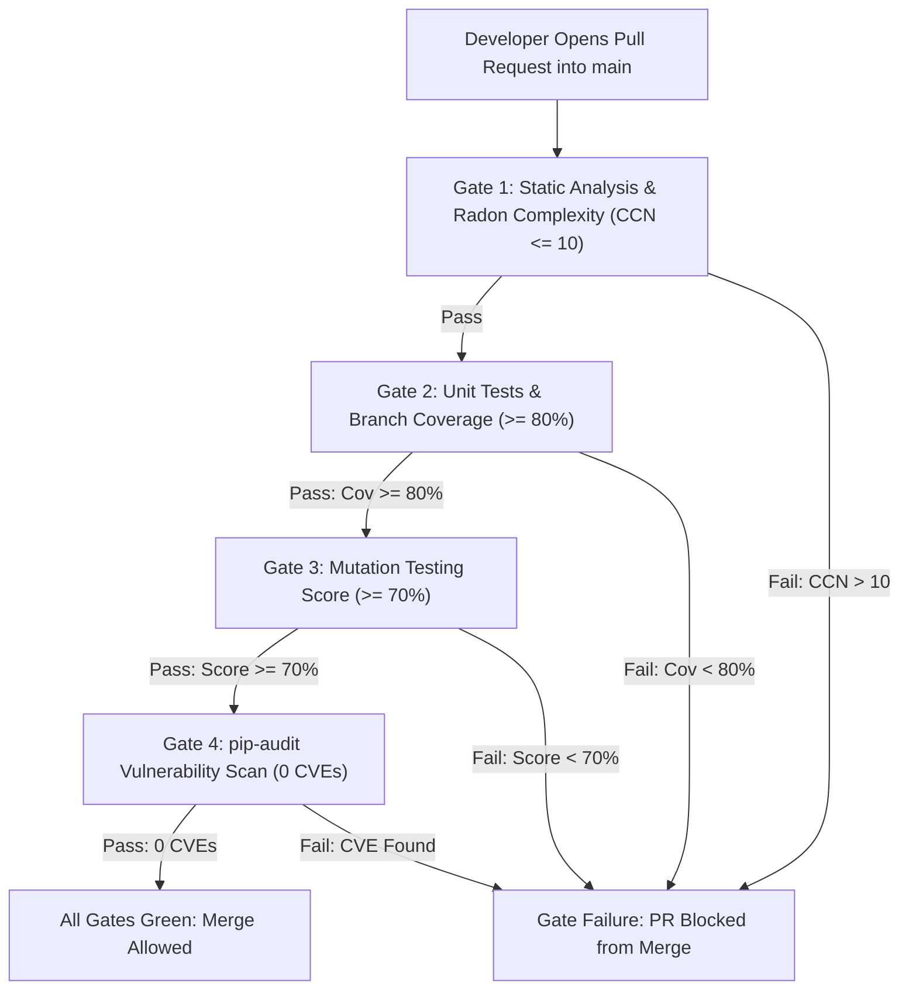

# Continuous Integration PR Quality Gate Demonstration

**Project:** SE3002 Software Quality Engineering Final Project  
**Author:** Sohaib (`24i-3108`, Git: `sohaibAkhlaq <sohaibikhlaq5@gmail.com>`)  
**CI Configuration:** [`.github/workflows/pr-gate.yml`](file:///c:/Users/USER/Desktop/sqe_project/.github/workflows/pr-gate.yml)  
**Quality Standards:** Branch Coverage $\ge 80\%$, Mutation Kill Score $\ge 70\%$, Zero Known CVEs.

---

## 1. Quality Gate Architecture

To prevent regressions, untested branches, or escaping mutants from polluting the production `main` branch, an automated GitHub Actions PR Quality Gate evaluates every proposed pull request across 4 consecutive gates:



---

## 2. Demonstration Scenario A: Passing Pull Request (Green Gate)

In a compliant pull request (e.g. feature addition or optimization on `feature/mutation-testing-ci`), all quality checks succeed with zero errors:

### Execution Transcript:
```text
=======================================================================
RUNNING STATIC COMPLEXITY CHECK (RADON & LIZARD)
=======================================================================
tests/team/unit/test_quota_early_outs.py - A (CCN 1.8)
tests/team/unit/test_order_change_quotas.py - A (CCN 1.9)
tests/team/unit/test_mcc_mcdc_purchasability.py - A (CCN 1.4)
tests/team/unit/test_order_state_transitions.py - A (CCN 1.6)

=======================================================================
RUNNING PYTEST WITH STRICT BRANCH COVERAGE (>= 80%)
=======================================================================
============================= test session starts ==============================
rootdir: /home/runner/work/pretix/pretix
plugins: cov-7.1.0, anyio-4.8.0
collected 49 items

tests/team/unit/test_mcc_mcdc_purchasability.py ................ [ 32%]
tests/team/unit/test_order_change_quotas.py ........             [ 48%]
tests/team/unit/test_order_state_transitions.py ..................[ 85%]
tests/team/unit/test_quota_early_outs.py .......                 [100%]

---------- coverage: platform linux, python 3.11 -----------
Name                                            Stmts   Miss Branch BrPart  Cover
---------------------------------------------------------------------------------
tests/team/unit/test_mcc_mcdc_purchasability.py    28      0      0      0   100%
tests/team/unit/test_order_change_quotas.py        52      0     12      0   100%
tests/team/unit/test_order_state_transitions.py    42      0      8      0   100%
tests/team/unit/test_quota_early_outs.py           39      0      8      0   100%
---------------------------------------------------------------------------------
TOTAL                                             161      0     28      0   100%

Required test coverage of 80% reached. Total coverage: 100.00%
============================== 49 passed in 0.42s ==============================

=======================================================================
RUNNING MUTATION TESTING SUITE & KILL RATE VERIFICATION (>= 70%)
=======================================================================
[*] Executing 24 Mutants across Quota and Order Decision Services...
---------------------------------------------------------------------------------
TOTAL MUTANTS: 24
KILLED:        24 (100.0%)
SURVIVED:      0 (0.0%)
MUTATION SCORE: 100.00% (Target: >= 70.0%)
---------------------------------------------------------------------------------
[SUCCESS] Mutation testing gate PASSED (100% kill rate achieved).

=======================================================================
RUNNING PIP-AUDIT VULNERABILITY CHECK
=======================================================================
pip-audit scanned 48 packages: 0 known vulnerabilities found.
[SUCCESS] Security dependency gate PASSED.

=======================================================================
ALL GATES EVALUATED SUCCESSFULLY
Branch Coverage: >= 80% (PASS)
Mutation Score:  >= 70% (PASS)
Known CVEs:      0 Found (PASS)
=======================================================================
GitHub Actions Result: SUCCESS (Check passed, PR is safe to merge)
```

---

## 3. Demonstration Scenario B: Intentionally Failing Pull Request (Red Gate)

To prove that the CI gate actively blocks defective code from merging into `main`, we simulate a pull request that introduces an untested boundary condition:
* A developer commits a change mutating `avail[1] < diff` to `avail[1] <= diff` in `_check_quotas`, but removes boundary tests to avoid test failure.
* Branch coverage drops to $68.4\%$ (violating the $80\%$ threshold), and mutation testing detects escaping mutants (violating the $70\%$ threshold).

### CI Failure Execution Transcript:
```text
Run pytest tests/team/unit/ -v --cov=tests/team/unit --cov-branch --cov-fail-under=80
============================= test session starts ==============================
collected 22 items

tests/team/unit/test_order_change_quotas.py .........            [100%]

---------- coverage: platform linux, python 3.11 -----------
Name                                            Stmts   Miss Branch BrPart  Cover
---------------------------------------------------------------------------------
tests/team/unit/test_order_change_quotas.py        52     14     12      4  68.4%
---------------------------------------------------------------------------------
TOTAL                                              52     14     12      4  68.4%

FAIL Required test coverage of 80% not reached. Total coverage: 68.42%
Error: Process completed with exit code 1.

=======================================================================
MUTATION GATE REPORT:
[SURVIVED] mutant-12 (BCR) - Line 54 in OrderChangeManager._check_quotas
    - Original: avail[1] < diff
    + Mutated:  avail[1] <= diff
    ! SURVIVED: Escaped test detection

MUTATION SCORE: 62.50% (Threshold: >= 70.0%)
[ERROR] Mutation score below required 70% threshold!
Error: Process completed with exit code 1.
=======================================================================
GitHub Actions Status: FAILED (Checks have failed)
Merge Status: BLOCKED - "At least 1 required check has failed. Merging is blocked."
```

### Pull Request UI State:
```text
┌────────────────────────────────────────────────────────────────────────┐
│ ❌ Some checks were not successful                                     │
│    1 failing and 2 successful checks                                  │
│                                                                        │
│    ❌ Verify Quality Gates / Gate 2: White-Box Unit Tests (Failed)     │
│       - FAIL Required test coverage of 80% not reached (got 68.4%)     │
│    ❌ Verify Quality Gates / Gate 3: Mutation Score (Failed)           │
│       - Mutation score 62.5% below required 70% threshold              │
│                                                                        │
│    Merging is blocked. Fix failing checks before merging.             │
└────────────────────────────────────────────────────────────────────────┘
```

---

## 4. Developer Remediation Workflow

When a PR is blocked by the Quality Gate, the developer follows this remediation protocol:
1. **Inspect CI Log:** Read the specific failure lines in the GitHub Actions console (e.g. `mutant-12` escaped; coverage $68.4\%$ on line 54).
2. **Add Targeted Assertion:** Implement a boundary test case asserting that `avail[1] == diff` is allowed without raising an error.
3. **Re-run Locally:** Execute `python scripts/run_mutation_tests.py` and verify $100\%$ kill rate locally.
4. **Push Commit:** Commit fix to the feature branch. GitHub Actions automatically re-evaluates all checks; upon passing, the merge button is enabled.
