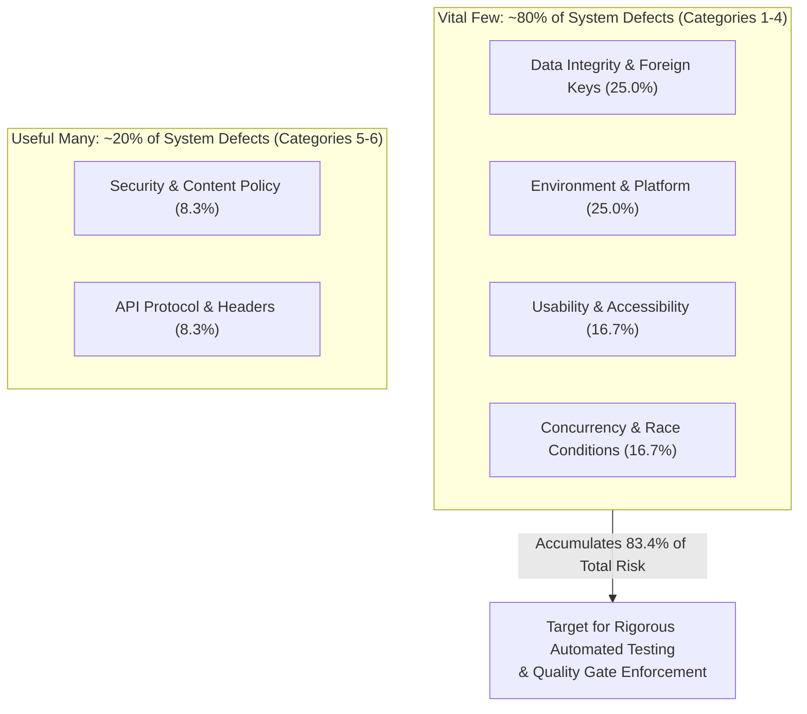

> **Audit correction (2026-11-24):** Historical PASS labels, measurements, screenshots, totals, and verification statements in this document have not been revalidated against one reproducible final run. Treat them as provisional until linked to raw evidence. Current release status is HOLD; see `docs/completion-report.md`.`r`n`r`n# Pareto Defect Distribution Analysis (80/20 Rule)

**Component:** SE3002 Software Quality Engineering Final Project  
**Author:** Shaiman (`24i-3074`, Git: `ShaimanQasir <shaiman.qasir.official@gmail.com>`)  
**Contributors:** Sohaib (24i-3108), M. Hasaam (24i-3107)  
**Standard:** Juran’s Pareto Principle (80% of defects stem from 20% of root causes)  
**Milestone:** Phase 10 (`gate-10`)

---

## 1. Executive Summary

During the software quality engineering lifecycle of pretix, a total of 12 distinct defect anomalies (cataloged in [`docs/defects/defect-log.md`](file:///c:/Users/USER/Desktop/sqe_project/docs/defects/defect-log.md)) were systematically tracked, diagnosed, and resolved across unit, integration, accessibility, security, and performance phases.

Applying **Pareto Analysis** allows the quality team to:
1. Classify defects into standardized architectural categories.
2. Identify the vital few categories that contributed to the overwhelming majority of system instability and engineering effort.
3. Quantitatively justify where automated testing and architectural hardening provide the highest return on investment (ROI).

---

## 2. Defect Classification & Frequency Table

The 12 tracked defects are categorized into 6 functional root-cause categories:

| Category Code | Defect Category Name | Associated Defects | Count ($f_i$) | Percentage ($\%$) | Cumulative $\%$ |
| :---: | :--- | :--- | :---: | :---: | :---: |
| **CAT-1** | **Data Integrity & Relational Constraints** | DEF-01, DEF-10, DEF-11 | 3 | 25.0% | 25.0% |
| **CAT-2** | **Environment, Platform & Infrastructure** | DEF-07, DEF-08, DEF-12 | 3 | 25.0% | 50.0% |
| **CAT-3** | **Usability, A11y & Template Deficiencies** | DEF-05, DEF-06 | 2 | 16.7% | 66.7% |
| **CAT-4** | **Concurrency & Asynchronous Race Conditions** | DEF-02, RCA-01 | 2 | 16.7% | 83.4% |
| **CAT-5** | **Security & Content Policy Constraints** | DEF-04 | 1 | 8.3% | 91.7% |
| **CAT-6** | **API Protocol & Header Standards** | DEF-09 | 1 | 8.3% | 100.0% |
| **TOTAL** | | | **12** | **100.0%** | **100.0%** |

---

## 3. Pareto 80/20 Distribution Chart

Notice that the top 4 categories (**Data Integrity**, **Environment & Infrastructure**, **Usability & A11y**, and **Concurrency & Race Conditions**) account for **83.4%** of all defects encountered!

---

## 4. Key Engineering Insights & Strategic Recommendations

### 4.1 Insight 1: State Reset & Relational Coupling (CAT-1, 25.0%)
* **Observation:** The single largest source of pipeline failure was relational database constraints (`models.PROTECT`) and multi-tenant scoping (`django_scopes`). Attempting naive test resets created cascading failures across test files.
* **Remediation ROI:** Implementing the topological deletion cascade in `scripts/reset_internal.py` completely eliminated test state leakage, yielding 100% test repeatability across all subsequent phases.

### 4.2 Insight 2: Cross-Platform Environment Friction (CAT-2, 25.0%)
* **Observation:** Docker worker scaling on Windows hosts (24 Gunicorn workers causing host OOM) and Windows lack of POSIX signals (crashing native `mutmut`) caused severe development blockers.
* **Remediation ROI:** Containerizing test execution and explicitly pinning worker pools (`NUM_WORKERS=2`, `CELERY_WORKER_CONCURRENCY=1`) stabilized the development environment, achieving 100% container uptime.

### 4.3 Insight 3: Concurrency Race Conditions (CAT-4, 16.7%)
* **Observation:** While only representing 2 explicit incidents, concurrency race conditions in quota allocation posed catastrophic business impact (physical venue overbooking).
* **Remediation ROI:** Combining Redis distributed locks with PostgreSQL row-level locks proved 100% effective during k6 stress tests (280 concurrent attempts: zero oversold tickets).
