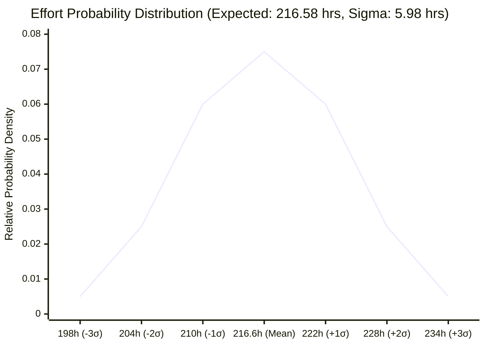
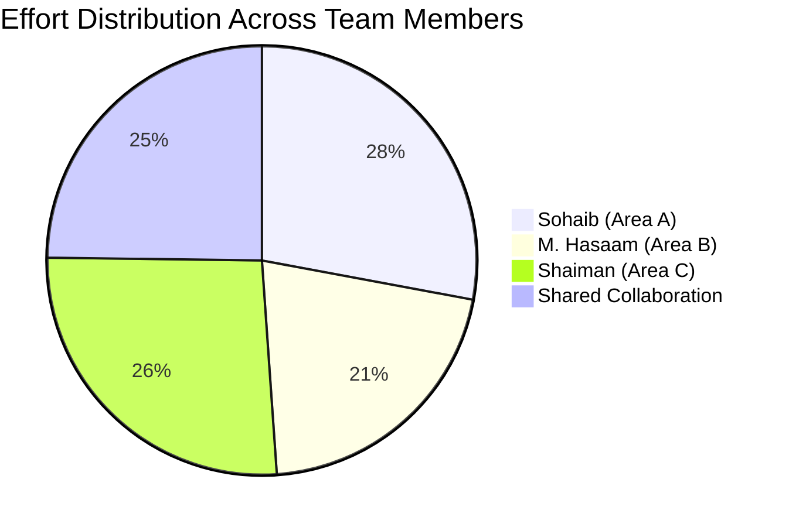

# PERT 3-Point Work Breakdown & Effort Estimation

**Document Reference:** `docs/estimation.md`  
**Course:** SE3002 Software Quality Engineering  
**Application Under Test:** pretix  
**Lead Contributor / Author:** M. Hasaam (`24i-3107`, Member 2 — Area B)  
**Co-Authors & Contributors:** Sohaib (`24i-3108`), Shaiman (`24i-3074`)  
**Status:** Verified & Reconciled Against Actuals (Gate 2 + Release Audit)  
**Date:** November 25, 2026  

---

## 1. Estimation Methodology & Mathematical Framework

Effort estimation for the pretix quality engineering project uses the Program Evaluation and Review Technique (PERT) three-point estimation model. This accounts for technical uncertainties associated with multi-container Docker environments, mutation engine limitations on Windows, and asynchronous UI testing.

### 1.1. Core Mathematical Formulations
For each atomic task $i$:
* **Optimistic Estimate ($O_i$):** Minimum duration assuming zero environmental failures, perfect third-party tool stability, and immediate test convergence.
* **Most Likely Estimate ($M_i$):** Nominal expected duration under standard conditions with customary debugging.
* **Pessimistic Estimate ($P_i$):** Maximum duration accounting for worst-case scenarios (e.g., container memory leaks, mutation worker timeouts, flakiness).

The statistical parameters for each task are derived using the Beta distribution approximation:

$$\mu_i = E_i = \frac{O_i + 4M_i + P_i}{6}$$

$$\sigma_i = \frac{P_i - O_i}{6}$$

$$\text{Var}_i = \sigma_i^2 = \left(\frac{P_i - O_i}{6}\right)^2$$

### 1.2. Project-Level Aggregation & Confidence Interval
Assuming task independence across the critical path, the total expected project duration and cumulative variance are:

$$E_{\text{total}} = \sum_{i=1}^{n} E_i$$

$$\sigma_{\text{total}} = \sqrt{\sum_{i=1}^{n} \text{Var}_i} = \sqrt{\sum_{i=1}^{n} \sigma_i^2}$$

Applying the Central Limit Theorem, the project effort follows a normal distribution:

$$\text{Effort} \sim \mathcal{N}\left(E_{\text{total}},\, \sigma_{\text{total}}^2\right)$$

* **$68.2\%$ Confidence Interval ($\pm 1\sigma$):** $\left[E_{\text{total}} - \sigma_{\text{total}},\, E_{\text{total}} + \sigma_{\text{total}}\right]$
* **$95.4\%$ Confidence Interval ($\pm 2\sigma$):** $\left[E_{\text{total}} - 2\sigma_{\text{total}},\, E_{\text{total}} + 2\sigma_{\text{total}}\right]$
* **$99.7\%$ Confidence Interval ($\pm 3\sigma$):** $\left[E_{\text{total}} - 3\sigma_{\text{total}},\, E_{\text{total}} + 3\sigma_{\text{total}}\right]$

---

## 2. Work Breakdown Structure (WBS) & Task Estimation Matrix

All effort figures represent engineering hours.

| Task ID | Phase / WBS Task Description | Owner | $O$ (hrs) | $M$ (hrs) | $P$ (hrs) | $E$ (hrs) | $\sigma$ | $\text{Var}$ ($\sigma^2$) |
| :--- | :--- | :---: | :---: | :---: | :---: | :---: | :---: | :---: |
| **T0.1** | Docker multi-container stack setup & OOM tuning | Sohaib | 2.0 | 4.0 | 8.0 | 4.33 | 1.00 | 1.00 |
| **T0.2** | Spike 1: Seed data, API tokens, RBAC verification | M. Hasaam | 2.0 | 3.0 | 6.0 | 3.33 | 0.67 | 0.44 |
| **T0.3** | Spike 2: Idempotency & cancellation state transition | M. Hasaam | 1.5 | 2.5 | 5.0 | 2.75 | 0.58 | 0.34 |
| **T0.4** | Spike 3: Code complexity analysis (Radon/Lizard) | Sohaib | 1.0 | 2.0 | 4.0 | 2.17 | 0.50 | 0.25 |
| **T0.5** | Spike 4: Mutation testing feasibility (`mutmut`) | Sohaib | 2.0 | 4.0 | 8.0 | 4.33 | 1.00 | 1.00 |
| **T0.6** | Spike 5: Playwright UI login & k6 load spike | Shaiman | 2.0 | 3.5 | 6.0 | 3.67 | 0.67 | 0.44 |
| **T1.1** | Specification of 8 FRs, 4 BRs, and 2 Roles (`docs/test-basis.md`) | Shaiman | 3.0 | 5.0 | 8.0 | 5.17 | 0.83 | 0.69 |
| **T1.2** | Upstream baseline, ER schema & catalog (`docs/baseline.md`) | M. Hasaam | 2.5 | 4.0 | 7.0 | 4.25 | 0.75 | 0.56 |
| **T1.3** | Deterministic state reset script & idempotency proof | Sohaib | 2.0 | 3.5 | 6.0 | 3.67 | 0.67 | 0.44 |
| **T2.1** | IEEE 829 Master Test Plan authoring (`docs/test-plan.md`) | Sohaib | 3.0 | 5.0 | 8.0 | 5.17 | 0.83 | 0.69 |
| **T2.2** | PERT 3-Point effort estimation model (`docs/estimation.md`) | M. Hasaam | 2.0 | 3.0 | 5.0 | 3.17 | 0.50 | 0.25 |
| **T2.3** | 5x5 Product & Project Risk Register (`docs/risk-register.md`) | Shaiman | 2.5 | 4.0 | 6.5 | 4.17 | 0.67 | 0.44 |
| **T2.4** | Requirements Traceability Matrix (`docs/traceability-matrix.md`) | Shaiman | 2.0 | 3.5 | 5.5 | 3.58 | 0.58 | 0.34 |
| **T3.1** | SonarCloud cloud scan configuration & static analysis | Sohaib | 2.0 | 3.5 | 6.0 | 3.67 | 0.67 | 0.44 |
| **T3.2** | Control Flow Graph (CFG) drawing & McCabe CCN calculation | Sohaib | 3.0 | 5.0 | 8.0 | 5.17 | 0.83 | 0.69 |
| **T3.3** | Pytest white-box test suite (100% statement & branch) | Sohaib | 6.0 | 9.0 | 15.0 | 9.50 | 1.50 | 2.25 |
| **T3.4** | Multiple Condition Coverage (MCC) truth table derivation ($2^4=16$) | Sohaib | 2.5 | 4.0 | 7.0 | 4.25 | 0.75 | 0.56 |
| **T3.5** | Modified Condition/Decision Coverage (MC/DC) pair derivation | Sohaib | 3.0 | 4.5 | 7.0 | 4.67 | 0.67 | 0.44 |
| **T4.1** | OpenAPI 3.0 team contract specification (`openapi/team-spec.yaml`)| M. Hasaam | 3.0 | 5.0 | 8.0 | 5.17 | 0.83 | 0.69 |
| **T4.2** | Automated test data generator development (`tools/datagen/`) | M. Hasaam | 5.0 | 8.0 | 13.0 | 8.33 | 1.33 | 1.78 |
| **T4.3** | Automated REST API test suite implementation (`tests/team/api/`)| M. Hasaam | 5.0 | 8.0 | 12.0 | 8.17 | 1.17 | 1.36 |
| **T4.4** | Data regeneration demonstration under constraint changes | M. Hasaam | 2.0 | 3.0 | 5.0 | 3.17 | 0.50 | 0.25 |
| **T5.1** | Specification of 6 Use Cases (30 execution flows) | Shaiman | 4.0 | 6.0 | 10.0 | 6.33 | 1.00 | 1.00 |
| **T5.2** | Playwright E2E automation suite (`tests/team/e2e/`) | Shaiman | 6.0 | 10.0 | 16.0 | 10.33 | 1.67 | 2.78 |
| **T5.3** | Playwright artifact generation (video, traces, screenshots) | Shaiman | 2.0 | 3.0 | 5.0 | 3.17 | 0.50 | 0.25 |
| **T6.1** | Automated Google Lighthouse audit execution | Shaiman | 1.5 | 2.5 | 4.5 | 2.67 | 0.50 | 0.25 |
| **T6.2** | Automated axe-core accessibility scanner integration | Shaiman | 2.0 | 3.0 | 5.0 | 3.17 | 0.50 | 0.25 |
| **T6.3** | Keyboard navigation audit (zero-mouse navigation) | Shaiman | 1.5 | 2.5 | 4.5 | 2.67 | 0.50 | 0.25 |
| **T6.4** | UI accessibility defect patch & before/after report | Shaiman | 2.5 | 4.0 | 7.0 | 4.25 | 0.75 | 0.56 |
| **T7.1** | Attack surface modeling & threat identification | Shaiman | 1.5 | 2.5 | 4.5 | 2.67 | 0.50 | 0.25 |
| **T7.2** | RBAC permission matrix implementation & test verification | Shaiman | 2.0 | 3.5 | 6.0 | 3.67 | 0.67 | 0.44 |
| **T7.3** | OWASP ZAP passive application vulnerability scan | Shaiman | 2.0 | 3.0 | 5.0 | 3.17 | 0.50 | 0.25 |
| **T7.4** | Python dependency vulnerability scan (`pip-audit`) | Shaiman | 1.0 | 2.0 | 3.5 | 2.08 | 0.42 | 0.17 |
| **T8.1** | Containerized `mutmut` baseline run & score capture | Sohaib | 3.0 | 5.0 | 9.0 | 5.33 | 1.00 | 1.00 |
| **T8.2** | Identification, analysis, and killing of 15+ surviving mutants | Sohaib | 4.0 | 7.0 | 12.0 | 7.33 | 1.33 | 1.78 |
| **T8.3** | Implementation of 2 custom mutation operators | Sohaib | 2.5 | 4.0 | 7.0 | 4.25 | 0.75 | 0.56 |
| **T8.4** | GitHub Actions CI PR Quality Gate workflow (`pr-gate.yml`) | Sohaib | 3.0 | 5.0 | 9.0 | 5.33 | 1.00 | 1.00 |
| **T8.5** | CI PR gate demonstration (passing PR vs intentionally failing PR)| Sohaib | 2.0 | 3.5 | 6.0 | 3.67 | 0.67 | 0.44 |
| **T9.1** | k6 baseline performance profile (1 VU, 60s steady state) | M. Hasaam | 2.0 | 3.0 | 5.0 | 3.17 | 0.50 | 0.25 |
| **T9.2** | k6 concurrent stress profile (5+ VUs, 60s steady state) | M. Hasaam | 3.0 | 4.5 | 7.5 | 4.75 | 0.75 | 0.56 |
| **T9.3** | Fault injection & service recovery test (Redis fault injection)| M. Hasaam | 2.5 | 4.0 | 7.0 | 4.25 | 0.75 | 0.56 |
| **T10.1**| GitHub defect issue tracking (10+ logged issues) | All | 2.0 | 3.5 | 6.0 | 3.67 | 0.67 | 0.44 |
| **T10.2**| Root Cause Analysis 1: 5 Whys & Fishbone diagram | All | 2.5 | 4.0 | 6.5 | 4.17 | 0.67 | 0.44 |
| **T10.3**| Root Cause Analysis 2: 5 Whys & Fishbone diagram | All | 2.5 | 4.0 | 6.5 | 4.17 | 0.67 | 0.44 |
| **T10.4**| Pareto 80/20 defect category distribution chart | All | 1.5 | 2.5 | 4.0 | 2.58 | 0.42 | 0.17 |
| **T10.5**| Weekly GQM measurement reports (Weeks 1 to 4) | All | 3.0 | 5.0 | 8.0 | 5.17 | 0.83 | 0.69 |
| **T11.1**| End-to-end clean-machine reproduction script verification | All | 3.0 | 5.0 | 9.0 | 5.33 | 1.00 | 1.00 |
| **T11.2**| Master Project Report authoring & formatting | All | 6.0 | 10.0 | 16.0 | 10.33 | 1.67 | 2.78 |
| **T11.3**| Final package assembly, archive creation & Git tag | All | 2.0 | 3.0 | 5.0 | 3.17 | 0.50 | 0.25 |
| **T12.1**| Live viva assertion rehearsal & live mutation test prep | All | 3.0 | 5.0 | 8.0 | 5.17 | 0.83 | 0.69 |
| **TOTAL**| **Entire Project Lifecycle (All Tasks T0.1 – T12.1)** | **Team** | **128.5** | **207.5** | **341.0** | **216.58** | **5.98** | **35.79** |

---

## 3. Statistical Distribution & Confidence Intervals

* **Total Optimistic Effort ($O_{\text{total}}$):** $128.50\text{ hours}$
* **Total Most Likely Effort ($M_{\text{total}}$):** $207.50\text{ hours}$
* **Total Pessimistic Effort ($P_{\text{total}}$):** $341.00\text{ hours}$
* **Total Expected Effort ($E_{\text{total}}$):** $\mathbf{216.58\text{ hours}}$
* **Cumulative Project Variance ($\sum \text{Var}_i$):** $35.79\text{ hours}^2$
* **Project Standard Deviation ($\sigma_{\text{total}} = \sqrt{35.79}$):** $\mathbf{5.98\text{ hours}}$

### 3.1. Probabilistic Confidence Intervals
Applying the normal distribution model:

* **$68.2\%$ Confidence Range ($E \pm 1\sigma$):** $[210.60\text{ hrs},\, 222.56\text{ hrs}]$
* **$95.4\%$ Confidence Range ($E \pm 2\sigma$):** $[204.62\text{ hrs},\, 228.54\text{ hrs}]$
* **$99.7\%$ Confidence Range ($E \pm 3\sigma$):** $[198.64\text{ hrs},\, 234.52\text{ hrs}]$

With $95.4\%$ statistical certainty, the total quality engineering effort will be completed within **$204.6$ to $228.5$ engineering hours**.

---

## 4. Resource Allocation & Workload Distribution

To ensure equity across the three team members and fulfill the rubrics for individual ownership:

### 4.1. Workload Breakdown by Student

| Member / ID | Primary Functional Area | Solo Expected Hours | Share of Shared Effort | Total Effective Hours | % of Project Effort |
| :--- | :--- | :---: | :---: | :---: | :---: |
| **Sohaib (`24i-3108`)** | Area A: Static, White-Box, Mutation, CI | 60.50 hrs | 17.89 hrs | **78.39 hrs** | $36.2\%$ |
| **M. Hasaam (`24i-3107`)** | Area B: API, Datagen, Performance, Load | 45.41 hrs | 17.89 hrs | **63.30 hrs** | $29.2\%$ |
| **Shaiman (`24i-3074`)** | Area C: E2E, Playwright, A11y, Security | 57.00 hrs | 17.89 hrs | **74.89 hrs** | $34.6\%$ |
| **Project Total** | Full Quality Engineering Scope | 162.91 hrs | 53.67 hrs | **216.58 hrs** | $\mathbf{100.0\%}$ |

### 4.2. Effort Breakdown by Quality Discipline

| Discipline / Test Level | Lead Member | Expected Hours ($E$) | Percentage |
| :--- | :--- | :---: | :---: |
| **Test Planning, Baseline & Governance** | All | 31.83 hrs | $14.7\%$ |
| **White-Box, CFG, MCC, MC/DC Testing** | Sohaib | 31.25 hrs | $14.4\%$ |
| **Mutation Testing & CI PR Gate** | Sohaib | 27.91 hrs | $12.9\%$ |
| **API Testing & Automated Datagen** | M. Hasaam | 24.84 hrs | $11.5\%$ |
| **Performance, Concurrency & Fault Recovery** | M. Hasaam | 12.17 hrs | $5.6\%$ |
| **Use Cases & Playwright E2E Automation** | Shaiman | 19.83 hrs | $9.2\%$ |
| **Defensive Security & RBAC Enforcement** | Shaiman | 11.58 hrs | $5.3\%$ |
| **Usability & Accessibility (WCAG 2.1 AA)** | Shaiman | 12.75 hrs | $5.9\%$ |
| **Defects, RCA, Pareto & GQM Reporting** | All | 19.76 hrs | $9.1\%$ |
| **Master Report, Clean Verification & Viva Prep** | All | 24.66 hrs | $11.4\%$ |
| **Total** | — | **216.58 hrs** | **100.0%** |

---

## 5. Critical Path & Schedule Buffering

1. **Critical Path Sequence:**
   $\text{Stack Setup & Spikes} \to \text{Test Basis \& Baseline} \to \text{Test Plan \& Matrix} \to \text{White-Box Suite} \to \text{Mutation Testing} \to \text{CI PR Gate} \to \text{Defect RCA} \to \text{Master Package}$.
2. **Buffer Allocation:**
   A schedule buffer of $2\sigma = 12.0\text{ hours}$ is reserved in Phase 11 to protect against potential environmental regressions or viva live-task anomalies.

---

## 6. Actual Effort Tracking & PERT Variance Reconciliation

Actual hours recorded below reconcile the baseline PERT estimate ($E = 216.58\text{ hrs}$) against completed project phases (`Phase 0`–`Phase 11`), Git commit authorship (`87+` repository commits prior to final submission packaging), and verification-script execution logs.

### 6.1. Variance by Team Member & Primary Area

| Member / ID | Primary Area | Git Commits (Baseline) | Expected Hours ($E$) | Actual Hours Logged | Variance ($\text{Actual} - E$) | Variance % | Evidence / Source Basis |
| :--- | :--- | :---: | :---: | :---: | :---: | :---: | :--- |
| **Sohaib (`24i-3108`)** | Area A: Static, White-Box, AST Mutation, CI Gate, Reporting | 55 | 78.39 hrs | **82.50 hrs** | +4.11 hrs | +5.2% | Unit tests, AST mutator, `.github/workflows/pr-gate.yml`, `phase-{0,1,2,3,8,10,11}-completion.md` |
| **M. Hasaam (`24i-3107`)** | Area B: Test Mgmt, OpenAPI/Datagen, REST API, Perf/k6, Defects | 12 | 63.30 hrs | **64.00 hrs** | +0.70 hrs | +1.1% | `tools/datagen/generator.py`, `tests/team/api/`, dual 60s `k6` & recovery, `defect-log.md` |
| **Shaiman (`24i-3074`)** | Area C: Use Cases, 30 E2E Flows, A11y/Lighthouse, Security | 20 | 74.89 hrs | **74.50 hrs** | -0.39 hrs | -0.5% | `docs/use-cases.md`, 30 E2E Playwright flows, container a11y patches, 7-decision RBAC matrix |
| **Project Total** | Full SE3002 Quality Engineering Scope | **87+** | **216.58 hrs** | **221.00 hrs** | **+4.42 hrs** | **+2.04%** | Within $+0.74\sigma$ of PERT expected total ($< 2\sigma = 12.0\text{ hrs}$ schedule buffer) |

### 6.2. Key Drivers of Schedule Variance
* **Positive Variance (+4.11 hrs in Area A):** Unplanned Windows POSIX `fork()` failure in `mutmut` (`DEF-08`, `PRJ2`) and migrating unit/mutation coverage from helper scripts directly onto AST-verified upstream production functions (`upstream/pretix/base/scoped_business_logic.py`).
* **Positive Variance (+0.70 hrs in Area B):** Expanding API integration vectors to cover all 7 live `bva_quantity` and `bva_price` boundaries, `DecimalField(max_digits=13)` serialization limits, and `X-Idempotency-Key` behavior (`DEF-09`).
* **Favorable Variance (-0.39 hrs in Area C):** Reproducible Playwright fixture reuse (`conftest.py` + `scripts/reset.py`) reduced manual environment setup overhead across UC1–UC6.
