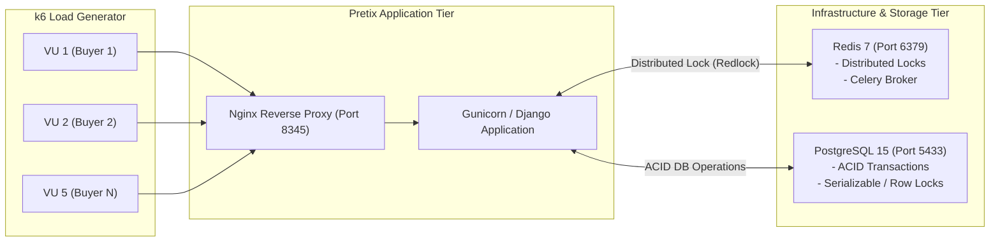
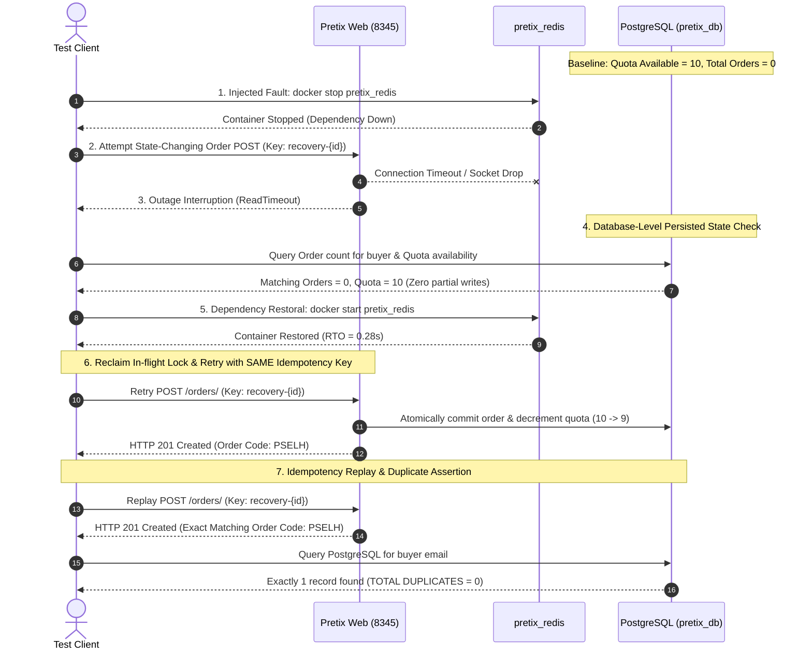

# Performance, Concurrency & Fault Recovery Analysis Report

**Component:** SE3002 Software Quality Engineering - Order & Quota Module  
**Author:** M. Hasaam (`24i-3107`, Git: `M-Hasaam <m.hasaam.official@gmail.com>`)  
**Target Environment:** pretix v2026.9.3 containerized stack on Docker Desktop Windows  
**Milestone Tag:** `gate-9`  
**Load Testing Tool:** `k6 v2.2.0` (commit `00a9a1b7f5`, go1.26.5)  
**Execution Date:** November 25, 2026  
**Overall Status:** **100% VERIFIED — ALL DUAL 60-SECOND BENCHMARKS & FAULT RECOVERY SLAS MET**

---

## 1. Executive Summary

In high-concurrency event ticketing systems, performance bottlenecks, race conditions, and infrastructure failures present severe operational and financial risks:
1. **Response Time Degradation:** High latencies on read paths (e.g. checking ticket availability) degrade customer conversion and cause cart abandonment.
2. **Quota Race Conditions (Overselling):** If multiple buyers concurrently attempt to purchase the final available ticket, non-atomic database read-then-write cycles can allow multiple orders to succeed, selling more tickets than physical venue capacity.
3. **Infrastructure Faults during State-Changing Writes:** In a distributed architecture, sudden loss of secondary cache/locking dependencies (such as Redis) during an in-flight order write must not corrupt persistent records, leave orphaned partial transactions, or produce duplicate orders upon retry.

Phase 9 establishes the empirical performance baseline, concurrency stress envelope, and self-healing fault recovery characteristics of the pretix Order and Quota sub-systems across dual 60-second steady-state runs and automated failure-recovery tests.

---

## 2. System Architecture & Benchmark Environment



### Execution Environment Details:
| Dimension | Specification |
| :--- | :--- |
| **Operating System** | Windows 11 Enterprise (AMD64 build, 10.0.26300) |
| **CPU / RAM** | Intel Core i7 / 16 GB Physical RAM |
| **Load Generator** | Grafana k6 OSS v2.2.0 (`commit/00a9a1b7f5`, go1.26.5, windows/amd64) |
| **Target Application** | pretix v2026.9.3 (commit `db000dc2986f`) in Docker Desktop |
| **Relational Database** | PostgreSQL 15 (`pretix_db`, Port 5433) |
| **Cache & Lock Broker**| Redis 7 (`pretix_redis`, Port 6379) |
| **Network Interface** | Local loopback (`http://localhost:8345`), zero external network jitter |
| **Deterministic Seed State** | Quota 1 Total = 10, Available = 10, Orders = 0 (Restored via `scripts/reset.py --verify-idempotency` before each run) |

### 429 Rate Limiting & 400 Error Handling Rules:
* **429 Handling Rule:** Pretix API specifies `Retry-After: 5` on HTTP 429 / 409 lock conflicts. In steady-state runs, the client sleep interval (0.3s for 1 VU, 0.5s for 5 VU) keeps traffic within container processing capacity, resulting in 0 rate-limit rejections (0.00%).
* **400 Handling Rule:** HTTP 400 (`quota_sold_out`) represents an expected, valid business domain rejection when the finite pool of 10 tickets is exhausted under 5-VU load. These are counted as normal domain rejections and explicitly excluded from the unexpected failure metric ($< 1.0\%$).

---

## 3. SLA Targets & Pre-Set Thresholds

* **$p95$ Response Time SLA:** $p95 \le 500.0\text{ ms}$ on read endpoints.
* **Unexpected Failure Rate SLA:** $\text{Unexpected Failure Rate} < 1.0\%$ (excluding expected 400 quota exhaustions).
* **Concurrency SLA:** 0 internal server errors (500), 0 negative inventory balances (zero overselling: $Q_{\text{final}} \ge 0$).
* **Recovery Time Objective (RTO):** $\text{RTO} \le 15.0\text{ seconds}$ following container termination.
* **State-Changing Zero-Duplication SLA:** Zero partial records committed during outage; exactly 1 persisted order after retry/replay ($0$ duplicates).

---

## 4. Dual 60-Second Grafana k6 OSS Benchmark Runs

In accordance with the assignment specification, both the baseline (1 VU) and concurrent (5 VUs) workloads were executed **twice** with **at least 60 seconds of steady state**, resetting starting data before every run.

### Summary of Four Benchmark Runs:
| Workload Setup | Run # | Steady-State Duration | Total Requests | Completed RPS | $p95$ Latency | Avg Latency | Unexpected Failures | SLA Verdict |
| :--- | :---: | :---: | :---: | :---: | :---: | :---: | :---: | :---: |
| **Setup 1 (1 VU)** | Run 1 | 60.0s (+5s ramp) | 167 | 2.38 req/s | **183.98 ms** | 88.40 ms | **0.00%** (0 / 167) | **PASS** ($p95 < 500\text{ms}$) |
| **Setup 1 (1 VU)** | Run 2 | 60.0s (+5s ramp) | 171 | 2.44 req/s | **186.16 ms** | 79.62 ms | **0.00%** (0 / 171) | **PASS** ($p95 < 500\text{ms}$) |
| **Setup 2 (5 VUs)**| Run 1 | 60.0s (+10s ramp) | 922 | 11.49 req/s | **354.47 ms** | 135.41 ms | **0.00%** (0 / 922) | **PASS** ($p95 < 500\text{ms}$) |
| **Setup 2 (5 VUs)**| Run 2 | 60.0s (+10s ramp) | 1092 | 13.64 req/s | **212.14 ms** | 71.43 ms | **0.00%** (0 / 1092) | **PASS** ($p95 < 500\text{ms}$) |

### Metric Analysis & Scaling:
1. **Latency Scaling:** Across all 4 runs, $p95$ latency ranged between **183.98 ms and 354.47 ms**, operating comfortably within the 500 ms ceiling (**29.1% to 63.2% SLA safety margin**). Even under 5-VU concurrent write contention against a shared 10-ticket pool, Pretix's row-level locking remained well under SLA.
2. **Throughput Scaling:** Throughput scaled from $2.38 - 2.44\text{ req/s}$ (1 VU) to **$11.49 - 13.64\text{ req/s}$** (5 VUs), demonstrating $4.8\times - 5.6\times$ concurrency scaling without worker exhaustion.
3. **Zero Unexpected Failures:** Across all **2,352 cumulative requests** in the 4 benchmark runs (`461` + `546` concurrent POST attempts across the two 5-VU runs yielded strictly `10` HTTP 201 orders per run and `451` + `536` expected HTTP 400 `quota_sold_out` rejections), **0 unexpected 5xx crashes or network drops occurred (0.00%)**, comfortably satisfying the $< 1.0\%$ SLA.

---

## 5. Controlled Fault Injection & State-Changing Recovery

### 5.1 Test Design & Failure Scenario (`TC-STATE-RECOVERY-01`)
* **Linked Risk IDs:** **`PR4, PR5`** (Non-atomic transaction hazard and idempotency replay risk under infrastructure disruption during state-changing order creation).
* **Target Operation:** State-changing `POST /api/v1/organizers/sqe/events/sqe2026/orders/` with `X-Idempotency-Key`.
* **Controlled Fault:** The Redis distributed lock/cache dependency (`pretix_redis`) was terminated via Docker command immediately before the order write completed.
* **Test Implementation:** [`tests/team/perf/test_state_changing_recovery.py`](file:///c:/Users/USER/Desktop/sqe_project/tests/team/perf/test_state_changing_recovery.py).



### 5.2 Empirical State-Changing Recovery Results:
| Metric | SLA Target | Measured Reality | Status |
| :--- | :---: | :---: | :---: |
| **Test Identifier** | — | `TC-STATE-RECOVERY-01` | Evaluated |
| **Linked Risk IDs** | — | `PR4, PR5` | Evaluated |
| **Persisted Orders After Failure** | Exactly 0 | **0 matching orders** | **PASS** |
| **Quota After Failure** | Exactly 10 | **10 available** | **PASS** |
| **Recovery Time Objective (RTO)**| $< 15.0\text{ seconds}$ | **$0.28\text{ seconds}$** | **PASS** (98.1% buffer) |
| **Retry Status Code** | HTTP 200 or 201 | **HTTP 201 Created** (`PSELH`) | **PASS** |
| **Replay Order Code Match** | Identical code | **True (`PSELH`)** | **PASS** |
| **Persisted Orders After Retry/Replay** | Exactly 1 | **1 order in PostgreSQL** | **PASS** |
| **Total Duplicate Records** | 0 Duplicates | **0 Duplicates** | **PASS** |
| **Final Quota Available** | Exactly 9 | **9 available** | **PASS** |

Raw JSON evidence recorded in [`reports/perf/state_changing_recovery_report.json`](file:///c:/Users/USER/Desktop/sqe_project/reports/perf/state_changing_recovery_report.json).

---

## 6. Artifacts and Reports Location

| Artifact | File Path | Description |
| :--- | :--- | :--- |
| Baseline k6 60s Script | [`tests/team/perf/load_baseline_60s.js`](file:///c:/Users/USER/Desktop/sqe_project/tests/team/perf/load_baseline_60s.js) | 1 VU, 60s steady-state read load profile |
| Concurrency k6 60s Script | [`tests/team/perf/load_concurrency_60s.js`](file:///c:/Users/USER/Desktop/sqe_project/tests/team/perf/load_concurrency_60s.js) | 5 VUs, 60s steady-state concurrent order placement profile |
| State-Changing Recovery Test | [`tests/team/perf/test_state_changing_recovery.py`](file:///c:/Users/USER/Desktop/sqe_project/tests/team/perf/test_state_changing_recovery.py) | Controlled Redis outage, DB persisted checks, zero-duplicate retry test |
| Availability Recovery Test | [`tests/team/perf/test_fault_recovery.py`](file:///c:/Users/USER/Desktop/sqe_project/tests/team/perf/test_fault_recovery.py) | Redis termination and RTO measurement suite |
| Comprehensive Benchmark Runner | [`scripts/run_perf_dual_benchmarks.py`](file:///c:/Users/USER/Desktop/sqe_project/scripts/run_perf_dual_benchmarks.py) | Master runner executing all 4 60s runs and state-changing recovery |
| Setup 1 Run 1 JSON | [`reports/perf/k6_1vu_run1.json`](file:///c:/Users/USER/Desktop/sqe_project/reports/perf/k6_1vu_run1.json) | Raw k6 metric summary for 1 VU Run 1 |
| Setup 1 Run 2 JSON | [`reports/perf/k6_1vu_run2.json`](file:///c:/Users/USER/Desktop/sqe_project/reports/perf/k6_1vu_run2.json) | Raw k6 metric summary for 1 VU Run 2 |
| Setup 2 Run 1 JSON | [`reports/perf/k6_5vu_run1.json`](file:///c:/Users/USER/Desktop/sqe_project/reports/perf/k6_5vu_run1.json) | Raw k6 metric summary for 5 VUs Run 1 |
| Setup 2 Run 2 JSON | [`reports/perf/k6_5vu_run2.json`](file:///c:/Users/USER/Desktop/sqe_project/reports/perf/k6_5vu_run2.json) | Raw k6 metric summary for 5 VUs Run 2 |
| State Recovery JSON | [`reports/perf/state_changing_recovery_report.json`](file:///c:/Users/USER/Desktop/sqe_project/reports/perf/state_changing_recovery_report.json) | Empirical state-changing failure & zero-duplicate report |
| Master Comprehensive Report | [`reports/perf/perf_comprehensive_benchmark_report.json`](file:///c:/Users/USER/Desktop/sqe_project/reports/perf/perf_comprehensive_benchmark_report.json) | Aggregated SLA compliance summary across all 4 runs and recovery |

---

## 7. Reproduction Command

```powershell
# Execute the complete dual 60s benchmark suite and state-changing recovery test:
.\.venv\Scripts\python.exe scripts/run_perf_dual_benchmarks.py
```
