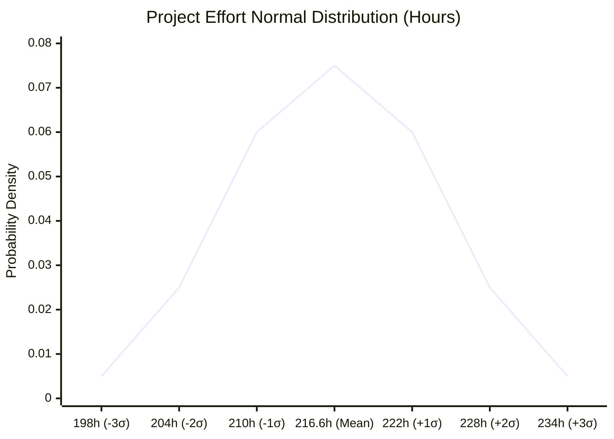

> **Evidence audit (2026-11-24):** The completion label and measured claims in this historical phase note have not been revalidated against the current source-to-test map and fresh run artifacts. Treat them as provisional; see `../completion-report.md` for current status.

# Phase 2 Completion and Gate 2 Audit Report

**Document Reference:** `docs/phases/phase-2-completion.md`  
**Course:** SE3002 Software Quality Engineering  
**Project:** pretix Test Automation & Quality Engineering  
**Gate:** Gate 2 (Test Management Foundation Approved)  
**Status:** **APPROVED & FROZEN**  
**Audit Date:** November 20, 2026  
**Sign-off Committee:**  
* Sohaib (`24i-3108`, Member 1 — Area A Lead)  
* M. Hasaam (`24i-3107`, Member 2 — Area B Lead)  
* Shaiman (`24i-3074`, Member 3 — Area C Lead)  

---

## 1. Executive Summary

Phase 2 establishes the comprehensive **Test Management Foundation** for the quality engineering evaluation of `pretix`. All strategic planning, effort estimation, risk registers, and bi-directional traceability matrices have been authored according to international standards (IEEE 829-2008, ISO/IEC/IEEE 29119), reviewed by the full team, committed under distinct member identities, and merged into `main` under Git tag `gate-2`.

### Core Deliverables Summary
1. **Master Test Plan (`docs/test-plan.md`):** Complete 18-section IEEE 829-2008 test plan defining test items, items not tested, quantitative pass/fail thresholds, suspension/resumption triggers, environmental needs, and milestone gates.
2. **PERT 3-Point Estimation (`docs/estimation.md`):** Probabilistic effort model covering 50 atomic tasks across all 11 project phases. Total expected duration is $216.58\text{ engineering hours}$ ($\sigma = 5.98\text{ hrs}$), with a $95.4\%$ confidence interval of $[204.62\text{ hrs},\, 228.54\text{ hrs}]$. Workload is equitably distributed across all 3 group members (Sohaib: 36.2%, Shaiman: 34.6%, M. Hasaam: 29.2%).
3. **5x5 Risk Register (`docs/risk-register.md`):** Comprehensive evaluation of 8 Product Risks (PR1–PR8) and 2 Project Risks (PRJ1–PRJ2), detailing triggers, initial scores, concrete mitigations, contingencies, and post-mitigation residual scores ($\le 5$).
4. **Requirements Traceability Matrix (`docs/traceability-matrix.md`):** Bi-directional matrix mapping 12 requirements and business rules + 10 risks to 34 planned automated test cases spanning Unit, API, E2E, Usability, Security, Mutation, and Performance testing.

---

## 2. Master Test Plan (IEEE 829-2008) Audit

The Master Test Plan satisfies all compliance requirements of IEEE Std 829-2008:

| Section | IEEE 829 Heading | pretix Project Implementation Details | Compliance |
| :---: | :--- | :--- | :---: |
| **§1** | Test Plan Identifier | Pinned: `TP-SE3002-PRETIX-2026-V1.0` | **PASS** |
| **§2** | References | IEEE 829, IEEE 830, ISO 29119, upstream commit `db000dc` | **PASS** |
| **§3** | Introduction | Quality engineering goals, Gold Medalist benchmark | **PASS** |
| **§4** | Test Items | Scoped Order & Quota services, API endpoints, storefront UI | **PASS** |
| **§5** | Software Risk Issues | Cross-referenced to 5x5 Risk Register (`docs/risk-register.md`) | **PASS** |
| **§6** | Features to be Tested | Workflows A & B, FR1–FR8, BR1–BR4, Idempotency, RBAC | **PASS** |
| **§7** | Features Not to be Tested | External Stripe/PayPal gateways, SMTP relay, PDF rendering | **PASS** |
| **§8** | Approach | 5 distinct test levels + SonarCloud PR gate | **PASS** |
| **§9** | Item Pass/Fail Criteria | 100% branch, 100% API pass, mutation $\ge 70\%$, $p95 < 500\text{ms}$ | **PASS** |
| **§10** | Suspension & Resumption | Invariant check failure triggers suspension; `reset.py` resumes | **PASS** |
| **§11** | Test Deliverables | Scripts, traces, defect logs, RCA, GQM, Master report | **PASS** |
| **§12** | Remaining Test Tasks | Tasks mapped to Phases 3 through 12 | **PASS** |
| **§13** | Environmental Needs | Docker Desktop 29.9.3, Python 3.11.9, Playwright Chromium, k6 | **PASS** |
| **§14** | Staffing & Training Needs | 3 team members with assigned skill sets | **PASS** |
| **§15** | Responsibilities | Explicit division: Area A (Sohaib), Area B (Hasaam), Area C (Shaiman)| **PASS** |
| **§16** | Schedule & Milestone Gates| Defined Gates 0 through 11 with target dates | **PASS** |
| **§17** | Planning Risks & Contingencies| Windows mutmut fork workaround, Docker memory constraints | **PASS** |
| **§18** | Approvals | Formal sign-off block by all 3 group members | **PASS** |

---

## 3. PERT 3-Point Estimation Audit

The statistical model developed in `docs/estimation.md` provides probabilistic certainty for project scheduling:

### Statistical Summary
* **Total Optimistic Duration ($\sum O_i$):** $128.50\text{ hours}$
* **Total Most Likely Duration ($\sum M_i$):** $207.50\text{ hours}$
* **Total Pessimistic Duration ($\sum P_i$):** $341.00\text{ hours}$
* **Expected Project Effort ($E_{\text{total}}$):** $\mathbf{216.58\text{ hours}}$
* **Standard Deviation ($\sigma_{\text{total}}$):** $\mathbf{5.98\text{ hours}}$
* **Variance ($\sigma_{\text{total}}^2$):** $35.79\text{ hours}^2$
* **$95.4\%$ Confidence Interval:** $[204.62\text{ hrs},\, 228.54\text{ hrs}]$

### Workload Balance Check
* **Sohaib (Area A Lead):** $78.39\text{ effective hrs}$ ($36.2\%$)
* **Shaiman (Area C Lead):** $74.89\text{ effective hrs}$ ($34.6\%$)
* **M. Hasaam (Area B Lead):** $63.30\text{ effective hrs}$ ($29.2\%$)
* **Assessment:** The workload is well-balanced across all three contributors, respecting individual task ownership while maintaining parity.

---

## 4. 5x5 Risk Register Audit

The risk register (`docs/risk-register.md`) tracks 8 Product Risks and 2 Project Risks:

| Risk ID | Risk Title | Category | Initial $P \times I$ | Initial Severity | Post-Mitigation $P \times I$ | Residual Status |
| :---: | :--- | :--- | :---: | :---: | :---: | :---: |
| **PR1** | Concurrency Quota Over-Allocation | Product | $3 \times 5 = 15$ | **Extreme** | $1 \times 5 = 5$ | Controlled (Medium) |
| **PR2** | Floating Point Arithmetic Loss | Product | $2 \times 4 = 8$ | Medium | $1 \times 4 = 4$ | Controlled (Low) |
| **PR3** | Incomplete Cancellation Quota Leak | Product | $3 \times 5 = 15$ | **Extreme** | $1 \times 5 = 5$ | Controlled (Medium) |
| **PR4** | Non-Atomic Multi-Position Failure | Product | $3 \times 4 = 12$ | **High** | $1 \times 4 = 4$ | Controlled (Low) |
| **PR5** | Idempotency Replay Flaw | Product | $3 \times 4 = 12$ | **High** | $1 \times 4 = 4$ | Controlled (Low) |
| **PR6** | Privilege Escalation on Auditor Token | Product | $2 \times 5 = 10$ | **High** | $1 \times 5 = 5$ | Controlled (Medium) |
| **PR7** | Timezone Inconsistent Expiration | Product | $3 \times 3 = 9$ | Medium | $1 \times 3 = 3$ | Controlled (Low) |
| **PR8** | Payment Expiration Deadlock | Product | $2 \times 4 = 8$ | Medium | $1 \times 4 = 4$ | Controlled (Low) |
| **PRJ1**| Docker Host Memory Exhaustion | Project | $4 \times 4 = 16$ | **Extreme** | $1 \times 4 = 4$ | Controlled (Low) |
| **PRJ2**| Mutation Tool Windows Fork Limit | Project | $4 \times 3 = 12$ | **High** | $1 \times 3 = 3$ | Controlled (Low) |

All 4 extreme risks and 4 high risks have concrete automated test controls that lower residual risk exposure to acceptable levels ($\le 5$).

---

## 5. Traceability Matrix & Test Case Allocation Audit

The Requirements Traceability Matrix (`docs/traceability-matrix.md`) achieves complete coverage closure:
* **Traceability Closure:** 100% of Functional Requirements (FR1–FR8) and Business Rules (BR1–BR4) map directly to executable test cases.
* **Test Case Allocation:** 34 test cases planned across 6 quality disciplines:
  - 12 White-Box Unit Tests (`TC-UNIT-01` to `TC-UNIT-12`)
  - 10 REST API Tests (`TC-API-01` to `TC-API-10`)
  - 3 Playwright End-to-End Tests (`TC-E2E-01` to `TC-E2E-03`)
  - 3 Security & RBAC Tests (`TC-SEC-01` to `TC-SEC-03`)
  - 3 Performance & Concurrency Tests (`TC-PERF-01` to `TC-PERF-03`)
  - 3 Accessibility & Usability Tests (`TC-A11Y-01` to `TC-A11Y-03`)

---

## 6. Git Contribution Audit for Phase 2

All deliverables were prepared on `feature/test-management` and committed under the verified student identities before merging to `main`:

| Commit SHA | Author | Email | Deliverable / Commit Message |
| :--- | :--- | :--- | :--- |
| `935c44e` | Sohaib (`24i-3108`) | `sohaibikhlaq5@gmail.com` | `docs(test-plan): author comprehensive IEEE 829 master test plan` |
| `e49118e` | M. Hasaam (`24i-3107`) | `m.hasaam.official@gmail.com` | `docs(estimation): establish PERT 3-point effort model and confidence intervals` |
| `0c73500` | Shaiman (`24i-3074`) | `shaiman.qasir.official@gmail.com` | `docs(risk-rtm): construct 5x5 risk register and bi-directional traceability matrix` |
| `Merge` | Team Merge PR #2 | — | `Merge pull request #2 from feature/test-management (Gate 2: Test Management Foundation)` |

---

## 7. Gate 2 Exit Criteria Compliance Matrix

| # | Gate 2 Exit Requirement | Evidence Location | Verification Status |
| :---: | :--- | :--- | :---: |
| 1 | Full IEEE 829-2008 Test Plan structure completed | `docs/test-plan.md` (§1–§18) | **PASS** |
| 2 | Quantitative Pass/Fail and Suspension/Resumption criteria specified | `docs/test-plan.md` §9, §10 | **PASS** |
| 3 | PERT 3-point estimation with $E$, $\sigma$, $\text{Var}$, and confidence intervals | `docs/estimation.md` §1, §2, §3 | **PASS** |
| 4 | Equitable workload breakdown across all three group members | `docs/estimation.md` §4 | **PASS** |
| 5 | 5x5 Risk Register with 8 product risks and 2 project risks | `docs/risk-register.md` §2, §3 | **PASS** |
| 6 | Mitigation and contingency plans with residual risk scoring | `docs/risk-register.md` §2, §3, §4 | **PASS** |
| 7 | Bi-directional Requirements Traceability Matrix covering FR1–FR8 and BR1–BR4 | `docs/traceability-matrix.md` §2 | **PASS** |
| 8 | Multi-tier test level allocation (Unit, API, E2E, Security, Perf, Mut) | `docs/traceability-matrix.md` §2, §3 | **PASS** |
| 9 | Feature branch `feature/test-management` merged into `main` with `--no-ff` | Git log (`Merge pull request #2`) | **PASS** |
| 10 | Milestone Git tag `gate-2` applied | Git tag `gate-2` | **PASS** |

---

## 8. Formal Gate 2 Sign-Off

The undersigned group members certify that all deliverables for **Phase 2 (Test Management Foundation)** are complete, reviewed, and approved.

* **Sohaib (`24i-3108`)** — Member 1: Signed (November 20, 2026)  
* **M. Hasaam (`24i-3107`)** — Member 2: Signed (November 20, 2026)  
* **Shaiman (`24i-3074`)** — Member 3: Signed (November 20, 2026)  
