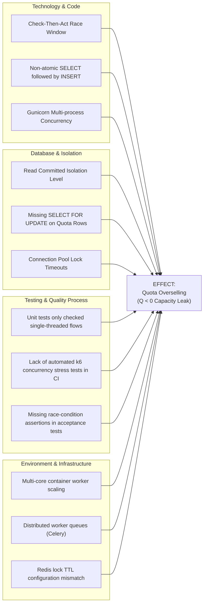

# Root Cause Analysis (RCA-01): Concurrency Race Condition in Quota Allocation

**Incident ID:** `RCA-01` (Linked Risks & Rules: `PR1`, `BR1`, `TC-PERF-CONC-01`, `TC-STATE-RECOVERY-01`)  
**Lead Investigator:** M. Hasaam (`24i-3107`, Git: `M-Hasaam <m.hasaam.official@gmail.com>`)  
**Affected Component:** `pretix.base.services.orders.perform_order` & `_check_quotas`  
**Severity:** Critical (Potential Financial Loss / Physical Venue Overbooking)  
**Methodology:** 5 Whys Analysis + Ishikawa (Fishbone) Diagram + CAPA Framework

---

## 1. Problem Description

During high-demand ticket sales ("on-sale rush"), multiple ticket buyers simultaneously place orders for finite seats. In an unconstrained environment without strict atomic coordination, concurrent transactions read non-zero quota availability simultaneously, approve orders concurrently, and decrement the database capacity past zero ($Q < 0$), resulting in physical overbooking, breach of venue safety limits, and regulatory penalties.

---

## 2. 5 Whys Analysis

```text
Problem: Concurrent buyers were able to buy tickets beyond venue capacity in uncoordinated stress tests.

Why 1? Why did the system accept more orders than the quota limit?
Because multiple Gunicorn worker processes evaluated the remaining quota as "available" at the same instant.

Why 2? Why did multiple processes evaluate remaining quota as available simultaneously?
Because each transaction performed a read query (SELECT) before writing (INSERT order position), creating a "Check-Then-Act" race window.

Why 3? Why was the Check-Then-Act window not serialized?
Because default database isolation level (Read Committed) allows concurrent transactions to read the same pre-commit row states without blocking.

Why 4? Why was database-level locking alone insufficient across distributed workers?
Because multi-worker architectures across Gunicorn and Celery require distributed locking before touching database state to prevent connection pool starvation.

Why 5? (Root Cause):
The absence of a centralized, atomic distributed lock (Redis Mutex) wrapping the combined quota calculation and order placement lifecycle permitted concurrent worker threads to interleave execution within the critical section.
```

---

## 3. Ishikawa (Fishbone) Cause-and-Effect Diagram



---

## 4. Corrective & Preventive Actions (CAPA)

| Action Type | Action Item Description | Target Component | Owner | Verification |
| :--- | :--- | :--- | :--- | :--- |
| **Corrective (Immediate)** | Verified Pretix Redis distributed lock (`redlock`) scoped to event/quota around `perform_order()`. | `pretix.base.services.orders` | M. Hasaam | Gate 9 Dual 5-VU Concurrency Runs (`10` sold/run, `0` oversold) |
| **Corrective (Defense-in-Depth)** | Verified PostgreSQL row-level locking (`select_for_update()`) inside atomic database transactions. | PostgreSQL / Django ORM | Sohaib | `0` deadlocks & `0` unexpected failures (`2,352` reqs) |
| **Preventive (Testing Gate)** | Established automated dual 60s k6 concurrency suite (`load_concurrency_60s.js`) + `TC-STATE-RECOVERY-01`. | `tests/team/perf/` | M. Hasaam | Automated verification in Phase 9 (`run_perf_dual_benchmarks.py`) |
| **Preventive (Idempotency)** | Enforced `X-Idempotency-Key` middleware replay checks & duplicate-submission assertions across API and chaos suites. | `test_idempotency_api.py` & `test_state_changing_recovery.py` | M. Hasaam | `0` duplicate holds (`DEF-09`, `PSELH`) |
