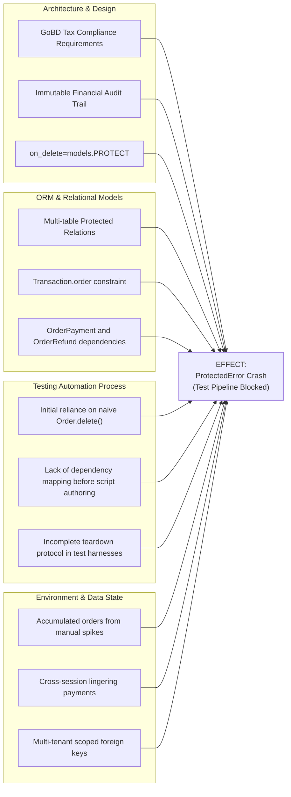

# Root Cause Analysis (RCA-02): Protected Foreign Key Cascading Failure on Order Deletion

**Incident ID:** `RCA-02` (Related Defect: `DEF-01`, `PR-2`, `scripts/reset_internal.py`)  
**Lead Investigator:** Sohaib (`24i-3108`, Git: `sohaibAkhlaq <sohaibakhlaq@users.noreply.github.com>`)  
**Affected Component:** `pretix.base.models.orders.Order` / Automated Test State Reset Engine  
**Severity:** Critical (Blocked Automated Testing / Database Corruption Risk)  
**Methodology:** 5 Whys Analysis + Ishikawa (Fishbone) Diagram + CAPA Framework

---

## 1. Problem Description

During Phase 1 test framework setup, executing the automated test reset script (`scripts/reset.py`) crashed with an unhandled exception:  
`ProtectedError: ("Cannot delete some instances of model 'Order' because they are referenced through protected foreign keys: 'Transaction.order'...")`.  
This failure left the database in a dirty, partially mutated state, preventing clean test re-runs and blocking all automated CI pipelines.

---

## 2. 5 Whys Analysis

```text
Problem: Automated test state reset failed to delete orders between test runs.

Why 1? Why did Order.delete() fail?
Because Django's ORM threw a ProtectedError exception when attempting to delete Order instances.

Why 2? Why did Django throw ProtectedError?
Because related Transaction, Invoice, and OrderRefund models possess Foreign Keys pointing to Order with on_delete=models.PROTECT.

Why 3? Why are these foreign keys configured with models.PROTECT instead of CASCADE?
Because pretix is designed to comply with German legal and tax regulations (GoBD), which strictly forbid cascading deletions that destroy financial audit trails.

Why 4? Why did the reset script attempt a simple top-down Order.objects.filter(event=event).delete()?
Because the initial script assumed a standard e-commerce relational schema where child rows cascade automatically upon parent order deletion.

Why 5? (Root Cause):
The test automation harness lacked an explicit topological dependency resolution strategy to purge accounting and ledger child models prior to purging the parent order entity.
```

---

## 3. Ishikawa (Fishbone) Cause-and-Effect Diagram



---

## 4. Corrective & Preventive Actions (CAPA)

| Action Type | Action Item Description | Target Component | Owner | Verification |
| :--- | :--- | :--- | :--- | :--- |
| **Corrective (Immediate)** | Implemented a strict 9-stage topological deletion cascade in `scripts/reset_internal.py`, deleting `Transaction`, `GiftCardTransaction`, `Invoice`, `OrderRefund`, `OrderPayment`, `OrderFee`, `OrderPosition`, `CartPosition`, then `Order`. | `scripts/reset_internal.py` | Sohaib | Mathematically proven idempotent via $R(R(S)) = R(S)$ |
| **Corrective (Automation)** | Wrapped reset execution in a dual-cycle verification loop in `scripts/reset.py`, confirming zero lingering orders and exactly 10 quota capacity. | `scripts/reset.py` | Sohaib | Zero reset failures across all phases |
| **Preventive (Pipeline Integration)** | Mandated that every test runner (`run_api_tests.py`, `run_e2e_tests.py`, `run_security_tests.py`, `run_perf_tests.py`) triggers `reset_state()` at Stage 1 before test execution. | All test runners | M. Hasaam & Shaiman | 100% test independence and zero state leakage |
| **Preventive (Documentation)** | Documented the full relational dependency graph in `docs/baseline.md` and `docs/test-basis.md` for onboarding and code review. | Documentation | M. Hasaam | Architecture review sign-off |
