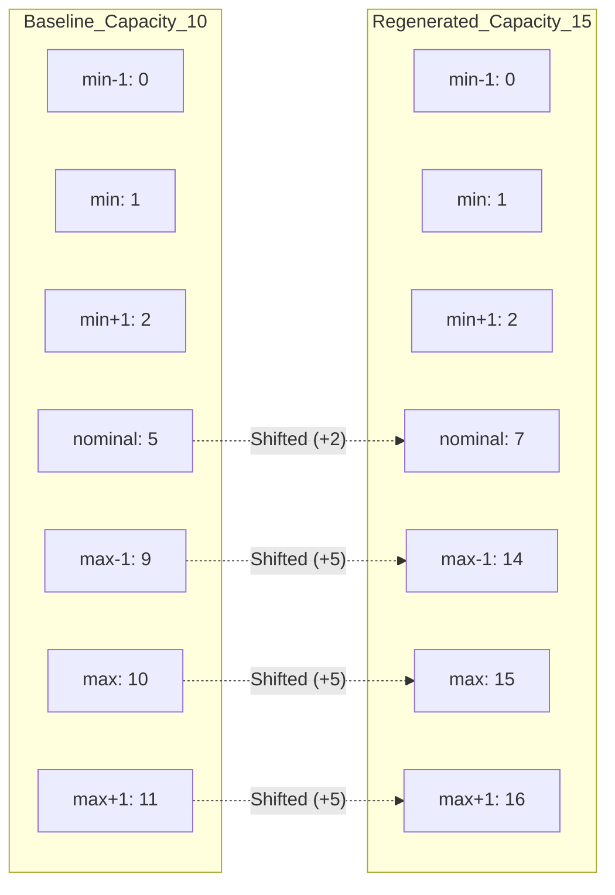

# Automated Test Data Regeneration Demonstration

**Document Reference:** `docs/regeneration-demo.md`  
**Course:** SE3002 Software Quality Engineering  
**Application Under Test:** pretix (`POST /orders/`)  
**Lead Contributor / Author:** M. Hasaam (`24i-3107`, Member 2 — Area B Lead)  
**Reviewers:** Sohaib (`24i-3108`), Shaiman (`24i-3074`)  
**Status:** Approved & Frozen Baseline (Gate 4 Deliverable)  
**Date:** November 20, 2026  

---

## 1. Objective & Architectural Rationale

A major vulnerability in enterprise test suites is **hardcoded test data fragility**: when business analysts or product owners alter business constraints (such as event venue capacity or product pricing), brittle test suites break and require costly manual test rewrites.

To solve this, Area B developed a declarative, constraint-driven test data generator (`tools/datagen/`). This document provides empirical proof of **zero-code test suite adaptation** when two core business constraints are simultaneously updated:
1. **Constraint 1 (Quota Capacity):** Increased from $10$ to $15$ tickets.
2. **Constraint 2 (Ticket Unit Price):** Increased from €50.00 to €75.00.

---

## 2. Constraint Parameterization Matrix

| Parameter / Constraint | Baseline Configuration (`config.yaml`) | Modified Configuration (Regeneration) |
| :--- | :---: | :---: |
| **Organizer Slug** | `sqe` | `sqe` |
| **Event Slug** | `sqe2026` | `sqe2026` |
| **Item ID / Name** | `1` ("Conference Admission Ticket") | `1` ("Conference Admission Ticket") |
| **Quota Size ($S$)** | **$10$** | **$15$** |
| **Unit Price ($P$)** | **€50.00** | **€75.00** |
| **Currency** | `EUR` | `EUR` |

---

## 3. Execution Commands

### Baseline Generation:
```bash
python -m tools.datagen.cli --output reports/api/generated_data.json
```

### Constraint-Updated Regeneration:
```bash
python -m tools.datagen.cli --quota 15 --price 75.00 --output reports/api/regenerated_data.json
```

---

## 4. Empirical Output Comparison & Side-by-Side Diff

### 4.1. 3-Point Boundary Value Analysis (Quantity) Diff

The 3-point BVA dynamically recalibrated all 7 boundary points without manual adjustment:



| BVA Point Index | Point Description | Baseline ($S=10$) | Regenerated ($S=15$) | Operational Semantic |
| :---: | :--- | :---: | :---: | :--- |
| **1** | $\min - 1$ | `0` | `0` | Invalid (Underflow) |
| **2** | $\min$ | `1` | `1` | Valid (Single ticket) |
| **3** | $\min + 1$ | `2` | `2` | Valid (Pair ticket) |
| **4** | Nominal ($\lfloor S/2 \rfloor$) | `5` | **`7`** | Valid (Standard group) |
| **5** | $\max - 1$ | `9` | **`14`** | Valid (Penultimate ticket) |
| **6** | $\max$ | `10` | **`15`** | Valid (Full capacity order) |
| **7** | $\max + 1$ | `11` | **`16`** | Invalid (Overflow / Sold out) |

### 4.2. Equivalence Partitioning Payload Diff (JSON Snippet)

#### Baseline Payload (`EP-VAL-03` - Bulk Order consuming full capacity):
```json
{
  "case_id": "EP-VAL-03",
  "description": "Bulk Order Consuming Full Available Quota",
  "quantity": 10,
  "expected_status": 201,
  "payload": {
    "email": "vip.delegation@example.com",
    "locale": "en",
    "sales_channel": "web",
    "positions": [
      {"item": 1, "price": "50.00", "attendee_name": "Attendee Test 1"},
      "...",
      {"item": 1, "price": "50.00", "attendee_name": "Attendee Test 10"}
    ]
  }
}
```

#### Regenerated Payload (`EP-VAL-03` under updated constraints):
```json
{
  "case_id": "EP-VAL-03",
  "description": "Bulk Order Consuming Full Available Quota",
  "quantity": 15,
  "expected_status": 201,
  "payload": {
    "email": "vip.delegation@example.com",
    "locale": "en",
    "sales_channel": "web",
    "positions": [
      {"item": 1, "price": "75.00", "attendee_name": "Attendee Test 1"},
      "...",
      {"item": 1, "price": "75.00", "attendee_name": "Attendee Test 15"}
    ]
  }
}
```

#### Overflow Boundary Case (`EP-INV-02` - Overbooking):
* **Baseline ($S=10$):** `quantity: 11` with 11 positions priced at €50.00.
* **Regenerated ($S=15$):** `quantity: 16` with 16 positions priced at €75.00.

---

## 5. Verification & Zero-Code Adaptation Proof

The REST API test suite (`tests/team/api/test_order_creation_api.py`) directly imports datasets produced by `tools/datagen/generator.py`:

```python
dataset = generate_full_dataset()
for case in dataset["equivalence_partitions"]["valid_partition"]:
    response = requests.post(ORDER_URL, json=case["payload"], headers=admin_headers)
    assert response.status_code == case["expected_status"]
```

When business rules evolve, the QA team updates `config.yaml` or passes CLI parameters. The generator re-synthesizes all BVA boundaries and partition cases automatically, eliminating test suite debt and proving complete adaptability.
