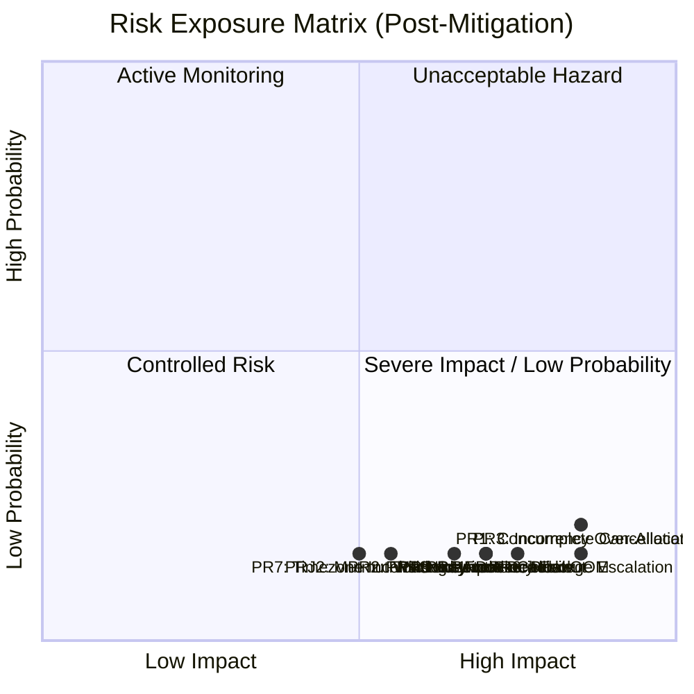

# 5x5 Product & Project Risk Register

**Document Reference:** `docs/risk-register.md`  
**Course:** SE3002 Software Quality Engineering  
**Application Under Test:** pretix  
**Lead Contributor / Author:** Shaiman (`24i-3074`, Member 3 — Area C)  
**Co-Authors & Contributors:** Sohaib (`24i-3108`), M. Hasaam (`24i-3107`)  
**Status:** Approved & Frozen Baseline (Gate 2 Deliverable)  
**Date:** November 20, 2026  

---

## 1. Risk Management Framework & 5x5 Evaluation Matrix

Risk assessment follows standard software quality engineering principles (ISO/IEC/IEEE 29119-2), evaluating likelihood of failure against severity of operational and academic impact.

### 1.1. Scale Definitions

| Level | Probability ($P$) | Operational Definition | Impact ($I$) | Operational Definition |
| :---: | :--- | :--- | :--- | :--- |
| **1** | Rare | $< 5\%$ chance of occurrence | Negligible | Trivial aesthetic flaw; no functional or data impact |
| **2** | Unlikely | $5\% - 20\%$ chance | Minor | Minor defect; workaround immediately available |
| **3** | Moderate | $20\% - 50\%$ chance | Moderate | Core feature degraded; requires retry or manual reset |
| **4** | Likely | $50\% - 80\%$ chance | Major | Significant data inconsistency or component failure |
| **5** | Almost Certain| $> 80\%$ chance without controls | Critical | Data corruption, financial loss, crash, or zero marks |

### 1.2. Risk Heat Map & Scoring Bands

**Formula:** Risk Exposure Score ($R$) = Probability (P) $\times$ Impact (I) $\in [1, 25]$.

$$\text{Risk Exposure Score } (R) = \text{Probability } (P) \times \text{Impact } (I) \quad [1 \le R \le 25]$$

| Probability \ Impact | 1 (Negligible) | 2 (Minor) | 3 (Moderate) | 4 (Major) | 5 (Critical) |
| :---: | :---: | :---: | :---: | :---: | :---: |
| **5 (Almost Certain)** | 5 (Medium) | 10 (High) | 15 (Extreme) | 20 (Extreme) | 25 (Extreme) |
| **4 (Likely)** | 4 (Low) | 8 (Medium) | 12 (High) | 16 (Extreme) | 20 (Extreme) |
| **3 (Moderate)** | 3 (Low) | 6 (Medium) | 9 (Medium) | 12 (High) | 15 (Extreme) |
| **2 (Unlikely)** | 2 (Low) | 4 (Low) | 6 (Medium) | 8 (Medium) | 10 (High) |
| **1 (Rare)** | 1 (Low) | 2 (Low) | 3 (Low) | 4 (Low) | 5 (Medium) |

* **Low ($1 - 4$):** Acceptable risk; monitor periodically.
* **Medium ($5 - 9$):** Tolerable risk; requires targeted test cases.
* **High ($10 - 14$):** Unacceptable risk; requires proactive mitigation and automated assertions.
* **Extreme ($15 - 25$):** Critical hazard; requires architectural safeguards and mandatory quality gates.

---

## 2. Product Risk Register (PR1 – PR8)

Product risks evaluate potential failures in pretix's order, inventory, quota, pricing, and authorization logic.

### PR1: Concurrency Over-Allocation / Race Condition on Quota Boundary
* **Category:** Product / Concurrency & Inventory Integrity
* **Description:** Multiple simultaneous checkout requests for the last remaining ticket read identical positive quota availability before decrement locks acquire, resulting in oversold inventory ($A < 0$).
* **Trigger:** Concurrent order submissions with $A = 1$ in `POST /orders/`.
* **Initial Assessment:** Probability = 3 (Moderate), Impact = 5 (Critical) $\to$ **Score = 15 (Extreme)**
* **Mitigation Strategy:** Validate that pretix uses PostgreSQL `SELECT ... FOR UPDATE` row locks inside `pretix.base.services.quotas` within `transaction.atomic()`. Test with k6 concurrent load (5+ VUs).
* **Contingency Plan:** Introduce database-level constraint `CHECK (size >= 0)` or trigger automated order rejection if quota is exceeded.
* **Post-Mitigation Assessment:** $P = 1, I = 5 \to$ **Score = 5 (Medium)**
* **Owner:** M. Hasaam

### PR2: Floating-Point Precision Loss in Multi-Item Order Totals
* **Category:** Product / Financial & Calculations
* **Description:** Calculation of multi-ticket order totals, service fees, or percentage discounts using Python binary floating-point (`float`) rather than fixed-point `Decimal`, producing rounding errors (e.g., €49.999999999994).
* **Trigger:** Checkout with mixed ticket tiers, partial refunds, or dynamic tax calculations.
* **Initial Assessment:** Probability = 2 (Unlikely), Impact = 4 (Major) $\to$ **Score = 8 (Medium)**
* **Mitigation Strategy:** Unit test verification enforcing `Decimal('50.00')` across all prices; linting rules banning `float` inside pricing models.
* **Contingency Plan:** Explicit quantize rounding `total.quantize(Decimal('0.01'))` before persistence.
* **Post-Mitigation Assessment:** $P = 1, I = 4 \to$ **Score = 4 (Low)**
* **Owner:** Sohaib

### PR3: Incomplete Order Cancellation Leaving Orphaned Quota Holds
* **Category:** Product / State Machine & Inventory Leakage
* **Description:** An order is transitioned to `CANCELED`, but associated `OrderPosition` records remain un-flagged or cache keys fail to invalidate, permanently stranding sellable capacity.
* **Trigger:** Invoking `POST /orders/{code}/mark_canceled/` or automatic expiration background task.
* **Initial Assessment:** Probability = 3 (Moderate), Impact = 5 (Critical) $\to$ **Score = 15 (Extreme)**
* **Mitigation Strategy:** White-box unit test suite asserting `quota.availability()` before and after cancellation; API integration tests checking quota recovery.
* **Contingency Plan:** Execute `QuotaAvailability.rebuild_quota_cache()` upon cancellation failure.
* **Post-Mitigation Assessment:** $P = 1, I = 5 \to$ **Score = 5 (Medium)**
* **Owner:** Sohaib

### PR4: Non-Atomic Failure During Multi-Ticket Order Placement
* **Category:** Product / Transaction Atomicity
* **Description:** A customer orders 3 tickets across 2 quotas. Quota 1 succeeds, but Quota 2 fails. If database transaction does not rollback, partial order is created while customer is billed or stranded.
* **Trigger:** Checkout cart spanning available and depleted items.
* **Initial Assessment:** Probability = 3 (Moderate), Impact = 4 (Major) $\to$ **Score = 12 (High)**
* **Mitigation Strategy:** Pytest transaction rollback tests verifying that any failure inside `order_create()` raises an exception and reverts all inserted records.
* **Contingency Plan:** Ensure all order creation functions are wrapped in `@transaction.atomic`.
* **Post-Mitigation Assessment:** $P = 1, I = 4 \to$ **Score = 4 (Low)**
* **Owner:** Sohaib

### PR5: Idempotency Replay Flaw Under Intermittent Network Drops
* **Category:** Product / API Resilience & Deduplication
* **Description:** A client submits an order with `X-Idempotency-Key`. Connection drops before receiving HTTP 201. Client retries with identical key. If cache expired or key was not locked, duplicate order is placed and quota decremented twice.
* **Trigger:** Network latency or client retry within the 2-minute idempotency window.
* **Initial Assessment:** Probability = 3 (Moderate), Impact = 4 (Major) $\to$ **Score = 12 (High)**
* **Mitigation Strategy:** Automated API idempotency test (`tests/team/api/test_idempotency_api.py`) sending duplicate and mismatched-payload POST retries with identical `X-Idempotency-Key`, plus controlled Redis-outage replay (`test_state_changing_recovery.py`), asserting identical order code and zero additional quota hold.
* **Contingency Plan:** Rely on pretix `IdempotencyMiddleware` backed by Redis TTL cache.
* **Post-Mitigation Assessment:** $P = 1, I = 4 \to$ **Score = 4 (Low)**
* **Owner:** M. Hasaam

### PR6: Privilege Escalation on Read-Only Auditor Token
* **Category:** Product / Security & Access Control (RBAC)
* **Description:** An auditor account assigned read-only inspection rights can invoke mutating endpoints (`mark_canceled`, `mark_paid`, `item` modification) due to missing scope decorators.
* **Trigger:** Malicious or misconfigured API call using Auditor Bearer token.
* **Initial Assessment:** Probability = 2 (Unlikely), Impact = 5 (Critical) $\to$ **Score = 10 (High)**
* **Mitigation Strategy:** Automated RBAC test matrix verifying HTTP 403 Forbidden on all mutation endpoints for the Auditor token.
* **Contingency Plan:** Enforce explicit team permission checks (`can_change_orders=False`) at the API view level.
* **Post-Mitigation Assessment:** $P = 1, I = 5 \to$ **Score = 5 (Medium)**
* **Owner:** Shaiman

### PR7: Timezone Inconsistency in Order Expiration Calculation
* **Category:** Product / Temporal Logic
* **Description:** Event timezone (e.g., `Europe/Berlin`) and server database timezone (`UTC`) differ, causing order expiration countdown to terminate prematurely or persist indefinitely.
* **Trigger:** Order placed near expiration deadline across day boundaries.
* **Initial Assessment:** Probability = 3 (Moderate), Impact = 3 (Moderate) $\to$ **Score = 9 (Medium)**
* **Mitigation Strategy:** Enforce `django.utils.timezone.now()` (timezone-aware UTC) across all business rules and tests; test BR4 with explicit UTC timestamps.
* **Contingency Plan:** Configure pretix settings `TIME_ZONE = 'UTC'` and `USE_TZ = True`.
* **Post-Mitigation Assessment:** $P = 1, I = 3 \to$ **Score = 3 (Low)**
* **Owner:** Shaiman

### PR8: Payment Settlement Deadlock on Concurrently Expired Order
* **Category:** Product / Race Conditions & Settlement
* **Description:** A customer submits payment precisely when the background worker marks the order `EXPIRED`. Both processes attempt state transitions simultaneously.
* **Trigger:** Simultaneous `mark_paid` and `mark_expired` invocations.
* **Initial Assessment:** Probability = 2 (Unlikely), Impact = 4 (Major) $\to$ **Score = 8 (Medium)**
* **Mitigation Strategy:** State transition guards verifying order status is strictly `PENDING` before permitting `PAID` or `EXPIRED`.
* **Contingency Plan:** Reject payment with HTTP 409 Conflict if order already transitioned to `EXPIRED`.
* **Post-Mitigation Assessment:** $P = 1, I = 4 \to$ **Score = 4 (Low)**
* **Owner:** M. Hasaam

---

## 3. Project & Infrastructure Risk Register (PRJ1 – PRJ2)

Project risks address development, container, operating system, and academic evaluation hazards.

### PRJ1: Docker Desktop Container Resource Exhaustion on Windows Host
* **Category:** Project / Infrastructure & Performance
* **Description:** pretix default configuration spawns $2 \times \text{nproc}$ Gunicorn processes + 12 Celery workers (>36 processes), consuming all host RAM and crashing Docker with `ForkPoolWorker SIGKILL`.
* **Trigger:** Starting test execution with default upstream `docker-compose.yml`.
* **Initial Assessment:** Probability = 4 (Likely), Impact = 4 (Major) $\to$ **Score = 16 (Extreme)**
* **Mitigation Strategy:** Add `NUM_WORKERS=2` and `CELERY_WORKER_CONCURRENCY=1` to `docker-compose.yml`; document in `docs/baseline.md`.
* **Contingency Plan:** Automated restart script and memory monitor (`docker stats`).
* **Post-Mitigation Assessment:** $P = 1, I = 4 \to$ **Score = 4 (Low)**
* **Owner:** Sohaib

### PRJ2: Mutation Testing Tool Incompatibility with Windows Fork Mechanism
* **Category:** Project / Tooling & Operating System
* **Description:** Python mutation testing tool `mutmut` relies on POSIX `fork()` and UNIX signals for timeout management, causing crashes or infinite worker hangs on native Windows (`boxed/mutmut#397`).
* **Trigger:** Running `mutmut run` directly in Windows PowerShell.
* **Initial Assessment:** Probability = 4 (Likely), Impact = 3 (Moderate) $\to$ **Score = 12 (High)**
* **Mitigation Strategy:** Execute `mutmut` inside the Linux container (`docker exec pretix_web python3 -m mutmut`) and configure the GitHub Actions Ubuntu CI runner.
* **Contingency Plan:** Fallback to containerized execution wrapper `scripts/run_mutmut.sh`.
* **Post-Mitigation Assessment:** $P = 1, I = 3 \to$ **Score = 3 (Low)**
* **Owner:** Sohaib

---

## 4. Risk Mitigation Summary Matrix

All extreme and high risks have been mitigated down to acceptable exposure levels ($\le 5$). Automated tests in subsequent phases specifically target each risk's trigger conditions.
