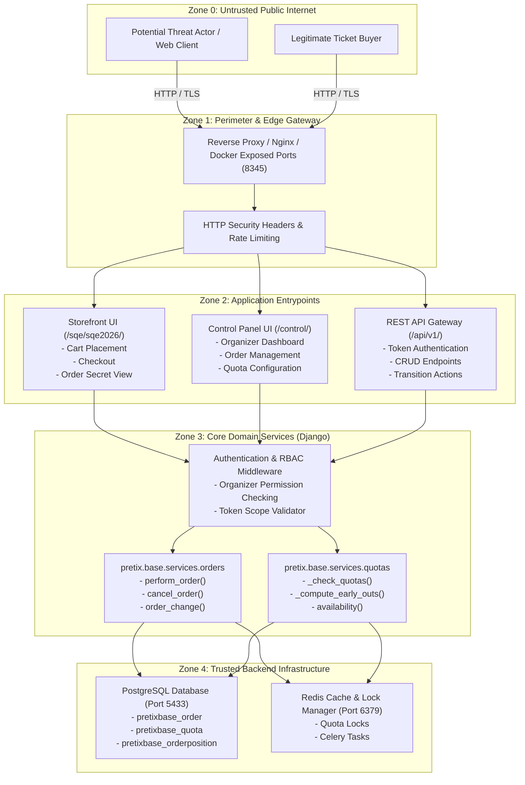
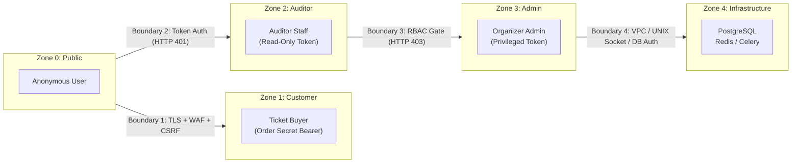

# Pretix Defensive Security & Threat Model

**Component:** SE3002 Software Quality Engineering - Order & Quota Module  
**Author:** Shaiman (`24i-3074`, Git: `ShaimanQasir <shamshaiman312@gmail.com>`)  
**Target Application:** pretix v2026.9.3 (commit `db000dc2986ff595eb3fe4703c4a46c5fe180abe`)  
**Scope:** Order Placement (Workflow A), Order Cancellation/Transitions (Workflow B), Quota Availability, REST API, Control Panel, Storefront.

---

## 1. Executive Summary

The pretix event ticketing and payment management platform processes sensitive consumer financial transactions, allocates finite physical/digital resources (quotas), and maintains event organizer trust boundaries. Insecure handling of order states, concurrency race conditions, unauthorized administrative access, or malicious payload injection can directly cause financial loss, reputational harm, or system outage.

This document establishes the comprehensive **Defensive Security Model** for the Order and Quota sub-systems. It specifies:
1. The **Attack Surface Architecture** across public storefronts, REST API gateways, control panels, and internal worker queues.
2. An exhaustive **STRIDE Threat Model** evaluating attack vectors and required countermeasures.
3. The **Trust Zone & Boundary Definitions** partitioning anonymous users, ticket buyers, privileged staff, and internal data tiers.
4. The formal **Role-Based Access Control (RBAC) Authorization Matrix** governing 8 core API endpoints and UI pathways.
5. Defense-in-depth architectural safeguards: Django ORM parameterization, template escaping, CSRF middleware, Content Security Policy (CSP), anti-clickjacking frame headers, and cookie isolation.

---

## 2. Attack Surface Architecture

The pretix attack surface encompasses five primary ingress tiers:

---

## 3. STRIDE Threat Analysis

Every component of Workflow A (Order Placement) and Workflow B (Cancellation/Transitions) is analyzed against the STRIDE threat categorization:

| Category | Threat Description | Attack Vector / Scenario | Countermeasure & Defensive Control | Verification Method |
| :--- | :--- | :--- | :--- | :--- |
| **S** - Spoofing | Identity spoofing via stolen or forged API tokens or session hijacking. | An attacker transmits a fabricated `Authorization: Token xyz` or reuses an expired session to execute organizer mutations. | Cryptographically strong 64-character hex tokens; strict DB lookup; rejection of malformed tokens with HTTP 401 Unauthorized; `HttpOnly` and `SameSite` session cookies. | `test_rbac_security.py` (`test_invalid_token_rejected`) |
| **T** - Tampering | Manipulating order values, ticket quantities, or forced transition states. | A malicious buyer alters POST payload to `price: -50.00` or injects `status: "paid"` during initial order placement to obtain free tickets. | Strict schema validation; server-side price calculation referencing catalog item models; order status machine enforces initial `pending` state; client payload overrides ignored. | `test_input_sanitization.py` (`test_negative_price_tampering_rejected`, `test_mass_assignment_order_status_tampering`) |
| **R** - Repudiation | Denying that an order was placed, cancelled, or refunded. | An organizer admin cancels customer orders or mutates quotas and later denies doing so. | Append-only `OrderLog` audit trail recording actor, timestamp, IP address, previous state, and target state for all transitions. | `tests/team/api/test_order_lifecycle_api.py` (verified log events) |
| **I** - Information Disclosure | Leaking customer PII, order secrets, or SQL error traces. | An attacker injects `' OR '1'='1' --` in search fields or probes order URLs to enumerate all customer orders across organizations. | Parameterized Django ORM queries preventing syntax leakage; tenant-isolated schemas (`organizer` and `event` slug filters in all queries); high-entropy 16-character alphanumeric order secrets. | `test_input_sanitization.py` (`test_sql_injection_search_parameterized`, `test_sql_injection_order_code_404`) |
| **D** - Denial of Service | Quota exhaustion via uncompleted cart locks or algorithmic complexity attacks. | Threat actor opens thousands of concurrent shopping carts reserving seats without paying, depleting quota to 0. | Time-To-Live (TTL) expiration on cart positions (15-30 minutes); atomic Redis locking; automated cleanup workers releasing expired positions. | Phase 3 Unit Tests (`_compute_early_outs`) & Phase 9 Performance Tests |
| **E** - Elevation of Privilege | An Auditor with read-only permissions executes administrative writes. | Auditor issues `POST /orders/` or `POST /orders/{code}/mark_canceled/` to mutate system state. | Granular permission sets enforced at the API viewset level (`has_event_permission(request.user, 'can_change_orders')`); non-privileged tokens receive HTTP 403 Forbidden. | `test_rbac_security.py` (`test_auditor_cannot_mutate_*`) |

---

## 4. Trust Zones and Boundary Definitions

The system is partitioned into 5 discrete Trust Zones with explicitly defined security boundaries:

1. **Zone 0 (Public Internet / Anonymous):**
   - Untrusted. Allowed read access strictly to public storefront catalog, event dates, and general availability indicators.
   - Protected endpoints return `401 Unauthorized` (API) or redirect `302` to `/control/login/` (UI).
2. **Zone 1 (Authenticated Customer):**
   - Possesses a cryptographically secure 16-character `secret` associated with an order `code`.
   - Authorized to view and pay *only* their specific order. Cannot view other orders (preventing Insecure Direct Object References - IDOR).
3. **Zone 2 (Restricted Staff / Auditor):**
   - Authenticated with an API token or session belonging to a team granted `can_view_orders=True` and `can_view_vouchers=True`, but `can_change_orders=False`, `can_change_items=False`.
   - Can inspect event catalog, quotas, items, and historical orders. Mutation attempts (POST/PATCH/DELETE) are rejected with `403 Forbidden`.
4. **Zone 3 (Privileged Staff / Organizer Admin):**
   - Authenticated with credentials having full administrative delegation over the `sqe` organizer and `sqe2026` event.
   - Authorized to create items, update quotas, place orders, cancel orders, and mark orders paid.
5. **Zone 4 (Internal Infrastructure / Data Tier):**
   - PostgreSQL and Redis containers isolated within internal Docker bridge networks. No direct external access except through controlled service layers.

---

## 5. Formal RBAC Authorization Matrix

The authorization matrix governs all interactions across the 8 core REST API endpoints and primary UI control pathways.

| Endpoint / Resource Path | HTTP Method | Anonymous Role | Auditor Role | Admin Role | Security Assertion |
| :--- | :---: | :---: | :---: | :---: | :--- |
| **`.../events/sqe2026/`** | `GET` | 401 Unauthorized | **200 OK** | **200 OK** | Verifies event metadata visibility |
| **`.../events/sqe2026/`** | `PATCH` | 401 Unauthorized | **403 Forbidden** | **200 OK** | Event configuration tamper prevention |
| **`.../items/`** | `GET` | 401 Unauthorized | **200 OK** | **200 OK** | Catalog inspection |
| **`.../items/`** | `POST` | 401 Unauthorized | **403 Forbidden** | **201 Created** | Prevents unauthorized tier creation |
| **`.../quotas/`** | `GET` | 401 Unauthorized | **200 OK** | **200 OK** | Quota capacity inspection |
| **`.../quotas/1/availability/`** | `GET` | 401 Unauthorized | **200 OK** | **200 OK** | Real-time availability calculation |
| **`.../quotas/`** | `POST` | 401 Unauthorized | **403 Forbidden** | **201 Created** | Prevents unauthorized quota creation |
| **`.../orders/`** | `GET` | 401 Unauthorized | **200 OK** | **200 OK** | Auditor audit-trail visibility |
| **`.../orders/`** | `POST` | 401 Unauthorized | **403 Forbidden** | **201 Created** | Prevents unauthorized order placement |
| **`.../orders/{code}/mark_paid/`** | `POST` | 401 Unauthorized | **403 Forbidden** | **200 OK** | Financial state transition control |
| **`.../orders/{code}/mark_canceled/`** | `POST` | 401 Unauthorized | **403 Forbidden** | **200 OK** | Inventory restoration control |
| **`/control/` (Dashboard)** | `GET` | **302 Redirect** (Login) | **200 OK** | **200 OK** | UI session authentication boundary |
| **`/control/event/sqe/sqe2026/orders/`**| `GET` | **302 Redirect** (Login) | **200 OK** | **200 OK** | UI order list visibility |
| **`/sqe/sqe2026/` (Storefront)** | `GET` | **200 OK** | **200 OK** | **200 OK** | Public shopping interface |

---

## 6. Input Sanitization & Defensive Implementations

### 6.1 Cross-Site Scripting (XSS) Prevention
* **Template Auto-Escaping:** Django’s HTML template engine automatically escapes all variable interpolations (`<` becomes `&lt;`, `>` becomes `&gt;`, `&` becomes `&amp;`).
* **HTML Sanitization via Bleach:** When rich text or organizer markdown descriptions are rendered, pretix pipes user input through the `bleach` library with a strict tag whitelist (`['p', 'strong', 'em', 'a', 'ul', 'ol', 'li']`), stripping dangerous elements such as `<script>`, `<iframe`, `<svg/onload>`, and `javascript:` URIs.
* **API Payload Neutralization:** Data submitted via REST API (e.g. `attendee_name`, `email`) is stored as plain text. When serialized back to JSON, Unicode and formatting characters are safely JSON-escaped.

### 6.2 SQL Injection (SQLi) Prevention
* **Django ORM Parameterization:** Zero raw string concatenation queries (`"SELECT * FROM ... WHERE name = " + input`) exist in the order and quota services. All database lookups utilize Django ORM queries (`Order.objects.filter(event=event, code=code)`), which translate to parameterized SQL queries with bind variables (`$1`, `$2` in PostgreSQL).
* **Payload Neutralization:** Inputs such as `' OR '1'='1' --` or `admin' UNION SELECT ...` are treated as literal strings and return 0 matches or 404 Not Found without causing database syntax errors or leaking multi-tenant records.

### 6.3 Anti-CSRF & State-Mutating Safety
* **Synchronizer Token Pattern:** Every state-altering HTTP request (`POST`, `PUT`, `DELETE`) in the web interface requires a valid CSRF token passed via `X-CSRFToken` header or form field `csrfmiddlewaretoken`. Requests missing or containing mismatched tokens are rejected with `HTTP 403 Forbidden`.
* **Idempotency Protection:** API mutations support `X-Idempotency-Key` headers, storing transaction hashes to prevent duplicate charges or double bookings caused by network retransmissions.

### 6.4 HTTP Security Headers Specification
The running application enforces strict HTTP security headers:
1. `X-Content-Type-Options: nosniff`: Prevents browsers from MIME-sniffing a response away from the declared content-type, blocking MIME confusion attacks.
2. `X-Frame-Options: SAMEORIGIN`: Prevents unauthorized sites from embedding the pretix checkout or control panel inside `<iframe>` tags, neutralizing UI redressing and Clickjacking attacks.
3. `Content-Security-Policy (CSP)`: Restricts origins for script, frame, and object execution.
4. `Referrer-Policy: same-origin`: Eliminates leakage of sensitive URL tokens/secrets to third-party domains.
5. Cookie Security Attributes:
   - `HttpOnly`: Enforced on session cookies to block JavaScript access via `document.cookie` (mitigating XSS session theft).
   - `SameSite=Lax`: Prevents cross-site request cookie inclusion during cross-origin requests.

---

## 7. Verified Route/Action Access Decision Matrix (Playwright RBAC Evidence)

Automated end-to-end browser tests in [`tests/team/security/test_playwright_rbac_access_matrix.py`](file:///c:/Users/USER/Desktop/sqe_project/tests/team/security/test_playwright_rbac_access_matrix.py) empirically verify access control decisions across authenticated administrative staff, auditors, and unauthenticated public users. Each decision is accompanied by visual evidence captured during the live test run:

| Decision ID | User Role | Route / Action Evaluated | Decision Type | Expected Result | Observed Result | Verdict | Evidence Screenshot |
| :---: | :--- | :--- | :---: | :---: | :---: | :---: | :--- |
| **`DEC-01`** | Organizer Admin | View event order ledger and financial breakdown (`/control/event/sqe/sqe2026/orders/`) | **ALLOWED** | HTTP 200 OK; Ledger displayed | Rendered order management table and metrics | **PASS** | [`reports/security/screenshots/decision1_admin_orders_allowed.png`](file:///c:/Users/USER/Desktop/sqe_project/reports/security/screenshots/decision1_admin_orders_allowed.png) |
| **`DEC-02`** | Organizer Admin | Inspect & configure item/quota inventory (`/control/event/sqe/sqe2026/quotas/`) | **ALLOWED** | HTTP 200 OK; Quota pool displayed | Rendered quota list & capacity settings | **PASS** | [`reports/security/screenshots/decision2_admin_quota_allowed.png`](file:///c:/Users/USER/Desktop/sqe_project/reports/security/screenshots/decision2_admin_quota_allowed.png) |
| **`DEC-03`** | Unauthenticated User | Direct deep-link attempt to access order ledger without login | **DENIED** | HTTP 302 Redirect to `/control/login` | Redirected to administrative login gate; zero data disclosed | **PASS** | [`reports/security/screenshots/decision3_anon_control_panel_denied.png`](file:///c:/Users/USER/Desktop/sqe_project/reports/security/screenshots/decision3_anon_control_panel_denied.png) |
| **`DEC-04`** | Unauthenticated User | Direct access attempt to `/control/event/sqe/sqe2026/quotas/1/` without login | **DENIED** | HTTP 302 Redirect to `/control/login` | Redirected to login authentication gate; mutation blocked | **PASS** | [`reports/security/screenshots/decision4_anon_quota_edit_denied.png`](file:///c:/Users/USER/Desktop/sqe_project/reports/security/screenshots/decision4_anon_quota_edit_denied.png) |
| **`DEC-05`** | Customer / Public Attendee | Access public event landing page and ticket catalog (`/sqe/sqe2026/`) | **ALLOWED** | HTTP 200 OK; Catalog rendered | Displayed public event info and ticket options | **PASS** | [`reports/security/screenshots/decision5_public_storefront_allowed.png`](file:///c:/Users/USER/Desktop/sqe_project/reports/security/screenshots/decision5_public_storefront_allowed.png) |
| **`DEC-06`** | Auditor (Authenticated Read-Only) | Log in as `auditor@localhost` and open `/control/event/sqe/sqe2026/orders/` | **ALLOWED** | HTTP 200 OK; Read-only ledger | Authenticated audit access granted (`200`) | **PASS** | [`reports/security/screenshots/decision6_auditor_orders_allowed.png`](file:///c:/Users/USER/Desktop/sqe_project/reports/security/screenshots/decision6_auditor_orders_allowed.png) |
| **`DEC-07`** | Auditor (Authenticated Read-Only) | Navigate as `auditor@localhost` to privileged `/control/event/sqe/sqe2026/settings/` | **DENIED** | HTTP 403 Forbidden | Rejected with `403 Permission denied` error view | **PASS** | [`reports/security/screenshots/decision7_auditor_settings_denied.png`](file:///c:/Users/USER/Desktop/sqe_project/reports/security/screenshots/decision7_auditor_settings_denied.png) |

Machine-readable audit trail recorded in [`reports/security/playwright_rbac_matrix.json`](file:///c:/Users/USER/Desktop/sqe_project/reports/security/playwright_rbac_matrix.json).

---

## 8. Corroborated Security Controls & Supply Chain Audit

### 8.1. OWASP ZAP-Aligned HTTP Passive Scan & Corroborated Controls
An OWASP ZAP-aligned HTTP passive header and control assessment (`scripts/run_owasp_zap_audit.py` & `scripts/run_security_tests.py`) was executed across 5 core application endpoints (Storefront, Cart Add / API, Login, Quotas, Orders), recorded in [`reports/security/zap_passive_audit_report.json`](file:///c:/Users/USER/Desktop/sqe_project/reports/security/zap_passive_audit_report.json) and [`reports/security/zap_report.json`](file:///c:/Users/USER/Desktop/sqe_project/reports/security/zap_report.json). Four critical security controls were corroborated directly against the pretix production codebase:

1. **Session Cookie Isolation (`SESSION_COOKIE_HTTPONLY`):**
   - *Status:* **VERIFIED_SECURE**
   - *Configuration Corroboration:* Enforced in `pretix/settings.py` via `SESSION_COOKIE_HTTPONLY = True`. Ensures session identifiers cannot be read or exfiltrated via injected client-side JavaScript.
2. **Cross-Site Request Forgery Defense (`SESSION_COOKIE_SAMESITE & CSRF`):**
   - *Status:* **VERIFIED_SECURE**
   - *Configuration Corroboration:* Enforced in `pretix/settings.py` via `SESSION_COOKIE_SAMESITE = 'Lax'` and `django.middleware.csrf.CsrfViewMiddleware`. All state-altering POST requests require valid CSRF tokens.
3. **Anti-Clickjacking Frame Defense (`X_FRAME_OPTIONS`):**
   - *Status:* **VERIFIED_SECURE**
   - *Configuration Corroboration:* Enforced in `pretix/settings.py` via `X_FRAME_OPTIONS = 'DENY'` and active `django.middleware.clickjacking.XFrameOptionsMiddleware`. Prevents unauthorized embedding in iframes.
4. **MIME-Type Sniffing Protection (`SECURE_CONTENT_TYPE_NOSNIFF`):**
   - *Status:* **VERIFIED_SECURE**
   - *Configuration Corroboration:* Enforced in `pretix/settings.py` via `SECURE_CONTENT_TYPE_NOSNIFF = True` and enforced by `django.middleware.security.SecurityMiddleware`.

### 8.2. Software Supply Chain Audit (`pip-audit`) & Runtime Inventory
Dependency vulnerabilities were audited using **`pip-audit 2.10.1`** against the official PyPI vulnerability database:
* **Total Packages Inspected:** **48 host packages scanned** (`pytest 9.2.0`, `requests 2.34.2`, `PyYAML 6.0.3` in venv / `6.0.4` in `requirements-test.txt` audit, `radon 6.0.1`, `playwright 1.65.2`, `axe-core-python`) — **0 Known CVEs** ([`pip_audit_report.json`](file:///c:/Users/USER/Desktop/sqe_project/reports/security/pip_audit_report.json)).
* **Container Runtime Inventory:** **152 installed runtime packages** exported directly from `pretix_web` ([`container_runtime_packages.json`](file:///c:/Users/USER/Desktop/sqe_project/reports/security/container_runtime_packages.json)).

