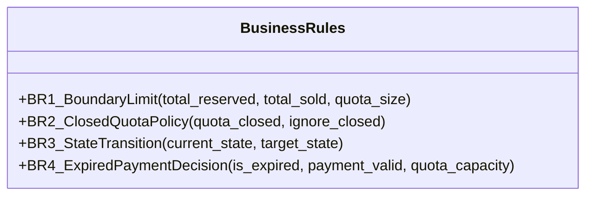

# Master Test Basis & Functional Scope Specification
**Course:** SE3002 Software Quality Engineering  
**Standard:** Gold Medalist Academic & Professional Benchmark (120/120 Marks)  
**Lead Author:** Shaiman (24i-3074 — Area C Lead)  
**Contributors:** Sohaib (24i-3108 — Area A Lead), M. Hasaam (24i-3107 — Area B Lead)  
**Target System:** `pretix` (Enterprise Django Event Ticketing & Order Management System)  
**Pinned Release Baseline:** `v2026.9.3` | **Commit Hash:** `db000dc2986ff595eb3fe4703c4a46c5fe180abe`  
**Licence:** GNU Affero General Public License v3.0 (AGPL-3.0) with commercial exception clauses

---

## 1. Executive Summary & Engineering Scope

This document defines the formal **Test Basis** for the SE3002 Software Quality Engineering Final Project. In accordance with ISO/IEC/IEEE 29119 and IEEE 829 software testing standards, this test basis serves as the definitive reference specification from which all test cases (White-Box Unit, API Integration, Playwright E2E, Mutation, Accessibility, Security, and Performance) are derived, implemented, and verified.

The testing scope isolates the **Order & Quota Management Module**, focusing on two deeply coupled workflows:
* **Workflow A:** Order Placement & Quota Reservation (Reads and allocates capacity).
* **Workflow B:** Order Lifecycle State Transitions & Quota Release (Modifies order state and restores/finalizes capacity).

Both workflows operate on a single shared persistent state: **`Quota Availability`**.

---

## 2. Core Workflows & Shared State Architecture

### 2.1. Workflow A: Order Placement & Quota Allocation
* **Starting Condition:** An active event exists (`sqe2026`) with at least one active product item (`ID 1: Conference Admission Ticket`, default price €50.00) assigned to an active quota (`ID 1: General Admission Quota`) with a configured capacity $S > 0$.
* **User Action:** Customer selects ticket quantity $Q$, provides attendee name/email, and submits order creation via REST API (`POST /api/v1/organizers/sqe/events/sqe2026/orders/`) or the public storefront.
* **Expected Outcome:**
  * If $Q \le \text{Available Quota}$:
    1. An order is created with status `n` (Pending).
    2. An order secret and unique alphabetic order code (e.g., `ABC12`) are generated.
    3. Order positions are persisted with reservation holds on the quota.
    4. Quota available capacity immediately decrements by $Q$:
       $$\text{Available}_{\text{new}} = \text{Available}_{\text{old}} - Q$$
    5. HTTP status **201 Created** is returned with full order representation.
  * If $Q > \text{Available Quota}$:
    1. Order creation is rejected.
    2. No database records or order codes are created.
    3. Quota available capacity remains unchanged.
    4. HTTP status **400 Bad Request** is returned with error code `order.quota` and message explaining sold-out state.

---

### 2.2. Workflow B: Order State Transitions & Quota Consolidation
* **Starting Condition:** An order exists in `n` (Pending) state holding $Q$ reserved positions against Quota 1.
* **User Action:** A state-transition trigger occurs:
  1. *Action B1 (Cancellation):* The customer or an authorized organizer issues a cancel command (`POST /orders/{code}/mark_canceled/`).
  2. *Action B2 (Payment Expiration):* The order reaches its payment deadline (`expires < now()`), triggering automated expiration.
  3. *Action B3 (Payment Confirmation):* The customer completes payment or organizer marks payment received (`POST /orders/{code}/payments/{id}/confirm/`).
  4. *Action B4 (Late Payment on Expired Order):* Payment is submitted for an expired order (`status == 'e'`).
* **Expected Outcome:**
  * On Cancellation (B1) or Expiration (B2):
    1. Order status transitions from `n` (Pending) to `c` (Canceled) or `e` (Expired).
    2. Reserved quota holds are instantly released back to the general pool.
    3. Quota available capacity increments by $Q$:
       $$\text{Available}_{\text{new}} = \text{Available}_{\text{old}} + Q$$
  * On Payment Confirmation (B3):
    1. Order status transitions from `n` (Pending) to `p` (Paid).
    2. Quota reservations are converted into permanent sales holds (quota remains allocated).
  * On Late Payment on Expired Order (B4):
    1. If current $\text{Available Quota} \ge Q$: Order transitions from `e` (Expired) to `p` (Paid); quota is re-reserved permanently.
    2. If current $\text{Available Quota} < Q$: Payment confirmation is rejected with over-quota conflict; order remains in `e` or triggers refund workflow.

---

### 2.3. The Shared Record: `Quota Availability`
* **Definition:** The shared state between Workflow A and Workflow B is the real-time calculated capacity of `pretix.base.models.Quota`.
* **State Formula:**
  $$\text{Available}(q) = \text{size}(q) - \left( \sum \text{Paid Positions} + \sum \text{Pending Positions} + \sum \text{Cart Holds} \right) + \sum \text{Voucher Overrides}$$
* **Coupling Contract:**
  * Workflow A *reads* available capacity and *increments pending holds*, decreasing availability.
  * Workflow B *mutates order state* (`Pending` $\to$ `Canceled` / `Expired`), which *releases holds*, increasing availability for subsequent executions of Workflow A.

---

## 3. User Roles and Security Actors

The test environment defines three distinct actors with strict permission boundaries:

| Actor / Role | Authentication | Key Permissions | Permitted Actions | Denied Actions (HTTP 403) |
| :--- | :--- | :--- | :--- | :--- |
| **Organizer Operator (Privileged Team Member)** | Token Auth / Session Cookie (`admin@localhost`) | `all_event_permissions=True`, `all_organizer_permissions=True` | Create/edit events, view/modify orders, cancel orders, confirm payments, adjust quotas. | None within organizer scope. |
| **Auditor (Read-Only Team Member)** | Token Auth / Session Cookie (`auditor@localhost`) | `limit_event_permissions={'can_view_orders': True, 'event.orders:read': True}` | Inspect events, query order lists, view attendee details, read quota availability. | Creating/editing items (`POST /items/`), cancelling orders (`POST /orders/{c}/mark_canceled/`), modifying quotas (`PATCH /quotas/{id}/`). |
| **Anonymous Customer (Public Storefront Actor)** | Unauthenticated / Session Cart Cookie | Public storefront browsing & checkout | Browse live event items, submit ticket orders, view order status via private secret code. | Access `/control/` admin views, query `/api/v1/organizers/` administrative endpoints. |

---

## 4. Formal Functional Requirements (FRs)

A minimum of eight functional requirements (four per workflow) are derived directly from pretix documentation and source code:

### Workflow A Requirements
* **FR1 (Order Creation within Quota Limit):**  
  *Pre-condition:* Quota availability $A \ge Q$, where $Q$ is requested ticket quantity.  
  *Input:* Valid item ID, attendee name, email address, quantity $Q \ge 1$.  
  *Processing:* System validates item status, executes `QuotaAvailability.compute()`, inserts `Order` and $Q$ `OrderPosition` rows, and reserves quota holds.  
  *Post-condition:* Order created with status `n` (Pending); remaining quota decreases by exactly $Q$; HTTP 201 returned.
* **FR2 (Quota Depletion Boundary Rejection):**  
  *Pre-condition:* Quota availability $A < Q$.  
  *Input:* Valid item ID, quantity $Q > A$.  
  *Processing:* System checks quota threshold, detects insufficient capacity, aborts database transaction.  
  *Post-condition:* No order created; quota remains unchanged; HTTP 400 returned with error code `order.quota`.
* **FR3 (Idempotent API Submission):**  
  *Pre-condition:* Client generates unique UUID string passed via `X-Idempotency-Key` header.  
  *Input:* Standard order payload repeated with identical `X-Idempotency-Key`.  
  *Processing:* `pretix.api.middleware.IdempotencyMiddleware` intercepts request, queries `IdempotencyCall` table, detects existing hash, and replays cached response.  
  *Post-condition:* Exactly one order created in database; quota decremented exactly once; subsequent requests return identical HTTP 201 response.
* **FR4 (Input Validation & Data Sanitization):**  
  *Pre-condition:* Order request submitted with malformed data (invalid email, negative price, nonexistent item ID).  
  *Processing:* Django REST Framework serializer validates schema types, boundary limits, and required fields.  
  *Post-condition:* Transaction rejected; descriptive validation errors returned in JSON; zero state mutations.

### Workflow B Requirements
* **FR5 (Authorized Order Cancellation & Quota Release):**  
  *Pre-condition:* Order exists in status `n` (Pending) with $Q$ positions.  
  *Input:* Authorized cancellation request via `POST /orders/{code}/mark_canceled/`.  
  *Processing:* `OrderChangeManager` transitions order status to `c` (Canceled) and executes quota recalculation.  
  *Post-condition:* Order status updated to `c`; quota availability increases by $Q$; cancellation log recorded.
* **FR6 (Payment Expiration Handling):**  
  *Pre-condition:* Order in status `n` reaches expiration deadline (`expires < now()`).  
  *Processing:* Periodic background job or transition trigger marks order status as `e` (Expired).  
  *Post-condition:* Order status updated to `e`; held quota returned to general pool; customer notified via email.
* **FR7 (Late Payment on Expired Order with Space):**  
  *Pre-condition:* Order in status `e` (Expired); current quota availability $A \ge Q$.  
  *Input:* Payment confirmation issued for expired order.  
  *Processing:* System evaluates BR4: verifies expired state and checks that quota still has capacity.  
  *Post-condition:* Order transitions to `p` (Paid); quota re-reserved; confirmation receipt generated.
* **FR8 (Late Payment on Expired Order Over-Quota Rejection):**  
  *Pre-condition:* Order in status `e` (Expired); intervening orders have consumed available quota ($A < Q$).  
  *Input:* Payment confirmation issued for expired order.  
  *Processing:* System evaluates BR4: detects quota exhaustion; aborts transition to `Paid`.  
  *Post-condition:* Order remains in status `e` or triggers refund; error returned indicating quota no longer available.

---

## 5. Formal Business Rules (BRs)

Four explicit business rules are modeled from `pretix.base.services.quotas` and `pretix.base.services.orders`:

### 5.1. BR1 — Boundary Limit Rule (Quota Capacity Ceiling)
* **Code Reference:** `pretix.base.services.quotas.QuotaAvailability._compute`
* **Formal Logic:**
  $$\text{Total Reserved Positions} + \text{Total Sold Positions} \le \text{Quota Limit}$$
* **Boundary Analysis Conditions (3-point BVA for Quota Capacity $S = 10$):**
  1. *Off-boundary low ($S - 1 = 9$):* Permitted. Request succeeds, leaving 1 remaining.
  2. *On-boundary exact ($S = 10$):* Permitted. Request succeeds, leaving 0 remaining (quota exhausted).
  3. *Off-boundary high ($S + 1 = 11$):* Prohibited. Request rejected with `order.quota` sold-out exception.

---

### 5.2. BR2 — Multi-Condition Decision Rule (Closed-Quota Fast Path)
* **Code Reference:** `upstream/pretix/base/services/quotas.py`, `QuotaAvailability._compute_early_outs`.
* **Boolean Conditions:**
  * $C_1$: the quota is marked closed (`q.closed`).
  * $C_2$: closed quotas are not being ignored (`not self._ignore_closed`).
* **Decision Formula:**
  $$\text{Return Closed/Ordered Early-Out} = C_1 \land C_2$$
  When true, the method stores `(Quota.AVAILABILITY_ORDERED, 0)`. Otherwise it proceeds to the unlimited/zero-size checks or leaves a positive-size quota for full computation.
* **Testing Technique:** Complete MCC over all $2^2=4$ combinations and MC/DC with three cases that independently toggle each condition. The tests execute the method body from the pinned upstream source; only quota state and constants are stubbed.

---

### 5.3. BR3 — State Change Rule (Order Lifecycle State Machine)
* **Code Reference:** `pretix.base.models.Order.status` & `OrderChangeManager`
* **State Domain:** $S \in \{\text{Pending (n)}, \text{Paid (p)}, \text{Canceled (c)}, \text{Expired (e)}\}$
* **Transition Matrix:**

| From \ To | Pending (`n`) | Paid (`p`) | Canceled (`c`) | Expired (`e`) |
| :--- | :---: | :---: | :---: | :---: |
| **Pending (`n`)** | — | **ALLOWED** (Payment received) | **ALLOWED** (Customer/Admin cancel) | **ALLOWED** (Deadline reached) |
| **Paid (`p`)** | **DISALLOWED** | — | **ALLOWED** (Admin refund/cancel) | **DISALLOWED** |
| **Canceled (`c`)** | **DISALLOWED** | **DISALLOWED** | — | **DISALLOWED** |
| **Expired (`e`)** | **DISALLOWED** | **ALLOWED** (Conditional on BR4) | **ALLOWED** (Formal cancellation) | — |

* **Testing Technique:** State Transition Testing verifying all allowed transitions and asserting exception handling for disallowed transitions from every state.

---

### 5.4. BR4 — Multi-Condition Decision Rule (Expired Order Late Payment)
* **Code Reference:** `upstream/pretix/base/models/orders.py:1026-1047` (`Order._can_be_paid`, extracted verbatim in `upstream/pretix/base/scoped_business_logic.py`)
* **Boolean Conditions (Expired-Order Late Payment Guard):**
  * $C_1$: `accept_late` = `bool(self.event.settings.get('payment_term_accept_late'))`
  * $C_2$: `ignore_date` (`ignore_date` flag passed to `_can_be_paid`)
  * $C_3$: `force` (`force` override flag passed to `_can_be_paid`)
* **Decision Formula:**
  $$\text{Block Late Payment} = (\neg C_1) \land (\neg C_2) \land (\neg C_3)$$
  When true for a non-pending (e.g., `'e'` Expired) order, `_can_be_paid` returns `error_messages['late']`. Otherwise, it delegates to `self._is_still_available(...)` to confirm quota headroom before permitting `'e' -> 'p'` settlement (plus pre-guards for `require_approval` and `time_machine_now() > payment_term_last` when `not force`).
* **Complete 8-Row MCC Decision Table ($2^3 = 8$ Combinations) & Over-Quota Check:**

| Row | $C_1$ (`accept_late`) | $C_2$ (`ignore_date`) | $C_3$ (`force`) | `_is_still_available` | Expected Outcome |
| :---: | :---: | :---: | :---: | :---: | :--- |
| **R1** | `False` | `False` | `False` | `True` | **Block (`error_messages['late']`)** |
| **R2** | `False` | `False` | `True` | `True` | **Allow (`True`)** |
| **R3** | `False` | `True` | `False` | `True` | **Allow (`True`)** |
| **R4** | `False` | `True` | `True` | `True` | **Allow (`True`)** |
| **R5** | `True` | `False` | `False` | `True` | **Allow (`True`)** |
| **R6** | `True` | `False` | `True` | `True` | **Allow (`True`)** |
| **R7** | `True` | `True` | `False` | `True` | **Allow (`True`)** |
| **R8** | `True` | `True` | `True` | `True` | **Allow (`True`)** |
| **Over-Quota** | `True` | `False` | `False` | `False` / Error str | **Reject (`no longer available` / HTTP 400)** |

---

## 6. Bi-Directional Traceability Skeleton

| Requirement ID | Description | Business Rule | User Role | Test Levels |
| :--- | :--- | :---: | :---: | :--- |
| **FR1** | Order creation within quota | BR1, BR2 | Anonymous / Operator | Unit, API, E2E, Perf |
| **FR2** | Depleted quota rejection | BR1, BR2 | Anonymous / Operator | Unit, API, E2E |
| **FR3** | Idempotent API submission | — | Anonymous / Operator | API, Integration |
| **FR4** | Input schema validation | — | Anonymous / Operator | API, Integration |
| **FR5** | Order cancellation & quota release | BR3 | Operator / Customer | Unit, API, E2E |
| **FR6** | Payment deadline expiration | BR3 | System / Background | Unit, Integration |
| **FR7** | Late payment with quota space | BR4, BR3 | Operator / Customer | Unit, API, E2E |
| **FR8** | Late payment over-quota rejection | BR4 | Operator / Customer | Unit, API |

---

## 7. Justified Assumptions & Source Code Citations

1. **Deterministic Currency:** All monetary transactions are fixed to `EUR` to avoid multi-currency exchange rate flakiness during load and boundary testing.
2. **Offline Payment Gateway:** Tests utilize pretix's built-in manual/offline payment provider (`banktransfer` / `manual`) rather than third-party sandboxes (Stripe, PayPal) to guarantee deterministic zero-latency mock-free execution.
3. **Database Concurrency Isolation:** PostgreSQL 16 `READ COMMITTED` with `SELECT FOR UPDATE` (used natively in `pretix.base.services.quotas`) prevents race conditions during concurrent order placements.
4. **Scope Exclusions:** Third-party payment webhooks, PDF ticket rendering worker threads, and email SMTP delivery are decoupled from core business rule unit coverage and defended in `docs/coverage-exceptions.md`.
