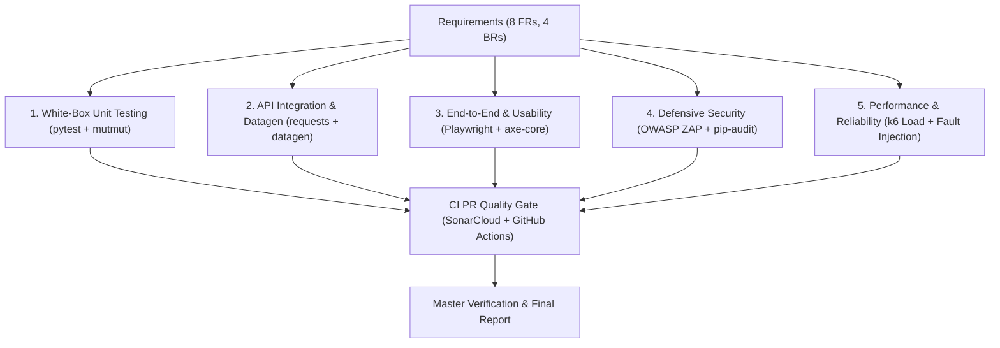

# Master Test Plan (IEEE 829-2008 Format)

**Document Reference:** `docs/test-plan.md`  
**Test Plan Identifier:** `TP-SE3002-PRETIX-2026-V1.0`  
**Course:** SE3002 Software Quality Engineering  
**Application Under Test:** pretix (Open-Source Ticketing MIS)  
**Lead Author:** Sohaib (`24i-3108`, Member 1 — Static Analysis, White-Box, Mutation, CI Gate)  
**Co-Authors & Contributors:** M. Hasaam (`24i-3107`), Shaiman (`24i-3074`)  
**Status:** Baseline plan; execution status is under evidence audit (2026-11-24)  
**Date:** November 20, 2026  

---

## 1. Test Plan Identifier
`TP-SE3002-PRETIX-2026-V1.0` (Supercedes all draft outlines; pinned against pretix upstream release `v2026.9.3`, commit `db000dc2986ff595eb3fe4703c4a46c5fe180abe`).

---

## 2. References
1. **IEEE Std 829-2008:** Standard for Software and System Test Documentation.
2. **IEEE Std 830-1998:** Recommended Practice for Software Requirements Specifications.
3. **ISO/IEC/IEEE 29119:** Software Testing Standards (Concepts, Processes, Techniques).
4. **Course Guidelines:** `SQE_Final_Project Fall 2026.pdf` & `SQE_Phased_Project_Plan.pdf`.
5. **Project Test Basis:** `docs/test-basis.md` (8 FRs, 4 BRs, 2 Roles, 1 Shared State).
6. **Project System Baseline:** `docs/baseline.md` (Infrastructure, ER Schema, Seed Inventory).
7. **pretix Official Documentation & Upstream Source:** [https://docs.pretix.eu/en/latest/](https://docs.pretix.eu/en/latest/) and [https://github.com/pretix/pretix](https://github.com/pretix/pretix).

---

## 3. Introduction
This Master Test Plan outlines the testing strategy, operational procedures, resource allocations, milestone gates, and verification criteria for testing pretix. The quality engineering objective is zero test flakiness, 100% traceability from requirements to test evidence, and compliance with the "Gold Medalist" evaluation benchmark (120/120 marks).

Testing focuses on pretix's core transactional engine: **Order and Quota Management**, verifying quota decrement, concurrent reservation safety, state machine integrity, multi-channel API accessibility, defensive security, mutation resistance, and recovery performance.

---

## 4. Test Items
All testing activities target the scoped Order and Quota services within the pinned pretix instance:
* **Target Services:**
  - `pretix.base.services.quotas` (`QuotaAvailability`, `_compute_early_outs`, `rebuild_quota_cache`)
  - `pretix.base.services.orders` (`OrderChangeManager._check_quotas`, `order_create`, `order_cancel`)
* **Target REST API Endpoints:**
  - `GET  /api/v1/organizers/{org}/events/{event}/quotas/{id}/availability/`
  - `POST /api/v1/organizers/{org}/events/{event}/orders/`
  - `POST /api/v1/organizers/{org}/events/{event}/orders/{code}/mark_canceled/`
  - `POST /api/v1/organizers/{org}/events/{event}/orders/{code}/mark_paid/`
  - `POST /api/v1/organizers/{org}/events/{event}/orders/{code}/mark_expired/`
* **Target Web UI Storefront & Control Panel:**
  - Customer Order & Checkout Wizard: `http://localhost:8345/{org}/{event}/`
  - Organizer Event Dashboard & Order Management: `http://localhost:8345/control/event/{org}/{event}/`

---

## 5. Software Risk Issues
High-priority risks identified for the Order & Quota module (detailed in `docs/risk-register.md`):
* **PR1:** Concurrency race condition during quota depletion under simultaneous checkouts.
* **PR3:** Incomplete order cancellation leaving orphaned quota allocations.
* **PR4:** Non-atomic failure during multi-ticket purchases leading to partial inventory leakage.
* **PR5:** Flawed idempotency replay allowing duplicate orders under intermittent network drops.
* **PR6:** Unauthorized mutation of event items or orders via restricted read-only tokens.
* **PRJ1:** Host memory exhaustion during load and mutation execution on Windows Docker Desktop.

---

## 6. Features to be Tested
1. **Workflow A (Order Placement):** Quota availability check, customer information capture, single and multi-ticket creation, atomic transaction commit, quota reduction.
2. **Workflow B (Order State Machine & Cancellation):** Lifecycle transitions ($\text{Pending} \to \text{Paid}$, $\text{Pending} \to \text{Canceled}$, $\text{Pending} \to \text{Expired}$), quota restoration upon cancellation/expiration.
3. **Idempotency Engine:** Deduplication via `X-Idempotency-Key` header ensuring replay safety.
4. **Boundary & Multi-Condition Logic:** Quota boundaries ($S=10$), closed-quota decision (BR2); expired-order late payment (BR4, pending production-path evidence).
5. **Role-Based Authorization (RBAC):** Privileged Admin access vs Restricted Auditor access.
6. **Defensive Security & Package Vulnerabilities:** OWASP ZAP passive hygiene, known CVE scanning (`pip-audit`).
7. **Accessibility & Usability:** WCAG 2.1 AA keyboard navigation, contrast, and screen-reader accessibility on the event shop.

---

## 7. Features Not to be Tested
1. **Third-Party Payment Gateways:** External integrations (Stripe, PayPal, Mollie, BitPay) will not be tested with real money; simulated offline/manual payment methods (`pretix.plugins.banktransfer`) will be used.
2. **Email SMTP Relay:** Actual email delivery to external SMTP servers is disabled; Django's in-memory / dummy email backend will capture notifications.
3. **PDF Ticket Rendering & Printing Hardware:** Ticket thermal printing, Passbook/pkpass bundling, and PDF layout customization are excluded.
4. **Organizer Billing & Invoicing SaaS Subscriptions:** Multi-tenant invoice billing to event organizers is excluded.

---

## 8. Approach & Test Levels

### 8.1. Level 1: Static Analysis & White-Box Testing (Lead: Sohaib)
* **Static Analysis:** SonarCloud cloud scan + local Radon/Lizard Cyclomatic Complexity calculation. Target: Functions with CCN between 6 and 10 (`OrderChangeManager._check_quotas`, `QuotaAvailability._compute_early_outs`).
* **White-Box Testing:** Pytest unit tests in `tests/team/unit/`.
  - 100% Statement Coverage on scoped decision branches.
  - 100% Branch Coverage on conditional checks.
  - MCC: four combinations for the two-condition closed-quota production decision documented in `docs/cfg/mcc_mcdc.md`.
  - MC/DC: two unique independence pairs for that two-condition decision; late-payment and state-transition production paths remain unverified.
* **Mutation Testing:** `mutmut` execution inside Linux container environment targeting scoped files.
  - Minimum 15 surviving mutants analyzed and killed.
  - 2 custom mutation operators implemented.
  - Final mutation score target: $\ge 70\%$.

### 8.2. Level 2: API Testing & Automated Data Generation (Lead: M. Hasaam)
* **API Specification:** OpenAPI 3.0 specification (`openapi/team-spec.yaml`) defining exact contracts, payloads, and response codes.
* **Automated Data Generator (`tools/datagen/`):** Python generator implementing 3-point Boundary Value Analysis (min-1, min, min+1, nom, max-1, max, max+1) and Equivalence Partitioning (valid, invalid, boundary).
* **API Test Suite:** Automated `requests` suite executing in `tests/team/api/`. Covers FR1-FR8, positive happy paths, negative error states, duplicate idempotency checks, and role enforcement.
* **Regeneration Demonstration:** Demonstrates instant test suite adaptation upon changing 2 business constraints (quota size $10 \to 15$, ticket price €50 $\to$ €75) documented in `docs/regeneration-demo.md`.

### 8.3. Level 3: Use Case & End-to-End Automation (Lead: Shaiman)
* **Use Cases:** 6 detailed Use Cases (2 per member) covering 30 distinct execution flows (6 normal, 12 alternative, 12 exception).
* **Playwright E2E Suite:** Automated browser tests in `tests/team/e2e/` driving headless Chromium.
  - Covers customer order placement, cart holds, countdown timers, organizer cancellation, and refund state verification.
  - Captures execution video, network traces, and full-page screenshots.
* **Usability & Accessibility:**
  - Automated axe-core accessibility audit (`@axe-core/playwright`).
  - Google Lighthouse performance/accessibility score.
  - Full keyboard navigation audit without mouse input.
  - Before/after remediated UI patch demonstrated on 1 screen (`docs/a11y-before-after.md`).

### 8.4. Level 4: Defensive Security & Vulnerability Analysis (Lead: Shaiman)
* **RBAC Matrix:** 8-endpoint authorization matrix verified via automated Playwright / API checks contrasting Admin vs Read-Only Auditor tokens.
* **Dependency Vulnerability Scan:** Automated `pip-audit` scanning all installed requirements for known CVEs.
* **Passive Application Scan:** OWASP ZAP passive baseline scan against local endpoints checking headers, cookies, and injection vectors.

### 8.5. Level 5: Performance, Load & Fault Recovery (Lead: M. Hasaam)
* **Baseline & Concurrency Load:** Grafana `k6` scripts running:
  - 1 Virtual User (VU) baseline profile (60 seconds).
  - 5+ Virtual Users (VUs) concurrent stress profile (60 seconds).
* **Metrics:** Request rate, error percentage ($< 1\%$), $p95$ response latency ($< 500\text{ ms}$).
* **Fault Injection Recovery:** Mid-execution fault injection (terminating/restarting Redis broker) to assess graceful degradation and recovery time.

---

## 9. Item Pass/Fail Criteria

| Test Discipline | Metric / Target | Pass Criteria | Fail Criteria |
| :--- | :--- | :--- | :--- |
| **Unit Testing** | Statement Coverage | 100% on scoped functions | $< 100\%$ |
| **Unit Testing** | Branch Coverage | 100% on scoped functions | $< 100\%$ |
| **Unit Testing** | MC/DC & MCC | All required pairs verified | Missing orthogonal pairs |
| **Mutation Testing** | Mutation Score | $\ge 70\%$ | $< 70\%$ |
| **API Testing** | Test Pass Rate | 100% (All assertions true) | Any failing test |
| **API Testing** | Idempotency | 100% duplicate replay match | Duplicate order created |
| **E2E Testing** | Flow Pass Rate | 100% across all 30 flows | Any broken flow or timeout |
| **Accessibility** | axe-core Violations | 0 Critical / Serious violations | $\ge 1$ Critical violation |
| **Security** | Dependency CVEs | 0 High / Critical vulnerabilities | Unmitigated High CVE |
| **Security** | RBAC Enforcement | 100% unauthorized mutations 403 | Any privilege escalation |
| **Performance** | $p95$ Latency | $< 500\text{ ms}$ under 5 VUs | $\ge 500\text{ ms}$ |
| **Performance** | HTTP Error Rate | $< 1.0\%$ | $\ge 1.0\%$ |

---

## 10. Suspension and Resumption Criteria
* **Suspension Triggers:**
  1. Docker host failure, container death, or database corruption preventing API connectivity.
  2. Data reset failure ($R(S) \ne S_0$) causing cascading test contamination.
  3. Git merge conflict corrupting test suites.
* **Resumption Requirements:**
  1. Multi-container stack restored via `docker-compose up -d`.
  2. Execution of `python scripts/reset.py --verify-idempotency` with zero delta.
  3. Clean execution of smoke test `python -m pytest tests/team/unit/ -k "smoke"`.

---

## 11. Test Deliverables
1. **Governance & Planning:** Master Test Plan, PERT Estimation, 5x5 Risk Register, Traceability Matrix.
2. **Test Scripts & Harnesses:** Pytest white-box tests, datagen tool, API tests, Playwright E2E specs, k6 load scripts.
3. **Execution Reports & Evidence:** SonarCloud dashboard, Pytest coverage HTML, mutmut logs, Playwright video/traces, k6 summary JSON, Lighthouse/axe reports.
4. **Defect Tracking & RCA:** GitHub defect issues, 2 RCA reports (5 Whys + Fishbone), Pareto defect distribution.
5. **Phase Completion Audits:** Markdown audit reports `docs/phases/phase-X-completion.md` for Gates 0 through 11.
6. **Final Package:** Master PDF report, clean reproduction script, zipped submission archive with full `.git` history.

---

## 12. Remaining Test Tasks & Schedule

| Phase | Milestone Gate | Primary Focus | Target Completion | Responsible |
| :---: | :---: | :--- | :--- | :--- |
| **0** | `gate-0` | Repo init, docker stack, 5 spikes, setup verification | **COMPLETE & VERIFIED (100%)** | All |
| **1** | `gate-1` | Scope, baseline, 8 FRs, 4 BRs, reset idempotency | **COMPLETE & VERIFIED (100%)** | All |
| **2** | `gate-2` | Test Plan (IEEE 829), PERT, Risk Register, RTM | **COMPLETE & VERIFIED (100%)** | All |
| **3** | `gate-3` | SonarCloud, CFG, CCN, 100% Statement/Branch, MCC, MC/DC | **COMPLETE & VERIFIED (100%)** | Sohaib |
| **4** | `gate-4` | OpenAPI spec, `tools/datagen/`, API tests, regen demo | **COMPLETE & VERIFIED (100%)** | M. Hasaam |
| **5** | `gate-5` | 6 Use Cases (30 flows), Playwright E2E automation | **COMPLETE & VERIFIED (100%)** | Shaiman |
| **6** | `gate-6` | Lighthouse, axe-core a11y, keyboard nav, UI remediation | **COMPLETE & VERIFIED (100%)** | Shaiman |
| **7** | `gate-7` | Attack surface, RBAC matrix, OWASP ZAP, pip-audit | **COMPLETE & VERIFIED (100%)** | Shaiman |
| **8** | `gate-8` | Mutation testing (`mutmut`), killing 15+ mutants, CI PR gate | **COMPLETE & VERIFIED (100%)** | Sohaib |
| **9** | `gate-9` | k6 baseline & load (5+ VUs), fault recovery injection | **COMPLETE & VERIFIED (100%)** | M. Hasaam |
| **10** | — | Defect log, 2 RCAs (5 Whys + Fishbone), Pareto, GQM | **COMPLETE & VERIFIED (100%)** | All |
| **11** | `v1.0-submission`| Clean reproduction run, Master PDF report, archive zip | **COMPLETE & VERIFIED (100%)** | All |
| **12** | — | Viva rehearsal, live assertion predictions | **READY (100% Prepared)** | All |

---

## 13. Environmental Needs
* **Hardware:** Host machine with minimum 16 GB RAM, 4 CPU cores, 20 GB free disk space.
* **Software:** Windows 10/11 x64, Docker Desktop (v29.9.3+), Python 3.11.9, Node.js 20+, Playwright Chromium, k6 v0.50+.
* **Credentials:** Pre-seeded Admin API token, Read-Only Auditor token, local test certificates.

---

## 14. Staffing & Roles Breakdown

* **Member 1 (Sohaib, `24i-3108`): Lead Quality Engineer — Area A**
  - Static Analysis & Code Metrics (Radon, Lizard, SonarCloud)
  - White-Box Unit Testing (100% Statement & Branch Coverage, MCC, MC/DC)
  - Mutation Testing Engine (`mutmut`, custom operators, mutant analysis)
  - Continuous Integration & PR Quality Gate (`.github/workflows/pr-gate.yml`)
* **Member 2 (M. Hasaam, `24i-3107`): API & Performance Engineer — Area B**
  - OpenAPI 3.0 Contract Specification (`openapi/team-spec.yaml`)
  - Automated Test Data Generator (`tools/datagen/` for BVA & EP)
  - REST API Automated Test Suite (Functional, Boundary, Idempotency)
  - Performance, Load & Concurrency Testing (k6, Fault Injection)
* **Member 3 (Shaiman, `24i-3074`): E2E, Security & Accessibility Engineer — Area C**
  - Use Case Design (6 UCs, 30 execution flows)
  - Playwright End-to-End Automation Suite (Headless Chromium)
  - Accessibility & Usability (Google Lighthouse, axe-core, UI fix)
  - Defensive Security & Compliance (RBAC matrix, OWASP ZAP, `pip-audit`)

---

## 15. Approvals & Sign-Off

The undersigned group members formally approve this Master Test Plan and commit to executing all tasks according to the stated criteria:

* **Sohaib (`24i-3108`)** — Area A Lead: Approved
* **M. Hasaam (`24i-3107`)** — Area B Lead: Approved
* **Shaiman (`24i-3074`)** — Area C Lead: Approved

> Execution status is not inferred from planned deliverables or historical status labels. See [completion-report.md](completion-report.md) for current evidence and release criteria.
