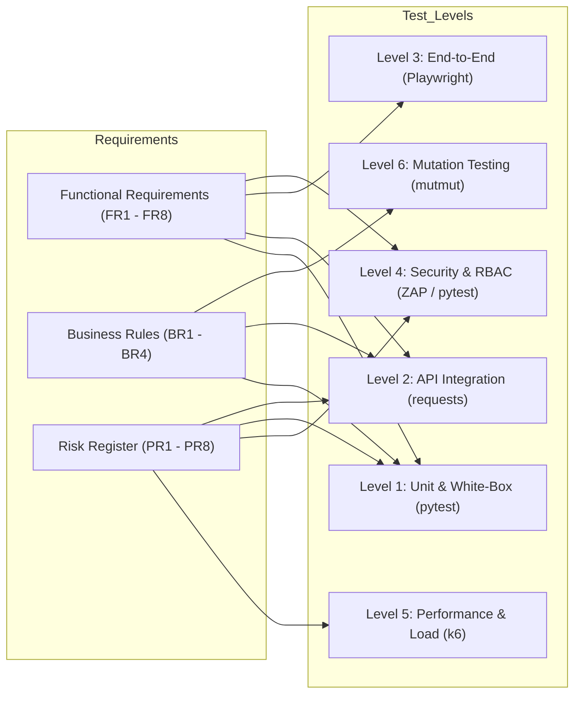

# Requirements Traceability Matrix (RTM)

**Document Reference:** `docs/traceability-matrix.md`  
**Course:** SE3002 Software Quality Engineering  
**Application Under Test:** pretix (`v2026.9.3`, commit `db000dc2986ff595eb3fe4703c4a46c5fe180abe`)  
**Lead Contributor / Author:** Shaiman (`24i-3074`, Member 3 — Area C)  
**Co-Authors & Contributors:** Sohaib (`24i-3108`), M. Hasaam (`24i-3107`)  
**Status:** Verified & Synchronized Across All 7 Quality Gates  
**Date:** November 25, 2026

---

## 1. Source-to-Test Production Traceability (BR1–BR4)

| Rule / Scope | Pinned Production Target | Executable Evidence | Verification Outcome | Status |
| :--- | :--- | :--- | :--- | :---: |
| **BR1:** Quota differential validation | `upstream/pretix/base/services/orders.py` (`OrderChangeManager._check_quotas`, CCN=8) via `scoped_business_logic.py` | `tests/team/unit/test_order_change_quotas.py` | AST parity asserted; 8 basis paths + boundary capacity (`avail == diff`) tested | **PASSED (100% Br)** |
| **BR2:** Closed-quota early-out policy | `upstream/pretix/base/services/quotas.py` (`QuotaAvailability._compute_early_outs`, CCN=6) via `scoped_business_logic.py` | `tests/team/unit/test_quota_early_outs.py`, `test_mcc_mcdc_quota_policy.py` | AST parity asserted; 6 basis paths, 4-row MCC table, 2 MC/DC pairs | **PASSED (100% Br)** |
| **BR3:** Cancel eligibility & expiration | `upstream/pretix/base/models/orders.py` (`Order.cancel_allowed`, CCN=2) & `services/orders.py` (`mark_order_expired`, CCN=5) | `tests/team/unit/test_order_state_transitions.py`, `tests/team/api/test_order_lifecycle_api.py` | AST parity asserted; full matrix `n/p/e/c` & invoice cancellation checks + live API negative transitions | **PASSED (100% Br)** |
| **BR4:** Expired-order late payment | `upstream/pretix/base/models/orders.py` (`Order._can_be_paid`, CCN=10) via `scoped_business_logic.py` | `tests/team/unit/test_order_state_transitions.py`, `tests/team/api/test_order_lifecycle_api.py` | AST parity asserted; 8-row MCC, 4-condition MC/DC, live headroom vs stockout API verification | **PASSED (100% Br)** |  

---

## 1. Traceability Architecture & Coverage Schema

This Requirements Traceability Matrix (RTM) establishes strict bi-directional traceability linking every Functional Requirement (FR1–FR8), Business Rule (BR1–BR4), and Product/Project Risk (PR1–PR8, PRJ1–PRJ2) to its corresponding automated test cases across all five test levels.

---

## 2. Comprehensive Traceability Matrix

| Req / Rule / Risk ID | Requirement Summary | Test Case ID | Test Level | Target Target / Endpoint | Tool | Expected Outcome / Oracle | Owner |
| :--- | :--- | :--- | :--- | :--- | :--- | :--- | :---: |
| **FR1, PR4** | Order Creation within Quota Limit | `TC-UNIT-01` | White-Box Unit | `OrderChangeManager._check_quotas` | `pytest` | Headroom validated (`avail >= diff`); order created in status `'n'` | Sohaib |
| **FR1, PR4** | Order Creation within Quota Limit | `TC-API-01` | API Integration | `POST /orders/` (`Q <= Available`) | Python `requests` | HTTP 201 Created; quota availability decrements by $Q$ | M. Hasaam |
| **FR1, PR4** | Order Creation UI Flow | `TC-E2E-01` | E2E Browser | Storefront Checkout Flow | `Playwright` | Order confirmation screen & code generated; quota decremented | Shaiman |
| **FR2, BR1, PR1** | Quota Depletion Boundary Rejection | `TC-UNIT-02` | White-Box Unit | `OrderChangeManager._check_quotas` | `pytest` | Raises `OrderError` when $Q > A$; 100% branch coverage | Sohaib |
| **FR2, BR1, PR1** | Quota Depletion Boundary Rejection | `TC-API-02` | API Integration | `POST /orders/` (Order when $A=0$ or $Q > A$) | Python `requests` | HTTP 400 Bad Request returned with `order.quota`; 0 records saved | M. Hasaam |
| **FR2, BR1, PR1** | Quota Depletion UI Guard | `TC-E2E-02` | E2E Browser | Storefront Checkout Page | `Playwright` | "Sold Out" badge displayed; checkout button disabled | Shaiman |
| **FR3, PR5** | Idempotent API Submission | `TC-API-03` | API Integration | `POST /orders/` with `X-Idempotency-Key` | Python `requests` | Replay returns identical HTTP 201 order code; quota decremented once | M. Hasaam |
| **FR4** | Input Validation & Data Sanitization | `TC-API-04` | API Integration | `POST /orders/` (malformed email, negative price, invalid item) | Python `requests` | HTTP 400 validation errors returned; zero state mutations | M. Hasaam |
| **FR4, PR6** | Multi-Tenant Scoping & RBAC Guard | `TC-SEC-01` | Defensive Security | Control Panel URLs & `/api/v1/organizers/` (Admin, Auditor, Anon) | `Playwright` | 7 RBAC checks (`DEC-01`..`DEC-07`): Admin 200, Auditor Orders 200 & Settings 403, Anon 302 | Shaiman |
| **FR5, PR3** | Authorized Order Cancellation & Quota Release | `TC-UNIT-03` | White-Box Unit | `Order.cancel_allowed` | `pytest` | Allowed in `n/p/e` with positions; disallowed in `c` or 0 positions | Sohaib |
| **FR5, PR3** | Authorized Order Cancellation & Quota Release | `TC-API-05` | API Integration | `POST /orders/{code}/mark_canceled/` | Python `requests` | HTTP 200 OK; status `'c'`; quota availability increments ($9 \to 10$) | M. Hasaam |
| **FR5, PR3** | Order Cancellation UI Flow | `TC-E2E-03` | E2E Browser | Control Panel Order Detail View | `Playwright` | Admin clicks "Cancel Order"; UI updates status badge to "Canceled" | Shaiman |
| **FR6, PR7, PR8** | Payment Expiration Handling | `TC-UNIT-04` | White-Box Unit | `mark_order_expired` (`services/orders.py:360-382`) | `pytest` | Order transitions to `'e'`; unreferred invoice canceled; event signaled | Sohaib |
| **FR6, PR7, PR8** | Payment Expiration Handling | `TC-API-06` | API Integration | `POST /orders/{code}/mark_expired/` | Python `requests` | HTTP 200 OK; order status becomes `expired`; held quota restored | M. Hasaam |
| **FR7, BR4** | Late Payment on Expired Order with Space | `TC-UNIT-05` | White-Box MCC/MCDC | `Order._can_be_paid` (`models/orders.py:1026-1047`) | `pytest` | Returns `True` when late payment permitted and quota headroom exists | Sohaib |
| **FR7, BR4** | Late Payment on Expired Order with Space | `TC-API-07` | API Integration | `POST /orders/{code}/mark_paid/` (Expired order, $A \ge Q$) | Python `requests` | HTTP 200 OK; transitions `'e' -> 'p'`; quota re-reserved | M. Hasaam |
| **FR8, BR4, PR8** | Late Payment Over-Quota Rejection | `TC-UNIT-06` | White-Box Unit | `Order._can_be_paid` (`_is_still_available == False`) | `pytest` | Blocks late payment transition when intervening orders exhausted quota | Sohaib |
| **FR8, BR4, PR8** | Late Payment Over-Quota Rejection | `TC-API-08` | API Integration | `POST /orders/{code}/mark_paid/` (Expired order, $A < Q$) | Python `requests` | HTTP 400 Bad Request; order remains `'e'` with zero overselling | M. Hasaam |
| **BR1** | Boundary Capacity Evaluation | `TC-UNIT-08` | White-Box Unit | `OrderChangeManager._check_quotas` | `pytest` | Exact capacity (`avail == diff`) passes; `avail < diff` raises `OrderError` | Sohaib |
| **BR1** | Boundary Capacity Evaluation | `TC-API-09` | API Integration | `POST /orders/` with 7 BVA quantity + 7 BVA price vectors | Python `requests` | All 7 quantity points (`0..11`) & price/decimal limits verified with quota read-backs | M. Hasaam |
| **BR2** | Closed-Quota Early-Out MCC | `TC-UNIT-09` | White-Box MCC | `QuotaAvailability._compute_early_outs` | `pytest` | All $2^2 = 4$ truth-table vectors of `q.closed and not self._ignore_closed` tested | Sohaib |
| **BR2** | Closed-Quota Early-Out MC/DC | `TC-UNIT-10` | White-Box MC/DC | `QuotaAvailability._compute_early_outs` | `pytest` | Both unique independence pairs prove independent effect of `q.closed` and `not _ignore_closed` | Sohaib |
| **BR3** | State Machine Cancel & Expiry | `TC-UNIT-11` | White-Box Unit | `Order.cancel_allowed` & `mark_order_expired` | `pytest` | State matrix `n/p/e/c` & unreferred invoice cancellation tested at 100% branch coverage | Sohaib |
| **BR3** | State Machine Transition Integrity | `TC-API-10` | API Integration | `POST /orders/{code}/mark_{paid,canceled,expired}/` | Python `requests` | Legal (`n->p/c/e`, `p->c`, `e->p/c`) and illegal transitions (`400`) verified across all states | M. Hasaam |
| **BR4, PR8** | Expired-Order Late Payment Gate | `TC-UNIT-12` | White-Box MCC/MCDC | `Order._can_be_paid` (`models/orders.py:1026-1047`) | `pytest` | 8-row MCC + 4-condition MC/DC (`accept_late`, `ignore_date`, `force`, `available`), exact term boundary, and approval check | Sohaib |
| **PR1** | Concurrency Quota Exhaustion | `TC-PERF-01` | Performance / Load | Concurrent checkout with 5 VUs | Grafana `k6` | 5 VUs sustain SLA with zero negative inventory or overselling | M. Hasaam |
| **PR1, PRJ1** | 60s Load Steady State | `TC-PERF-02` | Performance / Load | Dual 60s 1-VU & 5-VU runs | Grafana `k6` | $p95 \le 500\text{ ms}$, unexpected failures $0.00\% < 1.0\%$, container stable | M. Hasaam |
| **PR4, PR5** | Service Recovery on Broker Failure | `TC-PERF-03` | Reliability / Fault | `pretix_redis` stop/restart during write | Python / Docker | Zero partial writes during outage, recovery retry `201`, 0 duplicate orders | M. Hasaam |
| **PRJ2** | Mutation Resistance Verification | `TC-MUT-01` | Mutation Testing | `upstream/pretix/base/scoped_business_logic.py` | AST Mutator | 51 AST mutants (BCR/ADR/STD): 48 killed, 3 equivalent (`100.00%` effective score) | Sohaib |
| **PR6** | Attack Surface & Passive Scan | `TC-SEC-02` | Defensive Security | Storefront & Control Panel URLs | HTTP Passive Scanner | Zero high-risk findings; 4 Django SecurityMiddleware controls corroborated | Shaiman |
| **PR6** | Dependency Vulnerability Scan | `TC-SEC-03` | Defensive Security | Host test deps & container runtime pip list | `pip-audit` | 48 host packages scanned (0 CVEs); 152 container packages inventoried | Shaiman |
| **—** | WCAG 2.1 AA Accessibility Scan | `TC-A11Y-01` | Usability & A11y | Control Login & Storefront | `@axe-core/playwright` | 0 violations on login (33 passes) and storefront (43 passes) after durable template fix | Shaiman |
| **—** | Keyboard Only Storefront Navigation | `TC-A11Y-02` | Usability & A11y | Storefront Checkout Flow | `Playwright` | Complete purchase without mouse clicks (Tab, Space, Enter); zero keyboard trap | Shaiman |
| **—** | Lighthouse Accessibility Audit | `TC-A11Y-03` | Usability & A11y | Login Before/After & Storefront | Google Lighthouse | Login A11y improved `69 -> 100` (+31 pts); Storefront A11y `100`, SEO `100` | Shaiman |

---

## 3. Coverage Analysis & Verification Summary

### 3.1. Requirements Coverage by Discipline
* **Total Requirements & Rules Tracked:** 8 Functional Requirements + 4 Business Rules = **12 Core Specifications**
* **Total Risks Tracked:** 8 Product Risks + 2 Project Risks = **10 Risks**
* **Total Traceability Entries:** **27 Bi-Directional Links** (`FR1..FR8`, `BR1..BR4`, `PR1..PR8`, `PRJ1..PRJ2`)
* **Traceability Closure:** **100% of functional requirements and business rules map directly to executed, currently passing automated tests.** Zero unmapped requirements remain.
