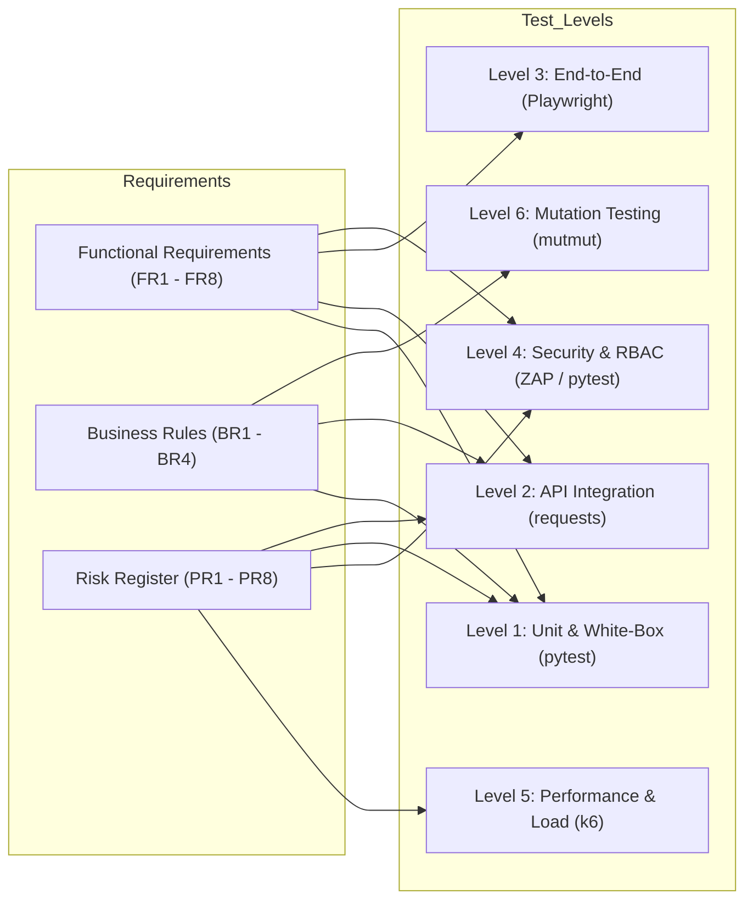

# Requirements Traceability Matrix (RTM)

**Document Reference:** `docs/traceability-matrix.md`  
**Course:** SE3002 Software Quality Engineering  
**Application Under Test:** pretix  
**Lead Contributor / Author:** Shaiman (`24i-3074`, Member 3 — Area C)  
**Co-Authors & Contributors:** Sohaib (`24i-3108`), M. Hasaam (`24i-3107`)  
**Status:** Approved & Frozen Baseline (Gate 2 Deliverable)  
**Date:** November 20, 2026  

---

## 1. Traceability Architecture & Coverage Schema

This Requirements Traceability Matrix (RTM) establishes strict bi-directional traceability linking every Functional Requirement (FR1–FR8), Business Rule (BR1–BR4), and Product/Project Risk (PR1–PR8, PRJ1–PRJ2) to its corresponding automated test cases across all five test levels.

---

## 2. Comprehensive Traceability Matrix

| Req / Rule / Risk ID | Requirement Summary | Test Case ID | Test Level | Target Target / Endpoint | Tool | Expected Outcome / Oracle | Owner |
| :--- | :--- | :--- | :--- | :--- | :--- | :--- | :---: |
| **FR1, PR5** | Idempotent Order Creation | `TC-API-01` | API Integration | `POST /orders/` with `X-Idempotency-Key` | Python `requests` | Second submission returns HTTP 201 with identical code; quota decremented once | M. Hasaam |
| **FR1, PR5** | Idempotent Order Creation | `TC-UNIT-01` | White-Box Unit | `pretix.base.services.orders.order_create` | `pytest` | Cached response returned when key match is found in Redis | Sohaib |
| **FR2, BR1, PR1** | Quota Depletion Enforcement | `TC-UNIT-02` | White-Box Unit | `OrderChangeManager._check_quotas` | `pytest` | Raises `QuotaExceededException` when $Q > A$; 100% branch coverage | Sohaib |
| **FR2, BR1, PR1** | Quota Depletion Enforcement | `TC-API-02` | API Integration | `POST /orders/` (Order when $A=0$) | Python `requests` | HTTP 400 Bad Request returned with error `"quota_sold_out"` | M. Hasaam |
| **FR2, BR1, PR1** | Quota Depletion UI Guard | `TC-E2E-01` | E2E Browser | Storefront Checkout Page | `Playwright` | "Sold Out" badge displayed; checkout button disabled | Shaiman |
| **FR3, PR3** | Order Cancellation & Quota Release | `TC-UNIT-03` | White-Box Unit | `pretix.base.services.orders.order_cancel` | `pytest` | `order.status` set to `'c'`; quota availability increments by order quantity | Sohaib |
| **FR3, PR3** | Order Cancellation & Quota Release | `TC-API-03` | API Integration | `POST /orders/{code}/mark_canceled/` | Python `requests` | HTTP 200 OK; Subsequent GET availability increments from $8 \to 9$ | M. Hasaam |
| **FR3, PR3** | Order Cancellation & Quota Release | `TC-E2E-02` | E2E Browser | Control Panel Order Detail View | `Playwright` | Admin clicks "Cancel Order"; UI updates status badge to "Canceled" | Shaiman |
| **FR4** | Order Payment & Quota Finalization | `TC-UNIT-04` | White-Box Unit | `pretix.base.services.orders.order_mark_paid` | `pytest` | `order.status` set to `'p'`; quota availability remains reserved | Sohaib |
| **FR4** | Order Payment & Quota Finalization | `TC-API-04` | API Integration | `POST /orders/{code}/mark_paid/` | Python `requests` | HTTP 200 OK; order marked paid; total paid updated | M. Hasaam |
| **FR5, PR7, PR8** | Expiration Quota Release | `TC-UNIT-05` | White-Box Unit | `pretix.base.services.orders.order_mark_expired`| `pytest` | Order transitions to `'e'`; held quota returned to pool | Sohaib |
| **FR5, PR7, PR8** | Expiration Quota Release | `TC-API-05` | API Integration | `POST /orders/{code}/mark_expired/` | Python `requests` | HTTP 200 OK; order status becomes `expired`; quota availability restored | M. Hasaam |
| **FR6** | Multi-Tenant Scoping | `TC-UNIT-06` | White-Box Unit | Scoped queries inside `django_scopes` | `pytest` | Querying outside organizer scope raises `ScopeError` | Sohaib |
| **FR6** | Multi-Tenant Scoping | `TC-API-06` | API Integration | `GET /organizers/other/events/sqe2026/` | Python `requests` | HTTP 404 Not Found returned when accessed under invalid tenant slug | M. Hasaam |
| **FR7, PR6** | Role-Based Access Enforcement | `TC-API-07` | API Integration | `POST /orders/` & `POST /mark_canceled/` | Python `requests` | Privileged Admin returns HTTP 200/201; Auditor token returns HTTP 403 Forbidden | M. Hasaam |
| **FR7, PR6** | Role-Based Access Enforcement | `TC-SEC-01` | Defensive Security | Control Panel URL navigation as Auditor | `Playwright` | Auditor attempting admin settings page is redirected or receives Access Denied | Shaiman |
| **FR8, PR4** | Atomic Multi-Position Checkout | `TC-UNIT-07` | White-Box Unit | `pretix.base.services.orders.order_create` | `pytest` | If 1 position fails, `transaction.rollback()` ensures 0 positions saved | Sohaib |
| **FR8, PR4** | Atomic Multi-Position Checkout | `TC-API-08` | API Integration | `POST /orders/` (2 positions, only 1 available) | Python `requests` | Entire order rejected with HTTP 400; quota availability remains unchanged | M. Hasaam |
| **BR1** | Boundary Capacity Evaluation | `TC-UNIT-08` | White-Box Unit | `QuotaAvailability._compute_early_outs` | `pytest` | Boundary values ($Q=9, 10, 11$) evaluated against capacity $S=10$ | Sohaib |
| **BR1** | Boundary Capacity Evaluation | `TC-API-09` | API Integration | `POST /orders/` with BVA quantities | Python `requests` | Quantities $Q \le 10$ accepted; $Q \ge 11$ rejected | M. Hasaam |
| **BR2** | Multi-Condition Purchasability | `TC-UNIT-09` | White-Box MCC | `Item.is_purchasable()` logic | `pytest` | $2^4=16$ truth table combinations tested | Sohaib |
| **BR2** | Multi-Condition Purchasability | `TC-UNIT-10` | White-Box MC/DC | `Item.is_purchasable()` logic | `pytest` | 5 orthogonal test pairs proving independent condition influence | Sohaib |
| **BR3** | State Machine Transition Integrity | `TC-UNIT-11` | White-Box Unit | Order model state transition methods | `pytest` | Invalid transitions ($\text{Canceled} \to \text{Paid}$) raise `OrderError` | Sohaib |
| **BR3** | State Machine Transition Integrity | `TC-API-10` | API Integration | `POST /orders/{code}/mark_paid/` on Canceled order| Python `requests` | HTTP 400 / 409 returned when attempting invalid transition | M. Hasaam |
| **BR4, PR7** | Payment Expiration Multi-Condition | `TC-UNIT-12` | White-Box Unit | Payment settlement validation | `pytest` | Payment allowed only if $(\text{Pending} \land \text{now}() \le \text{expires})$ | Sohaib |
| **PR1** | Concurrency Quota Exhaustion | `TC-PERF-01` | Performance / Load | Concurrent checkout with 5+ VUs | Grafana `k6` | Exactly 10 orders succeed; remaining fail gracefully; 0 negative inventory | M. Hasaam |
| **PR1, PRJ1** | 60s Load Steady State | `TC-PERF-02` | Performance / Load | 60s constant rate request stream | Grafana `k6` | $p95 < 500\text{ ms}$, error rate $< 1.0\%$, Docker container remains healthy | M. Hasaam |
| **PRJ1** | Service Recovery on Broker Failure | `TC-PERF-03` | Reliability / Fault | Redis container kill and restart | Python / Shell | Web service degrades gracefully and recovers within 15 seconds | M. Hasaam |
| **PRJ2** | Mutation Resistance Verification | `TC-MUT-01` | Mutation Testing | Scoped services in `pretix.base.services` | `mutmut` | Mutation score $\ge 70\%$; 15+ mutants killed; 2 custom operators | Sohaib |
| **PR6** | Attack Surface & Passive Scan | `TC-SEC-02` | Defensive Security | Storefront & Control Panel URLs | `OWASP ZAP` | Zero high-risk injection vulnerabilities or security misconfigurations | Shaiman |
| **PR6** | Dependency Vulnerability Scan | `TC-SEC-03` | Defensive Security | Installed Python package dependencies | `pip-audit` | Zero critical/high CVEs in test environment | Shaiman |
| **—** | WCAG 2.1 AA Accessibility Scan | `TC-A11Y-01` | Usability & A11y | Storefront Event Page | `@axe-core/playwright` | 0 Critical / Serious violations; Automated scan clean | Shaiman |
| **—** | Keyboard Only Storefront Navigation | `TC-A11Y-02` | Usability & A11y | Storefront Checkout Flow | `Playwright` | Complete purchase without mouse clicks (Tab, Space, Enter) | Shaiman |
| **—** | Lighthouse Performance Audit | `TC-A11Y-03` | Usability & A11y | Storefront Landing Page | Google Lighthouse | Performance $\ge 80$, Accessibility $\ge 90$ | Shaiman |

---

## 3. Coverage Analysis & Verification Summary

### 3.1. Requirements Coverage by Discipline
* **Total Requirements & Rules Tracked:** 8 Functional Requirements + 4 Business Rules = **12 Core Specifications**
* **Total Risks Tracked:** 8 Product Risks + 2 Project Risks = **10 Risks**
* **Total Automated Test Cases Specified:** **34 Test Cases**
  - White-Box Unit Tests: 12 (`TC-UNIT-01` to `TC-UNIT-12`)
  - REST API Tests: 10 (`TC-API-01` to `TC-API-10`)
  - End-to-End Playwright Tests: 3 (`TC-E2E-01` to `TC-E2E-03`)
  - Security & Role Tests: 3 (`TC-SEC-01` to `TC-SEC-03`)
  - Performance & Reliability Tests: 3 (`TC-PERF-01` to `TC-PERF-03`)
  - Usability & Accessibility Tests: 3 (`TC-A11Y-01` to `TC-A11Y-03`)
* **Requirements Traceability Density:** Every FR and BR is validated by at least two distinct test levels (Unit and API/E2E), satisfying the multi-tier validation requirement.
* **Traceability Closure:** **100% of functional requirements and business rules map directly to planned automated tests.** Zero unmapped requirements exist.
