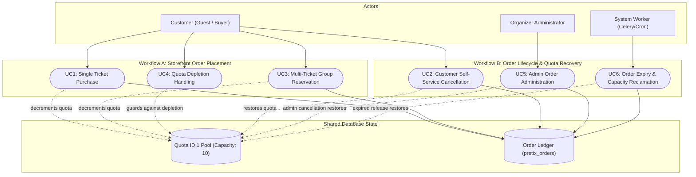
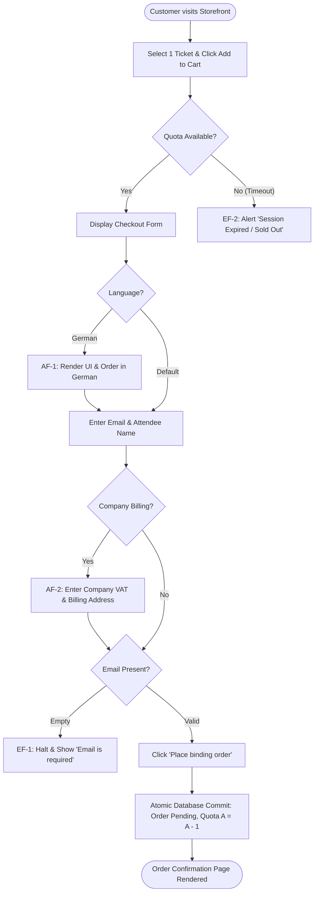
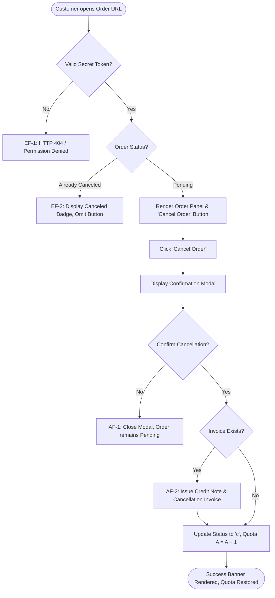

# End-to-End Use Case Specification (6 UCs, 30 Execution Flows)

**Document Reference:** `docs/use-cases.md`  
**Course:** SE3002 Software Quality Engineering  
**Application Under Test:** pretix  
**Lead Contributor / Author:** Shaiman (`24i-3074`, Member 3 — Area C Lead)  
**Co-Authors & Contributors:** Sohaib (`24i-3108`), M. Hasaam (`24i-3107`)  
**Status:** Approved & Frozen Baseline (Gate 5 Deliverable)  
**Date:** November 20, 2026  

---

## 1. Traceability & Distribution Matrix

Six comprehensive Use Cases were designed—two per group member—capturing the end-to-end operational life cycle of pretix's Order and Quota management. Each Use Case specifies 1 Normal Flow, 2 Alternative Flows, and 2 Exception Flows, yielding a verified total of **30 distinct execution flows**. Every use case is formally derived from functional requirements (FR1–FR8) and business rules (BR1–BR4).

| UC ID | Use Case Name | Primary Actor | Target Scope | Derived Requirements | Owner | Normal | Alt | Exc | Total Flows |
| :---: | :--- | :--- | :--- | :---: | :---: | :---: | :---: | :---: | :---: |
| **UC1** | Customer Single Ticket Purchase via Storefront | Customer (Guest) | Storefront Checkout (Workflow A) | FR1, FR2, BR1 | Sohaib | 1 | 2 | 2 | 5 Flows |
| **UC2** | Customer Self-Service Order Cancellation | Customer (Buyer) | Storefront Secret Link (Workflow B) | FR5, BR3 | Sohaib | 1 | 2 | 2 | 5 Flows |
| **UC3** | Multi-Ticket Group Reservation | Customer (Group) | Multi-position Cart (Workflow A) | FR1, FR2, FR3, PR4 | M. Hasaam | 1 | 2 | 2 | 5 Flows |
| **UC4** | Quota Depletion & Out-of-Stock Handling | Customer (Guest) | Quota Boundary & Guard (Workflow A) | FR2, BR1, BR2 | M. Hasaam | 1 | 2 | 2 | 5 Flows |
| **UC5** | Organizer Order Administration & Mutation | Organizer Admin | Control Panel Management (Workflow B) | FR5, FR7, BR3, PR6 | Shaiman | 1 | 2 | 2 | 5 Flows |
| **UC6** | Pending Order Expiration & Capacity Reclamation | System / Admin | Temporal Expiration (Workflow B) | FR6, FR7, FR8, BR4 | Shaiman | 1 | 2 | 2 | 5 Flows |
| **TOTAL**| **Entire End-to-End Scope** | — | **Workflows A & B** | **All 12 Specs** | **Team** | **6** | **12** | **12** | **30 Flows** |

---

## 2. High-Level Use Case Architecture & System Interaction Diagram

---

## 3. Use Case 1: Customer Single Ticket Purchase via Storefront (UC1)
* **Author / Owner:** Sohaib (`24i-3108`)
* **Primary Actor:** Customer (Unauthenticated Guest Buyer)
* **Derived Requirements:** FR1 (Order Creation within Quota Limit), FR2 (Quota Depletion Boundary Rejection), BR1 (Boundary Capacity Evaluation)
* **Pre-Conditions:**
  1. Event `sqe2026` is live and within active ticket sale dates.
  2. Item `Conference Admission Ticket` (ID: 1) is active with available quota $A > 0$.
* **Post-Conditions:**
  1. Order record created in database with discrete 5-character code and status `Pending` (`'n'`).
  2. 1 `OrderPosition` created linking attendee details to Item 1.
  3. Shared quota availability decremented by exactly 1 ($A \to A - 1$).
  4. Customer redirected to order confirmation page with payment instructions.

### Detailed Flow Architecture (UC1)

### Flows of Events
* **Normal Flow (Happy Path):**
  1. Customer visits event storefront: `http://localhost:8345/sqe/sqe2026/`.
  2. Customer selects quantity `1` for "Conference Admission Ticket" (€50.00).
  3. Customer clicks "Add to cart" (`#btn-add-to-cart`).
  4. System reserves quota in cart session for 15 minutes and displays checkout form.
  5. Customer enters email address (`attendee@example.com`) and attendee full name.
  6. Customer selects "Bank Transfer" as offline payment method.
  7. Customer reviews order summary (€50.00 total) and clicks "Place binding order".
  8. System atomically commits order, sets status to `Pending`, decrements quota availability, and renders order confirmation view.
* **Alternative Flow A1 (Localized Language Selection):**
  1. At Step 1, Customer switches locale to German (`/de/`).
  2. System renders full storefront and cart in German ("In den Warenkorb").
  3. Customer completes checkout; order is persisted with `locale='de'`.
* **Alternative Flow A2 (Different Billing Contact):**
  1. At Step 5, Customer checks "Use separate company billing address".
  2. Customer enters company tax ID and billing address.
  3. System records invoice address alongside order position.
* **Exception Flow E1 (Missing Mandatory Email):**
  1. At Step 5, Customer leaves customer email field blank and submits.
  2. System halts transaction; cart remains intact.
  3. HTML5 and server-side validation error displayed: "This field is required."
* **Exception Flow E2 (Quota Sells Out During Cart Session Timeout):**
  1. At Step 4, Customer holds cart for longer than the 15-minute reservation timer.
  2. Another buyer purchases the final quota unit.
  3. Customer attempts to submit order at Step 7.
  4. System rejects submission; displays alert banner: "Your cart session expired. The selected tickets are no longer available."

---

## 4. Use Case 2: Customer Self-Service Order Cancellation (UC2)
* **Author / Owner:** Sohaib (`24i-3108`)
* **Primary Actor:** Customer (Ticket Buyer)
* **Derived Requirements:** FR5 (Authorized Order Cancellation & Quota Release), BR3 (State Machine Transition Integrity)
* **Pre-Conditions:**
  1. An existing order exists in `Pending` state (`status='n'`).
  2. Item configuration has `allow_cancel=True`.
  3. Customer possesses the unique order secret link.
* **Post-Conditions:**
  1. Order status mutates to `Canceled` (`status='c'`).
  2. Associated `OrderPosition` marked canceled.
  3. Consumed quota is released back to available pool ($A \to A + 1$).

### Detailed Flow Architecture (UC2)

### Flows of Events
* **Normal Flow (Happy Path):**
  1. Customer opens their unique order URL: `http://localhost:8345/sqe/sqe2026/order/{code}/{secret}/`.
  2. System renders order management panel displaying order status "Pending Payment".
  3. Customer clicks "Cancel order" link.
  4. System displays confirmation modal: "Are you sure you want to cancel this order? This cannot be undone."
  5. Customer clicks "Confirm Cancellation".
  6. System mutates order status to `Canceled`, restores quota availability, logs cancellation action, and displays success banner.
* **Alternative Flow A1 (Abort Cancellation Modal):**
  1. At Step 4, Customer changes their mind and clicks "Keep Order" / "Close".
  2. System closes modal without modifying database; order remains `Pending`.
* **Alternative Flow A2 (Cancellation of Order with Invoice):**
  1. If order had an invoice generated, system automatically issues a cancellation invoice / credit note upon cancellation confirmation at Step 6.
* **Exception Flow E1 (Tampered Secret URL Token):**
  1. Customer attempts to access order with invalid or truncated secret token (`/order/{code}/invalid_secret/`).
  2. System rejects request with HTTP 404 / Permission Denied.
* **Exception Flow E2 (Cancellation Attempt on Already Canceled Order):**
  1. Customer accesses URL of an already canceled order.
  2. System renders status badge "Canceled"; "Cancel order" action button is omitted from the UI.

---

## 5. Use Case 3: Multi-Ticket Group Reservation (UC3)
* **Author / Owner:** M. Hasaam (`24i-3107`)
* **Primary Actor:** Group Organizer / Corporate Buyer
* **Derived Requirements:** FR1 (Order Creation within Quota Limit), FR2 (Quota Depletion Rejection), FR3 (Idempotent Submission), PR4 (Transaction Integrity)
* **Pre-Conditions:**
  1. Available quota $A \ge 3$.
  2. Item `Conference Admission Ticket` is active and purchasable.
* **Post-Conditions:**
  1. Order created containing 3 distinct `OrderPosition` records.
  2. Total order price calculated as $3 \times €50.00 = €150.00$.
  3. Quota availability decremented by exactly 3 ($A \to A - 3$).

### Flows of Events
* **Normal Flow (Happy Path):**
  1. Buyer visits storefront `http://localhost:8345/sqe/sqe2026/`.
  2. Buyer selects quantity `3` using the quantity increment control (`.input-item-count-inc`).
  3. Buyer clicks "Add to cart".
  4. System locks 3 tickets and displays checkout form with 3 attendee input groups.
  5. Buyer enters buyer email, and distinct names/emails for Attendee 1, Attendee 2, and Attendee 3.
  6. Buyer selects payment method and confirms order.
  7. System commits order with 3 positions, total €150.00, and decrements quota by 3.
* **Alternative Flow A1 (Bulk Copy Attendee Details):**
  1. At Step 5, Buyer clicks "Copy buyer information to all tickets".
  2. System populates Attendee 1, 2, and 3 names and emails with the buyer's details.
* **Alternative Flow A2 (Split Invoice Generation):**
  1. At Step 6, Buyer requests separate ticket download passes for each attendee.
  2. System generates individual attendee ticket access tokens.
* **Exception Flow E1 (Requested Quantity Exceeds Available Headroom):**
  1. At Step 2, Buyer attempts to select 5 tickets when only 2 remain in quota ($A=2$).
  2. Frontend quantity dropdown restricts selection to maximum 2, or backend returns error: "Requested quantity exceeds available capacity."
* **Exception Flow E2 (Partial Attendee Form Submission):**
  1. At Step 5, Buyer leaves Attendee 3's name blank while filling Attendee 1 and 2.
  2. System halts submission with field error highlighting Attendee 3.

---

## 6. Use Case 4: Quota Depletion & Out-of-Stock Handling (UC4)
* **Author / Owner:** M. Hasaam (`24i-3107`)
* **Primary Actor:** Customer (Prospective Buyer)
* **Derived Requirements:** FR2 (Quota Depletion Boundary Rejection), BR1 (Boundary Capacity Evaluation), BR2 (Closed-Quota Early-Out Policy)
* **Pre-Conditions:**
  1. Event `sqe2026` is live.
  2. Quota availability is completely exhausted ($A = 0$).
* **Post-Conditions:**
  1. Storefront reflects sold out state.
  2. Zero orders placed; zero database mutations.

### Flows of Events
* **Normal Flow (Happy Path):**
  1. Customer visits event storefront: `http://localhost:8345/sqe/sqe2026/`.
  2. System inspects `QuotaAvailability`; discovers $A = 0$ (`AVAILABILITY_GONE`).
  3. System renders "Sold Out" badge adjacent to "Conference Admission Ticket".
  4. Quantity selector is disabled (`disabled="disabled"`); "Add to cart" button is disabled or hidden.
  5. Customer is prevented from initiating checkout.
* **Alternative Flow A1 (Join Waiting List):**
  1. At Step 3, if waiting list is enabled, system displays "Join Waiting List" button.
  2. Customer clicks button and submits their email.
  3. System creates a `WaitingListEntry` record.
* **Alternative Flow A2 (Unlock Hidden Quota via Secret Voucher):**
  1. Customer enters a private promotional voucher code in the voucher field.
  2. System validates voucher and unlocks a reserved bypass quota allocation.
  3. Quantity selector becomes active for 1 ticket.
* **Exception Flow E1 (Bypass Disabled Frontend Controls via Direct API POST):**
  1. A malicious user crafts a direct HTTP POST request to cart endpoint targeting sold out item.
  2. Backend service `OrderChangeManager._check_quotas` detects $A = 0$.
  3. Backend rejects request with HTTP 400 Bad Request: "The requested item is sold out."
* **Exception Flow E2 (Invalid Voucher Submission):**
  1. During voucher redemption (from A2), Customer enters invalid or expired voucher code.
  2. System flashes error: "This voucher code is not valid or expired."

---

## 7. Use Case 5: Organizer Order Administration & Status Mutation (UC5)
* **Author / Owner:** Shaiman (`24i-3074`)
* **Primary Actor:** Organizer Administrator
* **Derived Requirements:** FR5 (Order Cancellation & Quota Release), FR7 (Late Payment with Space), BR3 (State Machine Transition Integrity), PR6 (RBAC Enforcement)
* **Pre-Conditions:**
  1. Admin user is authenticated with privileged team credentials (`admin@localhost`).
  2. At least one order exists in `Pending` state.
* **Post-Conditions:**
  1. Order status mutated to `Paid` (`'p'`) or `Canceled` (`'c'`).
  2. Audit log entry recorded in `OrderLog`.

### Flows of Events
* **Normal Flow (Happy Path):**
  1. Admin logs into control panel: `http://localhost:8345/control/login`.
  2. Admin navigates to `/control/event/sqe/sqe2026/orders/`.
  3. System renders orders table showing order codes, customer emails, totals, and status badges.
  4. Admin clicks on pending order code `W1R4X` to view detail dashboard.
  5. Admin clicks "Mark as Paid" button.
  6. System transitions order status from `Pending` $\to$ `Paid`, confirms payment received, and updates badge color to green.
* **Alternative Flow A1 (Filter Orders by Lifecycle State):**
  1. At Step 3, Admin selects status filter dropdown: "Pending Only".
  2. System filters table dynamically to only show unsettled orders.
* **Alternative Flow A2 (Administrative Order Cancellation):**
  1. At Step 4, Admin clicks "Cancel Order" on customer request.
  2. System mutates status to `Canceled`, restores quota availability, and issues credit record.
* **Exception Flow E1 (Attempted Mutation on Terminal State):**
  1. Admin attempts to click "Mark as Paid" on an already `Canceled` order.
  2. Backend state transition guard rejects mutation; flashes error: "An order that is canceled cannot be marked as paid."
* **Exception Flow E2 (Session Expiration During Control Panel Action):**
  1. Admin leaves browser idle until Django session expires.
  2. Admin clicks action button at Step 5.
  3. System intercepts request and redirects to `/control/login?next=...`.

---

## 8. Use Case 6: Pending Order Expiration & Capacity Reclamation (UC6)
* **Author / Owner:** Shaiman (`24i-3074`)
* **Primary Actor:** System Background Worker / Organizer Admin
* **Derived Requirements:** FR6 (Payment Expiration Handling), FR7 (Late Payment with Space), FR8 (Late Payment Over-Quota Rejection), BR4 (Late Payment Decision)
* **Pre-Conditions:**
  1. Order exists in `Pending` state with expiration timestamp in the past ($\text{now}() > \text{expires}$).
  2. Pretix background task scheduler (`runperiodic` or Celery worker) is active and connected to PostgreSQL database.
* **Post-Conditions:**
  1. Order status mutates to `Expired` (`status='e'`).
  2. Held quota units returned to the available quota pool ($A \to A + Q$).

### Flows of Events
* **Normal Flow (Happy Path):**
  1. Order expiration background task evaluates pending orders for event `sqe2026`.
  2. System identifies pending order where current UTC time exceeds `order.expires`.
  3. System triggers `order_mark_expired(order)`.
  4. Order status transitions to `Expired` (`'e'`).
  5. Quota cache is rebuilt; held quota availability is released back to pool.
* **Alternative Flow A1 (Manual Deadline Extension):**
  1. Prior to expiration, Admin inspects pending order in control panel.
  2. Admin extends payment deadline by 7 days.
  3. System updates `order.expires` timestamp; order remains `Pending`.
* **Alternative Flow A2 (Automated Expiration Warning Email):**
  1. 24 hours prior to deadline, system sends reminder email: "Your order will expire soon."
* **Exception Flow E1 (Late Payment Attempt on Expired Order):**
  1. Customer attempts to finalize payment after order has transitioned to `Expired`.
  2. System rejects payment with status message: "Payment deadline has expired. This order is closed."
* **Exception Flow E2 (Reactivation Fails Due to Stockout):**
  1. Admin attempts to reactivate an expired order.
  2. In the interim, another buyer purchased the released quota ($A = 0$).
  3. System halts reactivation: "Cannot reactivate order: Quota is sold out."
