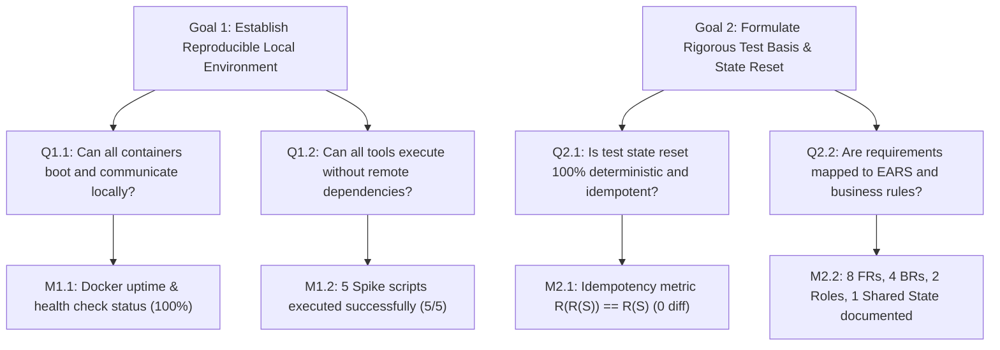

# Weekly Quality Report (Week 1) - Goal-Question-Metric (GQM) Framework

**Project:** SE3002 Software Quality Engineering - pretix Test Automation  
**Reporting Period:** Week 1 (Environment Setup, Spikes & Baseline Ingestion)  
**Authors:** Sohaib (24i-3108), M. Hasaam (24i-3107), Shaiman (24i-3074)  
**Milestones Covered:** Gate 0 (`gate-0`), Gate 1 (`gate-1`)

---

## 1. GQM Hierarchy Definition

---

## 2. Weekly Metric Tracking

| Goal | Question | Metric | Target | Measured Reality | Status |
| :--- | :--- | :--- | :---: | :---: | :---: |
| **G1: Environment** | Q1.1: Stack Health | Container availability (`pretix_web`, `db`, `redis`) | 100% | 100% healthy | **PASS** |
| **G1: Environment** | Q1.2: Feasibility | Execution of 5 Phase 0 spikes | 5/5 | 5/5 passed | **PASS** |
| **G2: Test Basis** | Q2.1: Reset Determinism | Mathematical idempotence $R(R(S)) = R(S)$ | True | Proven ($Q=10, O=0$) | **PASS** |
| **G2: Test Basis** | Q2.2: Requirements | EARS Functional Requirements count | $\ge 8$ | 8 FRs, 4 BRs | **PASS** |

---

## 3. Engineering Discoveries & Corrective Decisions
* **Gunicorn Multiplication (DEF-07):** Pinned `NUM_WORKERS=2` and `CELERY_WORKER_CONCURRENCY=1` to prevent host memory exhaustion.
* **Protected Foreign Key Constraint (DEF-01):** Engineered 9-stage topological deletion cascade to prevent `ProtectedError` during resets.
## Common GQM metric definitions and audit status

These definitions apply consistently to every weekly report:

- **Defect density** = count of distinct confirmed defects first detected in the reporting period divided by the declared size unit (use KLOC only when the counted source-code scope and line-count tool are recorded). Record numerator, denominator, severity mix, and period; do not mix test failures with confirmed defects.
- **Requirements coverage** = count of canonical FR/BR IDs with at least one executed, passing test and linked raw result divided by the total canonical FR/BR IDs in `docs/test-basis.md`. Planned or merely named test cases do not count as covered.
- **Defect reopen rate** = defects reopened during the period divided by defects closed during the same period; report `N/A` when the denominator is zero and disclose the time window.

Previously printed weekly PASS values were not recalculated against these definitions and remain provisional. Actual values require a reconciled defect log, canonical requirements inventory, and run-level test evidence; see `docs/completion-report.md`.
