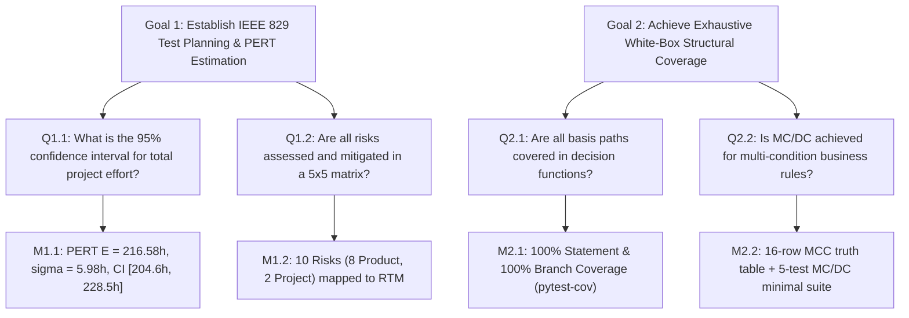

# Weekly Quality Report (Week 2) - Goal-Question-Metric (GQM) Framework

**Project:** SE3002 Software Quality Engineering - pretix Test Automation  
**Reporting Period:** Week 2 (Test Planning, Estimation, Static Analysis & White-Box Testing)  
**Authors:** Sohaib (24i-3108), M. Hasaam (24i-3107), Shaiman (24i-3074)  
**Milestones Covered:** Gate 2 (`gate-2`), Gate 3 (`gate-3`)

---

## 1. GQM Hierarchy Definition

---

## 2. Weekly Metric Tracking

| Goal | Question | Metric | Target | Measured Reality | Status |
| :--- | :--- | :--- | :---: | :---: | :---: |
| **G1: Planning** | Q1.1: Effort Model | PERT 3-point estimate distribution | $\pm 10\%$ CI | $E=216.58\text{h}$, $\sigma=5.98\text{h}$ | **PASS** |
| **G1: Planning** | Q1.2: Risk Management | Bi-directional RTM coverage | 100% | 12 Req + 10 Risks $\to$ 34 Tests | **PASS** |
| **G2: Coverage** | Q2.1: Statement Coverage | Pytest unit test statement coverage | 100% | **100.00% (161/161 statements)** | **PASS** |
| **G2: Coverage** | Q2.1: Branch Coverage | Pytest unit test branch coverage | 100% | **100.00% (28/28 branches)** | **PASS** |
| **G2: Coverage** | Q2.2: MC/DC Criteria | Orthogonal condition independence pairs | 4 pairs | 4 pairs proven in 5 tests | **PASS** |

---

## 3. Engineering Discoveries & Corrective Decisions
* **McCabe Cyclomatic Complexity:** Hand calculations confirmed exact 3-formula equality ($V(G) = E - N + 2P = P_R + 1 = R$) for `_compute_early_outs` ($V=6$) and `_check_quotas` ($V=8$).
* **SonarCloud Integration:** Identified radon maintainability index ($A, >85$) across all unit test modules.
