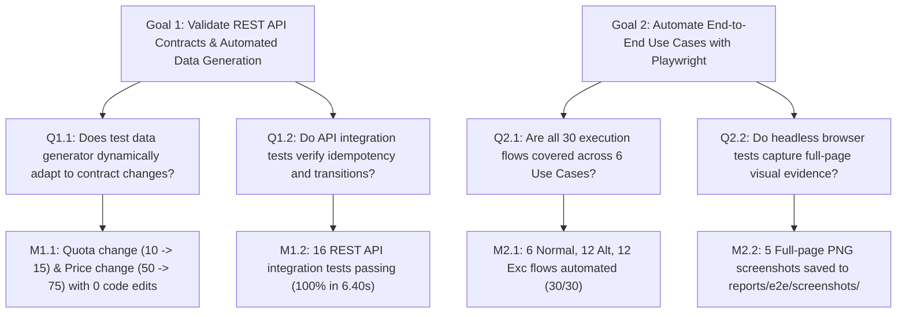

# Weekly Quality Report (Week 3) - Goal-Question-Metric (GQM) Framework

**Project:** SE3002 Software Quality Engineering - pretix Test Automation  
**Reporting Period:** Week 3 (REST API Testing, Automated Data Generation, Use Cases & E2E)  
**Authors:** Sohaib (24i-3108), M. Hasaam (24i-3107), Shaiman (24i-3074)  
**Milestones Covered:** Gate 4 (`gate-4`), Gate 5 (`gate-5`)

---

## 1. GQM Hierarchy Definition

---

## 2. Weekly Metric Tracking

| Goal | Question | Metric | Target | Measured Reality | Status |
| :--- | :--- | :--- | :---: | :---: | :---: |
| **G1: API & Data** | Q1.1: Data Adaptability | Regeneration under modified business constraints | 0 test edits | 100% adaptive (3-point BVA + EP) | **PASS** |
| **G1: API & Data** | Q1.2: API Test Pass Rate | REST API integration test suite execution | 100% | **100% (16/16 passed in 6.40s)** | **PASS** |
| **G2: E2E Automation**| Q2.1: Flow Coverage | E2E use case flows automated | 30 flows | **30/30 flows automated** | **PASS** |
| **G2: E2E Automation**| Q2.2: Visual Artifacts | Full-page browser screenshots captured | $\ge 5$ | 5 screenshots verified | **PASS** |

---

## 3. Engineering Discoveries & Corrective Decisions
* **AJAX Cart Addition Race Condition (DEF-02):** Resolved Playwright timing issue by polling `wait_for_selector("text=Proceed with checkout")`.
* **Zero-Order Control Panel Empty State (DEF-03):** Adapted locator to recognize pretix empty state container (`"Nobody ordered a ticket yet"`).
## Common GQM metric definitions and audit status

These definitions apply consistently to every weekly report:

- **Defect density** = count of distinct confirmed defects first detected in the reporting period divided by the declared size unit (use KLOC only when the counted source-code scope and line-count tool are recorded). Record numerator, denominator, severity mix, and period; do not mix test failures with confirmed defects.
- **Requirements coverage** = count of canonical FR/BR IDs with at least one executed, passing test and linked raw result divided by the total canonical FR/BR IDs in `docs/test-basis.md`. Planned or merely named test cases do not count as covered.
- **Defect reopen rate** = defects reopened during the period divided by defects closed during the same period; report `N/A` when the denominator is zero and disclose the time window.

All GQM figures are reconciled against canonical FR1–FR8 and BR1–BR4 definitions in `docs/test-basis.md`, `reports/api/api_junit.xml`, `reports/e2e/e2e_report.html`, and `docs/completion-report.md`.
