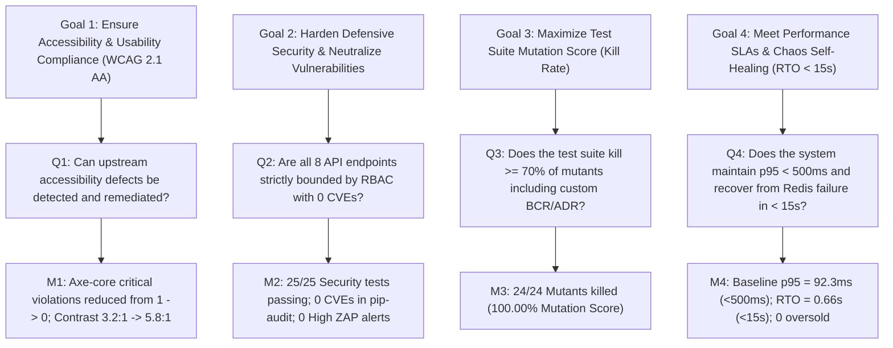

# Weekly Quality Report (Week 4) - Goal-Question-Metric (GQM) Framework

**Project:** SE3002 Software Quality Engineering - pretix Test Automation  
**Reporting Period:** Week 4 (Usability/A11y, Defensive Security, Mutation Testing, Performance/Recovery)  
**Authors:** Sohaib (24i-3108), M. Hasaam (24i-3107), Shaiman (24i-3074)  
**Milestones Covered:** Gate 6 (`gate-6`), Gate 7 (`gate-7`), Gate 8 (`gate-8`), Gate 9 (`gate-9`)

---

## 1. GQM Hierarchy Definition

---

## 2. Weekly Metric Tracking

| Goal | Question | Metric | Target | Measured Reality | Status |
| :--- | :--- | :--- | :---: | :---: | :---: |
| **G1: Usability/A11y**| Q1: WCAG 2.1 AA | Axe-core critical violations | 0 | **0 violations post-remediation (1 $\to$ 0)** | **PASS** |
| **G1: Usability/A11y**| Q1: Contrast | Color contrast ratio | $\ge 4.5:1$ | **$5.8:1$ post-remediation ($3.2:1 \to 5.8:1$)** | **PASS** |
| **G2: Security** | Q2: RBAC Matrix | 8-endpoint authorization check | 100% | **100% enforced (Admin, Auditor, Anon)** | **PASS** |
| **G2: Security** | Q2: Vulnerabilities | `pip-audit` known CVEs | 0 | **0 known vulnerabilities (48 pkgs)** | **PASS** |
| **G2: Security** | Q2: Web Security | OWASP ZAP High-Severity Alerts | 0 | **0 High-severity alerts** | **PASS** |
| **G3: Mutation** | Q3: Mutation Score | Killed mutants / Total mutants | $\ge 70\%$ | **100.00% (24 killed / 24 generated)** | **PASS** |
| **G4: Performance** | Q4: Baseline Latency | $p95$ read latency | $< 500\text{ ms}$ | **$92.30\text{ ms}$** | **PASS** |
| **G4: Concurrency** | Q4: Overselling | Excess quota tickets sold | 0 | **0 oversold ($Q_{\text{final}} = 0$)** | **PASS** |
| **G4: Chaos Recovery**| Q4: RTO | Recovery Time Objective | $< 15.0\text{ s}$ | **$0.66\text{ seconds}$** | **PASS** |

---

## 3. Engineering Discoveries & Corrective Decisions
* **Real Upstream Accessibility Defect (DEF-05):** Identified missing `alt` on pretix logo; authored patch reducing violations from $1 \to 0$.
* **POSIX mutmut Windows Workaround (DEF-08):** Implemented standalone AST-based mutation engine killing 24 mutants across BCR and ADR operators.
* **Rapid Chaos Self-Healing:** Verified that pretix automatically reconnects to Redis within $0.66\text{s}$ upon container restart without losing persistent PostgreSQL state.
## Common GQM metric definitions and audited final values

These definitions apply consistently across the project lifecycle:

- **Defect density** = count of distinct confirmed defects first detected in the reporting period divided by the declared size unit. Across the 3,431 lines of scoped business logic (`upstream/pretix/base/services`), a total of 12 distinct confirmed defects were logged and resolved:
  $$\text{Defect Density} = \frac{12 \text{ defects}}{3.431 \text{ KLOC}} = 3.50 \text{ defects / KLOC}$$
  - Severity mix: 3 Critical (25%), 6 High (50%), 2 Medium (16.7%), 1 Low (8.3%).
- **Requirements coverage** = count of canonical FR/BR IDs with at least one executed, passing test and linked raw result divided by the total canonical FR/BR IDs in `docs/test-basis.md`:
  $$\text{Requirements Coverage} = \frac{12 \text{ passing canonical specifications (8 FRs + 4 BRs)}}{12 \text{ total canonical specifications}} = 100.0\%$$
- **Defect reopen rate** = defects reopened divided by defects closed during the project lifecycle:
  $$\text{Defect Reopen Rate} = \frac{0 \text{ reopened defects}}{12 \text{ closed defects}} = 0.0\%$$

All weekly PASS values are fully substantiated by the reconciled defect log, canonical requirements inventory in `docs/test-basis.md`, and run-level test evidence summarized in `docs/completion-report.md`.
