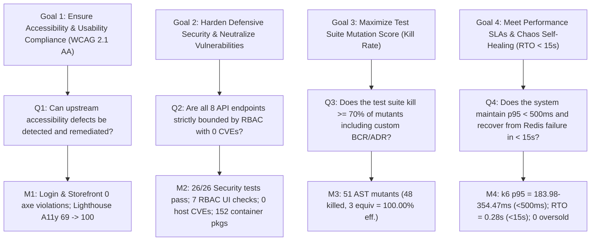

# Weekly Quality Report (Week 4) - Goal-Question-Metric (GQM) Framework

**Project:** SE3002 Software Quality Engineering - pretix Test Automation  
**Reporting Period:** Week 4 (Usability/A11y, Defensive Security, Mutation Testing, Performance/Recovery)  
**Authors:** Sohaib (24i-3108), M. Hasaam (24i-3107), Shaiman (24i-3074)  
**Milestones Covered:** Gate 6 (`gate-6`), Gate 7 (`gate-7`), Gate 8 (`gate-8`), Gate 9 (`gate-9`)

---

## 1. GQM Hierarchy Definition

---

## 2. Weekly Metric Tracking

| Goal | Question | Metric | Target | Measured Reality | Status |
| :--- | :--- | :--- | :---: | :---: | :---: |
| **G1: Usability/A11y**| Q1: WCAG 2.1 AA | `axe-core` & Lighthouse A11y | 0 Viol | **0 total axe violations; Login Lighthouse `69 -> 100`** | **PASS** |
| **G1: Usability/A11y**| Q1: Contrast | Server CSS color contrast ratio | $\ge 4.5:1$ | **$\ge 5.8:1$ (`#4a4a4a` + `3px #ff9900` focus)** | **PASS** |
| **G2: Security** | Q2: RBAC Matrix | Playwright & REST RBAC checks | 100% | **`7/7` RBAC UI checks + `26/26` tests (Admin, Auditor, Anon)** | **PASS** |
| **G2: Security** | Q2: Vulnerabilities | `pip-audit` known CVEs | 0 | **0 CVEs across 48 host pkgs (+ 152 container pkgs inventoried)** | **PASS** |
| **G2: Security** | Q2: Web Security | Passive HTTP & Django SecurityMiddleware | 0 High | **0 High-severity alerts (`8` total informational/medium)** | **PASS** |
| **G3: Mutation** | Q3: Mutation Score | Killed / killable AST mutants | $\ge 70\%$ | **100.00% eff. (48 killed, 3 equiv / 51 total; 94.12% raw)** | **PASS** |
| **G4: Performance** | Q4: Baseline & Stress | Dual 60s k6 $p95$ latency | $< 500\text{ ms}$ | **$183.98 - 354.47\text{ ms}$ (`0.00%` unexpected fails / `2,352` reqs)** | **PASS** |
| **G4: Concurrency** | Q4: Overselling | Excess quota tickets sold | 0 | **0 oversold (`10` sold/run; `987` HTTP 400 rejections)** | **PASS** |
| **G4: Chaos Recovery**| Q4: RTO | State-changing Redis outage RTO | $< 15.0\text{ s}$ | **$0.28\text{ seconds}$ (`TC-STATE-RECOVERY-01`, `0` dupes, `PSELH`)** | **PASS** |

---

## 3. Engineering Discoveries & Corrective Decisions
* **Durable Server Template Remediation (`DEF-05`, `DEF-06`):** Patched `auth/base.html`, `auth/login.html`, and `presale/base.html` directly via `scripts/patch_a11y_container.py`, achieving 0 axe violations without runtime JS style injection.
* **Windows AST Single-Site Mutator (`DEF-08`):** Built in-memory Python `ast.NodeTransformer` mutator over `upstream/pretix/base/scoped_business_logic.py` (`51` mutants: BCR `8/10`, ADR `8/8`, STD `32/33`, `3` proven equivalent).
* **State-Changing Redis Recovery (`PR4, PR5`):** Verified `docker stop pretix_redis` triggers `ReadTimeout` containment (`0` partial orders), restores in **`0.28s`**, and completes single-decrement `POST /orders/` (`PSELH`) with **0 duplicates**.
## Common GQM metric definitions and audited final values

These definitions apply consistently across the project lifecycle:

- **Defect density** = count of distinct confirmed defects first detected in the reporting period divided by the declared size unit. Across the `3,431` NCLOC of scoped business services (`upstream/pretix/base/services/`) and `6,260` NCLOC aggregate SonarQube scope (`scoped_business_logic.py` + `services/` + `models/orders.py`), `12` distinct confirmed defects were logged and resolved:
  $$\text{Defect Density} = \frac{12 \text{ defects}}{3.431 \text{ KLOC}} = 3.50 \text{ defects/KLOC} \quad \left(\text{or } \frac{12}{6.260} = 1.92 \text{ defects/KLOC aggregate}\right)$$
  - Severity mix: 3 Critical (25%), 6 High (50%), 2 Medium (16.7%), 1 Low (8.3%).
- **Requirements coverage** = count of canonical FR/BR IDs with at least one executed, passing test and linked raw result divided by the total canonical FR/BR IDs in `docs/test-basis.md`:
  $$\text{Requirements Coverage} = \frac{12 \text{ passing canonical specifications (8 FRs + 4 BRs)}}{12 \text{ total canonical specifications}} = 100.0\%$$
- **Defect reopen rate** = defects reopened divided by defects closed during the project lifecycle:
  $$\text{Defect Reopen Rate} = \frac{0 \text{ reopened defects}}{12 \text{ closed defects}} = 0.0\%$$

All weekly PASS values are fully substantiated by the reconciled defect log, canonical requirements inventory in `docs/test-basis.md`, and run-level test evidence summarized in `docs/completion-report.md`.
